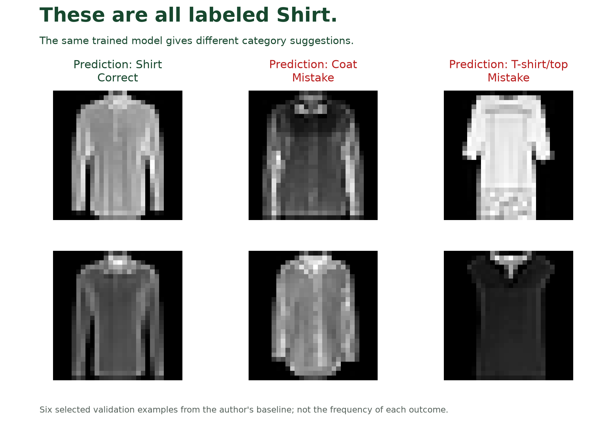

🏷
# From notebook to pipeline

Threadline Retail is the fictional online clothing shop you will work with in this course. Each new product needs a category, such as `Dress`, `Shirt` or `Bag`, before it can appear in the right part of the catalog. If a dress is listed as a bag, a customer filtering for dresses can miss it.

Catalog staff currently inspect product images and choose categories. The shop wants to investigate a simple aid: **given a product image, suggest a category for a person to check**. This is **image classification**: choosing one category from a fixed list based on an image.

You are the ML engineer building that aid. A **machine-learning model** is a program whose behavior is learned from examples. Your first job is to teach a small image model using known examples, find out where it makes mistakes, and make its saved learning usable on another image. Later, you will compare changes and keep the chosen model traceable as people use it.

# Start with an image and a known answer

A **dataset** is a collection of examples. Ours is Fashion-MNIST: small product images paired with categories that people have already assigned. That known category is the image's **label**. A model's suggested category is its **prediction**. A prediction can disagree with the label.

All six images above have the known label `Shirt`. These selected examples show both correct suggestions and actual mistakes from one recorded model. They illustrate the kinds of confusion staff would need to correct; their proportions do not represent the whole dataset. What details might make a shirt look like a coat or T-shirt at this size?

Each research image is a `28×28` grid of **pixels**, the small squares that make an image. These images are **grayscale**: a pixel records brightness rather than separate red, green and blue values. The ten labels cover clothing, footwear and bags. Some categories look similar at this small size, which gives us meaningful mistakes to investigate.

The course uses these prepared thumbnails to represent the shop's classification task. It does not establish performance on arbitrary phone photographs. The [dataset card](https://github.com/richhiey/ml-llm-ops/blob/main/docs/dataset-card.md) explains what the research images contain and where they came from.

# Training turns examples into a model

A model produces a score for each possible category. Its **weights** are learned numbers that influence those scores.

**Training** adjusts those numbers. The model sees a training image, produces category scores, compares them with the known label, and adjusts its weights to reduce the error. Repeating this across many examples can make its predictions more useful. Our model starts with randomly initialized weights and learns from scratch.

We also need examples that do not update the weights. A **validation set** is a separate group of labeled images used to check how the trained model performs. During this check, called **evaluation**, we compare its predictions with the known answers and measure its mistakes. A final test set stays separate until the model-selection work is complete.

After training, we save the learned weights. **Inference** means using that saved learning to predict a category for an incoming image. The incoming request does not need to include a known category, and making the prediction does not retrain the model.

# How a CNN works with an image

We will use a **convolutional neural network**, usually shortened to **CNN**. It is a type of neural network designed to process image grids through connected layers of calculations.

A CNN applies small learned grids of numbers, called **filters**, across different parts of the image. A filter can respond to a local pattern, such as a change in brightness along an edge. Later layers combine those responses into useful patterns, called **features**, that help distinguish categories. The final layers produce a score for each category. Training learns the filters and the final category-scoring weights together.

You will inspect the actual CNN and its mistakes in the project. The first trained version becomes the **baseline**: the reference result against which later changes are compared.

# Connect the work into a repeatable pipeline

A **pipeline** connects steps so their outputs become the next step's inputs. For the catalog task, five stages make the route from image files to predictions explicit.

| Stage | Plain meaning | In this project |
|---|---|---|
| Ingestion | Bring the examples into the system | Load the product images and their labels |
| Preprocessing | Put inputs into the form the model expects | Prepare brightness values and image dimensions consistently |
| Training | Learn from labeled examples | Adjust the CNN's weights and save them |
| Evaluation | Check predictions against known answers | Measure mistakes on separate validation images |
| Inference | Use the saved model | Suggest categories for incoming product images |

An incoming image uses ingestion, preprocessing and the saved model for inference. It does not travel through training every time. Evaluation is how we check a model's predictions; it is not a weight-update step.

A notebook is useful for exploring images and trying calculations. Its cells can also leave values in memory from an earlier execution. Someone receiving only a result screenshot cannot tell which data, settings or saved weights produced it.

A **reproducible pipeline** makes the necessary inputs and steps available so another engineer can repeat the work and check the result. We will keep the data used, the code and training settings, the Python package versions, the saved weights and the predictions used for evaluation. That lets the catalog team connect a reported result to the model that will suggest tomorrow's categories.

# Learn more when you need it

| If you want to explore… | Start here |
|---|---|
| The actual product images and their limits | [Course dataset card](https://github.com/richhiey/ml-llm-ops/blob/main/docs/dataset-card.md) |
| CNN filters and the flow through a neural network | [PyTorch neural-network tutorial](https://docs.pytorch.org/tutorials/beginner/blitz/neural_networks_tutorial.html), opening explanation and network picture |
| How a training loop updates learned numbers | [PyTorch training tutorial](https://docs.pytorch.org/tutorials/beginner/basics/optimization_tutorial.html), training-loop explanation |

These are optional deeper explanations. Use this project's installed package versions for the practical work.

# Check for Understanding

A colleague gives you an accuracy screenshot and a saved model file named `best-model.pt`. They want you to suggest categories for a new folder of product thumbnails.

Draw the route those new images should follow. Then mark the missing information you would request before trusting that this file is the model shown in the screenshot. Explain where the five stages belong and which ones need known labels.

Solution

**Result you should get**

The new images are loaded, prepared in the expected form and passed to the saved model for category suggestions. They do not require new training or known labels to obtain predictions. You still need to connect the saved weights to the data, settings and evaluation that produced the screenshot.

**How**

Trace ingestion → preprocessing → inference for the new folder. Trace the model backward to training and evaluation records. Training used known labels to adjust weights; evaluation used separate known labels to check predictions. A filename and screenshot cannot establish which examples, code or weights produced the score. Request the recorded recipe and supporting predictions before treating it as verified evidence.

## Learning outcome

Explain why a reproducible training/inference pipeline replaces a one-off notebook workflow, and identify the 5 stages a production ML pipeline must cover - ingestion, preprocessing, training, evaluation, inference.

## Summary

Your task is to help a clothing shop suggest product categories and measure where those suggestions fail. Training learns from labeled examples; evaluation checks that learning; inference uses the saved model on another image. The pipeline connects those activities so a colleague can inspect and repeat the work.
