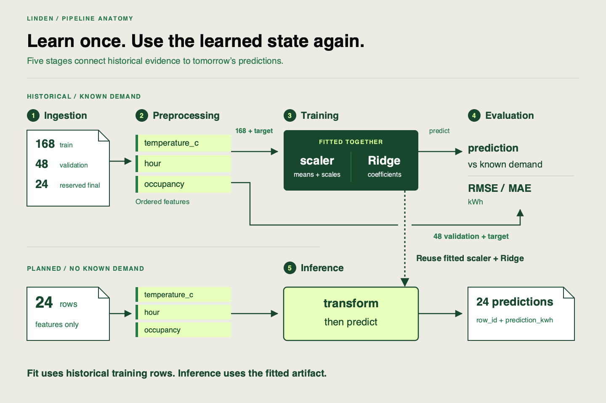

🏷️
# From notebook to pipeline

Linden Facilities has an energy-demand model that works in an analyst's notebook. Tomorrow, the planner needs another complete file of 24 hourly predictions. The analyst is away. Which cells produced the fitted model? Which data did they use? Will running the notebook from the top recreate the same result?

Those questions turn a successful experiment into an engineering task. Our project keeps the useful ML work and makes its dependencies explicit. You will inspect that project in VS Code, extend one validation boundary, and build evidence that another engineer can understand.

## Make the next execution predictable

A **pipeline** connects stages through declared inputs and outputs. A **reproducible** execution can be rebuilt from recorded source, data, configuration and environment to obtain an agreed result. Saving a prediction file preserves a result; it does not preserve everything needed to rebuild it.

A notebook can call a well-structured pipeline. The problem is hidden state: a cell may depend on an object fitted earlier, a changed file, or cells run in a different order. Moving that same hidden dependency into a script would preserve the problem. Named functions, explicit configuration and checks at their boundaries make the execution inspectable in either workspace.

Linden's supplied Python scaffold has five stages. Read the table as input → responsibility → output, rather than a list of functions to memorize.

| Stage | What it does for Linden | Output another stage can use |
|---|---|---|
| Ingestion | Reads the historical CSV and checks its schema, completeness and unique identifiers | Checked historical table |
| Preprocessing | Checks model inputs and selects the three features in the declared order | Feature table with rows/index preserved |
| Training | Fits preprocessing statistics and regression coefficients using training rows | Fitted scaler and estimator together |
| Evaluation | Compares validation predictions with known demand | Error metrics in kWh |
| Inference | Uses the fitted artifact to predict planned inputs | Identified rows with `prediction_kwh` |

## Follow the target, then the fitted artifact

A **feature** is an input to the model; the **target** is the value it learns to predict. Linden's features are `temperature_c`, `hour` and `occupancy`. Its historical target is `demand_kwh`. The unique identifier `row_id` aligns records; `partition` identifies their fixed role. Neither is a model feature.

Follow the solid data arrows. Historical training rows supply both features and known demand to fitting. Validation rows supply known demand to evaluation, without fitting. Planned rows supply features to inference and have no known demand yet. Evaluation produces evidence; it does not turn into a prediction input.

Linden uses a `StandardScaler`, which learns feature means and scales, followed by Ridge regression, a linear model whose penalty limits coefficient size. The scaler is fitted inside the model using training rows only. Both fitted objects must travel together. At inference, they transform and predict; they do not learn again from the planned batch.

This also separates two questions: did the job deliver usable predictions, and how well did the model predict held-out historical demand? A completed CSV answers the first. **RMSE** (root mean squared error) and **MAE** (mean absolute error) answer the second, in the target's units of kWh. Without observed demand for planned rows, there is no prediction-error score for that batch.

## Know what stays fixed

The [dataset card](https://github.com/richhiey/ml-llm-ops/blob/main/src/linden_mlops/data/README.md) describes 240 fixed synthetic records: 168 training, 48 validation and 24 reserved final rows. Use the supplied split. Final targets and scores stay outside development decisions until the final handoff. This small teaching fixture demonstrates operational evidence; its interleaved split is not a real building-forecasting evaluation design.

The [inference brief](https://github.com/richhiey/ml-llm-ops/blob/main/docs/inference-brief.md) asks for all 24 planned predictions in one complete CSV within 60 seconds. Keep that delivery requirement in view as you trace and change the code.

## Check for Understanding

Sketch the two paths for Linden. Mark where a known target is required and which fitted artifact must reach planned inference. Then diagnose this proposal: “We'll keep yesterday's regression coefficients but fit a fresh scaler on tomorrow's planned inputs.” What breaks, and what must be handed over instead?

Solution — open after drawing your paths and diagnosing the proposal

**Result you should get:** Training and historical evaluation require known demand; planned inference does not. The proposal changes the feature representation the coefficients expect. Hand over the fitted scaler and regressor together, alongside the recorded recipe.

**How:** Trace which object learned means/scales during training. A new scaler uses different statistics even if the column names and regression coefficients match. Mark that learned state on your sketch; do not draw evaluation metrics entering the estimator as features.

Keep this sketch in your working notes. You will attach concrete functions, records and output files to the same map. Before execution, use the [VS Code setup](https://github.com/richhiey/ml-llm-ops/blob/main/docs/setup.md).

## Learning outcome

Explain why a reproducible training/inference pipeline replaces a one-off notebook workflow, and identify the 5 stages a production ML pipeline must cover - ingestion, preprocessing, training, evaluation, inference.

## Summary

Linden needs a repeatable dependency chain as well as a prediction file. You can now separate historical fitting/evaluation from planned inference and locate the fitted preprocessing that connects them. The next step is to find those boundaries in the supplied source and its actual outputs.
