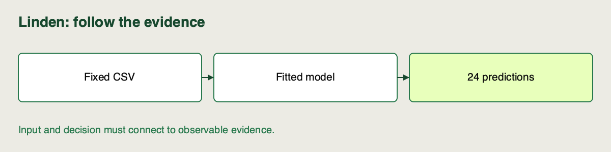

📝
# Reading the provided pipeline scaffold

Linden Facilities has a runnable helper, but a planner's CSV passes through several objects before predictions appear. We will follow that path and match each stage to an observable result.


## Notebook workspace

Use the [sprint notebook](https://github.com/richhiey/ml-llm-ops/blob/main/notebooks/01-pipeline-and-extension.ipynb) in your local project environment. Find the section for **Reading the provided pipeline scaffold** using its Campus activity ID **A-S1-02**. It imports the shared core modules for the demonstrations; keep your own decisions and checks in the attempt cells. Reuse this same clone and saved work between activities.

## Work in the repository

After [setup](https://github.com/richhiey/ml-llm-ops/blob/main/docs/setup.md), run this once from the repository root:

```sh
uv run linden-mlops bootstrap --config configs/baseline.json --state work/baseline
```

Inspect `pipeline.py` and run the trace below as a local script with `uv run python your_script.py`:

```python
from pathlib import Path
import json
from linden_mlops import ingest, preprocess, train, evaluate, Config
from linden_mlops.pipeline import TARGET
config = Config(**json.loads(Path('configs/baseline.json').read_text()))
f = ingest()
x = preprocess(f, config)
t = f.partition.eq('train')
v = f.partition.eq('validation')
m = train(x.loc[t], f.loc[t, TARGET], config)
print(f.groupby('partition').size())
print(x.columns.tolist(), m.named_steps)
print(evaluate(m, x.loc[v], f.loc[v, TARGET]))
```

Inspect `work/baseline/batch.csv` and `batch.json`; compare its identifiers with `src/linden_mlops/data/batch-v1.csv`. Keep these outputs for the inference decision.


## Starting and finished state

Start after repository setup, with the fixed historical snapshot. Finish with one five-stage map grounded in a historical row and a planned row, plus the written baseline prediction file. Reuse the map you started rather than creating a second trace.

## Follow the data through the stages

1. **Inspect the input** at **Read the input**. Group by `partition` and read the feature columns. Expect `168` training, `48` validation and `24` reserved final rows. `row_id` aligns records; `demand_kwh` is the target. Neither is a feature.
2. **Trace fitting** at **Select features, fit once, evaluate held-out rows**. A Boolean mask contains one true/false value per row; `.loc[mask]` selects the matching features and targets. `StandardScaler` learns training means and scales inside the fitted model; validation calls `predict` without fitting again. Expect validation RMSE near `1.443003925` kWh.
3. **Inspect fitted state** at **Find the learned state**. The model contains `scale` and `ridge`, with three input features. Contrast learned scaler statistics with the configured `alpha`. Check that the training and validation masks never overlap.
4. **Follow planned rows** at **Follow planned input to the delivered file**. The supplied `bootstrap` wrapper runs the same recipe from saved code and makes a fitted model available for the batch. Model storage and selection are prepared infrastructure here; no registry decisions are required. Inspect the returned CSV and version. Expect `24` finite predictions, in the same `row_id` order as the planned input, within the `60`-second brief. Planned rows have no known demand, so this output cannot measure prediction error.

## Watch out for

RMSE is root mean squared error in the target’s units; lower is better. It describes held-out historical prediction error, not tomorrow’s unknown error.

A matching row count can hide reordered records. Compare identifiers as well as counts. Fitting a new scaler on planned data changes the feature representation; reuse the stored scaler and estimator together.

## Quick reference

| Object | Purpose |
|---|---|
| `ingest()` | Read and check historical rows |
| `preprocess()` | Validate and select ordered features |
| `train()` / `evaluate()` | Fit on training rows / score held-out rows |
| `linden-mlops bootstrap` | Provided full-path wrapper; inspect its batch file and metadata |
| `batch_predict()` | Inference function used inside that wrapper |

## Check your trace

Choose one historical row and one planned row. Explain which has a known target, where fitting occurs, and which fitted object reaches inference. Point to the saved output that checks row alignment. Stop after the trace notes; the stage edit is the next activity.



## Check your work after attempting the task

<details>
<summary>Compare your result after the attempt</summary>

**Result you should get:** Your trace separates the 168 fitting rows, 48 validation rows and 24 untouched final rows. The planned file has 24 aligned finite predictions and no known target. Its validation RMSE is about 1.443 kWh, not a measure of tomorrow's observed error.

**How:** Inspect the actual masks, fitted scale/ridge object and batch identifiers. If you equated completion with predictive accuracy, locate which dataset supplies a known target before interpreting a metric. Compare input/output row IDs as well as counts.

</details>

## Learning outcome

Trace how data moves through the provided training/inference pipeline scaffold from raw input to served prediction, and label each stage's purpose.

## Summary

You traced raw rows, ordered features, a fitted pipeline and a versioned batch output. Those boundaries give you specific places to check when an extension changes behavior.
