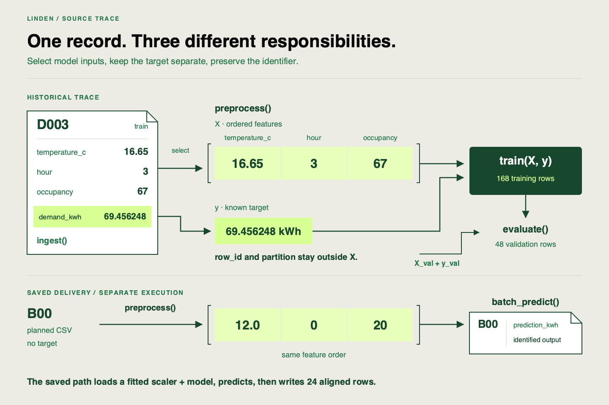

📝
# Reading the provided pipeline scaffold

Linden Facilities needs to know how a historical row becomes a prediction in the planner's file. We will inspect the real pipeline, run its public functions and keep an actual baseline before changing the application.

Complete the [local setup](https://github.com/richhiey/ml-llm-ops/blob/main/docs/setup.md). Use one clone and a VS Code terminal at its root. Finish with an annotated five-stage map, one recorded fitted artifact and independently checked batch output.

## 1. Follow the application interfaces

Open [pipeline.py](https://github.com/richhiey/ml-llm-ops/blob/main/src/linden_mlops/pipeline.py) and [lifecycle.py](https://github.com/richhiey/ml-llm-ops/blob/main/src/linden_mlops/lifecycle.py). `ingest()` reads the historical snapshot; `preprocess()` checks and selects model features; `train()` fits; `evaluate()` predicts on separate labeled rows. `Workspace.run()` connects those functions and records their result in MLflow. A **tracking store** holds those execution records and model files.



A **feature** is a model input; the **target** is known demand used for fitting or evaluation. `row_id` and `partition` describe a record's identity and role; they are not features. The illustration maps the interfaces, not additional commands you must execute.

Create `work/inspect-pipeline.py` in VS Code with this code. The script is your inspection of the application; it does not edit source or install an exercise state.

```python
from pathlib import Path
import json
import mlflow.sklearn
import numpy as np
import pandas as pd
from linden_mlops import Config, Workspace, ingest, preprocess, batch_predict
from linden_mlops.pipeline import DATA, FEATURES

config = Config(alpha=1, range_guard=True, autolog=True)
workspace = Workspace("work/baseline-state")
record_path = Path("work/baseline-run.json")
if record_path.exists():
    record = json.loads(record_path.read_text())
else:
    record = workspace.run(config, name="planner-baseline")
    record_path.write_text(json.dumps(record, indent=2) + "\n")
frame = ingest()
features = preprocess(frame, config)
fitted = mlflow.sklearn.load_model(record["model_uri"])
print("Partitions, counts only:", frame.groupby("partition").size().to_dict())
print("Feature order:", features.columns.tolist())
print("Historical training row:", frame.loc[frame.partition.eq("train")].iloc[0].to_dict())
print("Fitted steps:", list(fitted.named_steps))
print("Scaler fitting rows:", fitted.named_steps["scale"].n_samples_seen_)
print("Validation metrics:", record["metrics"])
metadata_path = workspace.path / "baseline-batch.json"
if metadata_path.exists():
    metadata = json.loads(metadata_path.read_text())
    output = pd.read_csv(workspace.path / "baseline-batch.csv")
else:
    output, metadata = batch_predict(
        workspace, output_name="baseline-batch", model_uri=record["model_uri"])
planned = pd.read_csv(DATA / "batch-v1.csv")
assert planned.row_id.tolist() == output.row_id.tolist()
assert len(output) == 24 and np.isfinite(output.prediction_kwh).all()
assert metadata["complete_within_60s"]
assert metadata["run_id"] == record["run_id"]
print("Planned input:", planned.iloc[0].to_dict())
print("Matched prediction:", output.iloc[0].to_dict())
print("Batch metadata:", metadata)
```

Run `uv run python work/inspect-pipeline.py`. Expect `168` training, `48` validation and `24` reserved final rows, with feature order `temperature_c`, `hour`, `occupancy`. Inspect final partition labels/counts only. Keep their targets and scores outside development decisions.

**Check:** Open the printed training row and mark its features, target and identity on your map. The saved `baseline-run.json` is a real run manifest; rerunning this script reopens it. Preserve it when the later source change creates a different application revision.

## 2. Locate fitting and evaluation

Follow `run_pipeline()` in the source. Its training mask selects matching features and `demand_kwh` targets. The fitted scikit-learn `Pipeline` contains `scale` and `ridge`. The scaler learns feature means and scales from training rows; Ridge learns regression weights from those transformed rows. Both learned objects travel together.

Then follow `evaluate()`: it calls `predict()` on validation features and compares with known validation demand. There is no second fit. The masks must not overlap.

Expect fitted steps `['scale', 'ridge']`, scaler fitting rows `168`, and validation root mean squared error (**RMSE**) about `1.443` kWh for this baseline. Mean absolute error (**MAE**) is a separate diagnostic in the same units. Record the raw values from your execution; small display-rounding differences do not change the recipe.

**Check:** Locate `.fit()` and `.predict()`. Explain why fitting a new scaler on planned inputs would change the representation expected by the saved regression weights. A successful prediction file alone cannot measure unknown future error.

## 3. Follow planned inputs into the delivered CSV

Open [batch-v1.csv](https://github.com/richhiey/ml-llm-ops/blob/main/src/linden_mlops/data/batch-v1.csv). It has `row_id` and three features, without historical target or partition. Historical `ingest()` therefore is not its reader.

`batch_predict()` reads that file, applies shared preprocessing, loads the supplied fitted model and writes the identified predictions. A model **URI** is its loading address. Here we pass the exact logged artifact URI, so no model-registry selection is needed. `resolved_version=None` is expected in this mode; `run_id` and `model_uri` identify the fitted artifact. Later, alias-based serving will additionally record a registered version.

Expect `work/baseline-state/baseline-batch.csv` and its matching JSON. All `24` output identifiers must match input order, with finite `prediction_kwh` values and `complete_within_60s=True`. The timer covers loading, prediction and file writing; setup and training are separate.

**Check:** Compare the entire identifier sequence. Row count alone cannot detect a reorder. Read the actual elapsed seconds and rows per second; another author's timing is not a target.

## Watch out for

An earlier run's manifest describes its training source, not a claim that the current checkout is unchanged. Keep baseline evidence when editing. If a named output already exists, inspect it; use a distinct output name for another job. Resolve an execution error before claiming completion.

## Quick reference

| Locate | What to explain |
|---|---|
| `ingest()` / `preprocess()` | Historical schema and ordered, checked features |
| `train()` / `evaluate()` | Training-only fit and separate validation error |
| `Workspace.run()` | Actual logged execution and model URI |
| `batch_predict(..., model_uri=...)` | Planned input through a pinned fitted artifact |
| `baseline-run.json` / batch CSV and JSON | Recipe, observed delivery and matching source run |

## Check your trace

Annotate one map with all five stages, an actual training identifier, a planned identifier, target presence/absence and output files. Explain which learned objects reach inference and why count and identity checks are separate.

<details><summary>Solution — compare after annotating your map</summary>

**Result you should get:** Training uses `168` labeled rows; evaluation uses `48` different labeled rows. Planned inference needs no target and reuses fitted scaling and regression. The batch contains `24` aligned finite predictions within its measured deadline.

**How:** Match source calls to the printed objects and retained raw files. Remove an error-score claim if no actual target supports it. Check identifier sequences before accepting a merely correct count.

</details>

## Learning outcome

Trace how data moves through the provided training/inference pipeline scaffold from raw input to served prediction, and label each stage's purpose.

## Summary

Your map connects application functions, fitted objects and actual files. Keep the baseline: it lets you distinguish a useful existing pipeline from a missing planner intake requirement when you add the next validation boundary.
