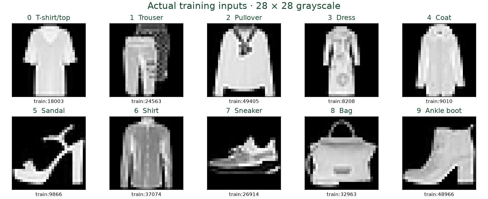
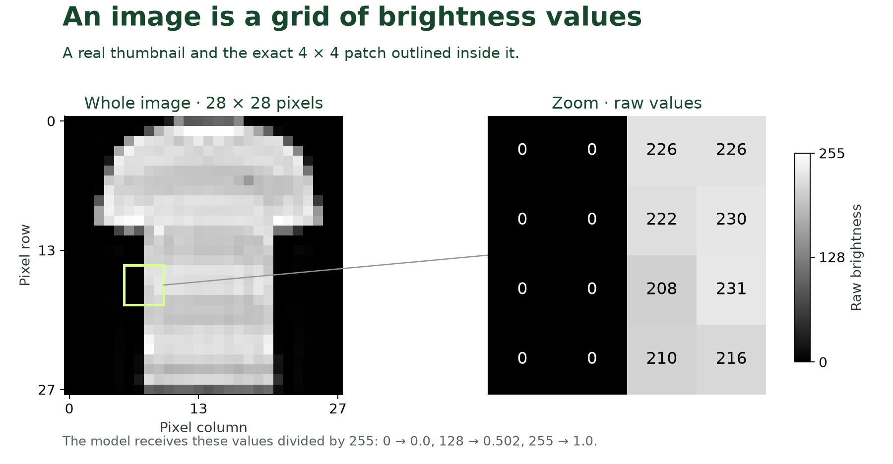
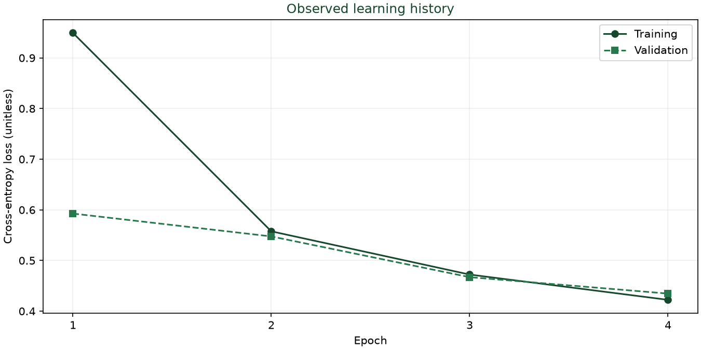
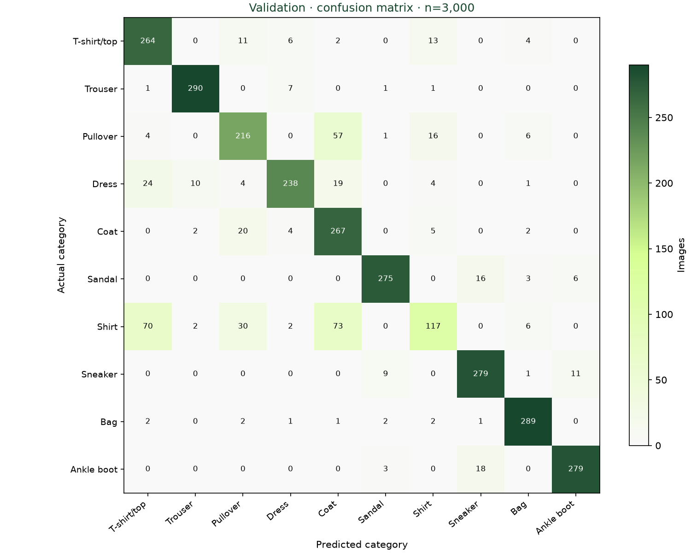

📝
# Reading the provided pipeline scaffold

Threadline is a fictional online fashion retailer. Its catalog specialists check whether each product belongs under a category such as shirt, coat or sneaker so customers can find the right items. They want to try model suggestions while keeping a person responsible for checking them.

You will train a small convolutional neural network, or **CNN**, an image model that learns patterns from labeled examples. This first trained model is your **baseline**, the reference for later improvements. Its **weights** are the numbers adjusted during learning. You will inspect its mistakes, save those learned numbers and use them to suggest categories for other images.

The provided **scaffold** is a working starter project: its files already connect image loading, preparation, training, evaluation and prediction. Work in one local copy in VS Code. Finish with the saved baseline, its evaluation results, a prediction file for several images and a response to one image request. The [README](https://github.com/richhiey/ml-llm-ops/blob/main/README.md) repeats this exact command sequence, including the two-terminal service step. The [setup guide](https://github.com/richhiey/ml-llm-ops/blob/main/docs/setup.md) covers installation and recovery.

Run the commands below. Short Python excerpts explain the ML operations inside the supplied files; you do not need to copy those excerpts into a second implementation. The [companion notebook](https://github.com/richhiey/ml-llm-ops/blob/main/notebooks/01-pipeline-and-extension.ipynb) shows the full data-reading, model and plotting code when you want to inspect it.

# 1. What images are we learning from?

Get the repository and install its locked environment.

```bash
git clone https://github.com/richhiey/ml-llm-ops.git
cd ml-llm-ops
uv sync --frozen
source .venv/bin/activate
python scripts/prepare_data.py
python scripts/inspect_dataset.py
```

`uv sync --frozen` installs the locked environment once. Activate `.venv` once in each terminal, then run the tools directly. On Windows, use the activation command in the [setup guide](https://github.com/richhiey/ml-llm-ops/blob/main/docs/setup.md). `python` executes the named file, which you can open in your editor. Preparation downloads and verifies Fashion-MNIST, then records which images are used for learning and which for checking. Inspection reads the image arrays with NumPy and plots examples with Matplotlib.

Expect the original array to have shape `(60000, 28, 28)`, meaning `60,000` images with `28` rows and `28` columns of pixels. A **pixel** is one position in the image grid. Its `uint8` data type stores brightness as a whole number from `0` to `255`.

The supplied settings keep this exercise small enough for the computer's CPU, its general-purpose processor. They use `12,000` training images and `3,000` separate **validation images**, whose known categories let us check mistakes without using those images to update the weights. There are `1200` training and `300` validation images per category. The official test split stays reserved for reporting after model selection.

Open `work/training-examples.png`. Each image has an identifier so we can connect a prediction to the original image. For example, `train:56368` identifies image `56368` in the research training file; the recorded split decides whether our pipeline uses an image for learning or a separate check. Choose two categories you expect the model to confuse and explain what makes their silhouettes similar.



The script's [visible data-reading implementation](https://github.com/richhiey/ml-llm-ops/blob/main/scripts/inspect_dataset.py) is available if you want to inspect the file format. Understanding binary headers is not required for this task.

# 2. What does the CNN receive?

A raw thumbnail contains integer brightness values from `0` to `255`. PyTorch, the library used here to build and train the CNN, works with **tensors**, multidimensional arrays of numbers. A grayscale image has one **channel**, one brightness value at each pixel position. The following line converts a prepared image batch to decimal values on the model's expected scale. `float32` is the numeric type used to store those decimal values.

```python
inputs = raw_images.to(dtype=torch.float32) / 255.0
```

Here, `raw_images` is an existing batch shaped `(N, 1, 28, 28)`. `N` counts the images, `1` is the grayscale channel, and `28, 28` describes their height and width. A raw pixel of `128` becomes approximately `0.502`. Training and inference must use that same scale. Scaling each image by its own brightest pixel would change what its numbers mean.

The CNN moves small learned filters across each image to find patterns. This operation is a **convolution**. **Pooling** keeps the strongest response in a small area while reducing the grid size. Two such blocks build image features, the numeric pattern responses passed to the final classifier. That classifier produces ten raw category scores, called **logits**.

| Point in the CNN | Shape for one image |
|---|---|
| Prepared input | `1 × 28 × 28` |
| First convolution and pooling | `16 × 14 × 14` |
| Second convolution and pooling | `32 × 7 × 7` |
| Flattened features | `1568` values |
| Hidden classifier layer | `32` values |
| Output | `10` category scores |

The first block produces `16` pattern-response grids, each reduced from `28×28` to `14×14` by pooling. The second produces `32` grids of `7×7`. **Flattening** lays those `32 × 7 × 7 = 1568` values out as a single list for the classifier.

Open [model.py](https://github.com/richhiey/ml-llm-ops/blob/main/src/catalog_mlops/model.py). Locate `nn.Conv2d`, `nn.MaxPool2d` and the final `nn.Linear`. Match them to this table. You are tracing the supplied architecture; you do not need to rewrite it.



# 3. How does the model learn?

Inspect `configs/baseline.json`. It specifies four **epochs**, four passes through the training examples. A training batch size of `64` groups up to 64 examples before each weight update. This use of a batch concerns learning. The incoming prediction batch later in this walkthrough is a list of images awaiting category suggestions.

The learning rate `0.001` controls the size of weight updates. The seed `426` records a starting point for random choices such as initial weights and image order, helping repeat the same recipe in the same environment.

```bash
python scripts/train.py --config configs/baseline.json --output work/runs/baseline
```

The script starts with fresh CNN weights, before they have learned from any examples. Adam is the **optimizer**, the update rule used to change those weights. Inside the existing training loop, the essential update is:

```python
optimizer.zero_grad(set_to_none=True)
logits = model(inputs)
loss = nn.functional.cross_entropy(logits, known_labels)
loss.backward()
optimizer.step()
```

The **loss** is a number measuring disagreement with the known labels. `backward()` calculates **gradients**, signals telling the optimizer how changing the weights could reduce the loss. `step()` makes the update. Clearing gradients gives the next batch its own update signal. Validation makes predictions without updating weights.

Expect four epoch observations and a completed `work/runs/baseline` directory. Keep that directory. An existing output is protected; inspect it rather than deleting it to rerun the same command.

# 4. Where does the baseline struggle?

Reload the saved model, evaluate it on the fixed validation images and inspect its results.

```bash
python scripts/evaluate.py --run work/runs/baseline
python scripts/inspect_results.py --run work/runs/baseline
```

The first script evaluates the saved weights. The second recomputes **metrics**, numeric measures of performance, from the retained prediction CSV and draws your own plots. Expect `3000` predictions. The author's reference run reached accuracy `0.8380`, or `83.8%`, and macro F1 `0.8322`. Use your own observations to describe your model's result.

Start with one category. The reference contains `300` actual shirts: the model finds `117` and misses `183`. It suggests `Shirt` for `158` images in total, but `41` of those suggestions are other categories. Those two views answer different catalog questions: how many shirts did we find, and how often can staff trust a “Shirt” suggestion?

**Accuracy** is the fraction classified correctly. **Recall** asks how many actual examples of a category were found. **Precision** asks how many predictions of that category were correct. F1 combines precision and recall. **Macro F1** averages the ten category F1 scores equally, matching Threadline's equal-category priority. These F1 scores range from `0` to `1`, with higher values indicating better performance.



Open `work/learning-history.png`. Training loss is averaged while the weights change during an epoch; validation loss is measured afterward using the resulting weights on separate images. The two values therefore describe different measurement moments. Describe how both change; four epochs alone cannot establish what a longer run would achieve.

A **confusion matrix** counts the actual categories on its rows and the predicted categories on its columns. A count where the two categories match represents correct suggestions. Other cells show which categories the model mixed up.



Open `work/confusion-matrix.png`. Follow the actual-shirt row across the predictions. The reference found `117` of `300` shirts, giving recall `0.39`. It called `73` shirts coats and `70` T-shirts/tops. Those suggestions would send specialists to the wrong category even though overall accuracy is much higher. Identify the largest error in your own matrix.

# 5. What connects the score to a usable model?

A **run** is one execution of the training recipe. Its saved files are **artifacts**, outputs another engineer can inspect or reuse. Open `work/runs/baseline` and match these artifacts to the questions they answer.

| Artifact | What it lets you check |
|---|---|
| `config.json`, `history.json` | Training settings and learning observations |
| `dataset.json` | Data identities, class order and fixed split indices |
| `model.pt` | The model checkpoint, a file containing the learned weights and their model declaration |
| `metrics.json`, `validation-predictions.csv` | Scores and the predictions behind them |
| `source.zip`, `environment.json`, `run.json` | Code, environment and connected artifact identities |

A **hash** is a content fingerprint used here to detect mismatched files. The run record contains the saved model's fingerprint; the consumers below report that same model identity. Retain the files as well as their hashes so another engineer can retrieve the recipe.

This is a useful stopping point. You can close your editor and resume from the saved model without training again.

# 6. Can the saved model process an incoming batch?

The catalog team now needs suggestions for a group of incoming images. The export script creates an **intake**, the files received for this prediction job, from images separate from training and validation. Its **manifest** is a CSV checklist pairing each image's unique identifier with its filename. It supplies no category labels to the model.

```bash
python scripts/export_samples.py --count 20 --output work/intake
python scripts/predict_batch.py --run work/runs/baseline --manifest work/intake/manifest.csv --output work/batches/baseline
```

Expect `20` rows in `work/batches/baseline/predictions.csv`, plus `batch.json`. Match identifiers and order to the intake manifest. Each result contains a category and a top softmax score. **Softmax** converts the ten raw category scores into values between `0` and `1` that add up to `1`. The largest value marks the model's preferred category; it does not guarantee the suggestion is correct.

Open [inference.py](https://github.com/richhiey/ml-llm-ops/blob/main/src/catalog_mlops/inference.py). Trace the image read, shared preprocessing, saved-model call and output row. Incoming images supply no category label.

# 7. Can a client request one prediction?

For a specialist reviewing one item, a **client** sends an image request and waits for a response. A **server** keeps the saved model available to answer those requests. They exchange messages using HTTP, the request/response protocol used by web applications. Both processes will run on your computer here.

In a **second terminal**, at the repository root, start the web server.

```bash
source .venv/bin/activate
uvicorn scripts.api:app --host 127.0.0.1 --port 8000
```

Uvicorn is the program that runs the server. FastAPI handles its request and response routes. Uvicorn loads the application declared in [scripts/api.py](https://github.com/richhiey/ml-llm-ops/blob/main/scripts/api.py), which selects `work/runs/baseline`. Wait for startup to complete and keep the terminal running.

Back in the **first terminal**, prepare the request body and send it using `curl`.

```bash
python scripts/prepare_request.py --image work/intake/56368.png --image-id train:56368 --output work/intake/request.json
curl --fail-with-body -sS -H "Content-Type: application/json" --data-binary "@work/intake/request.json" http://127.0.0.1:8000/predict
```

The [request preparation file](https://github.com/richhiey/ml-llm-ops/blob/main/scripts/prepare_request.py) reads the PNG with Pillow, a Python image library, and writes its identifier and pixel array as JSON, a text format for structured data. Open `request.json` to inspect the values the client sends. `curl` performs the HTTP request directly. In Windows PowerShell, use `curl.exe` for this command.

Expect a prediction, loaded model identity and the time spent processing the request inside the server. Match the class to `train:56368` in your batch CSV. The model hashes must agree. Top scores should differ by at most `1e-6`, or `0.000001`, allowing small differences from decimal arithmetic in the two execution routes. Stop Uvicorn with `Ctrl+C` in the second terminal.

# Quick reference

Complete an annotated route from raw image to served suggestion. For each of the five stages, name its purpose, input, output, actual source function and one observed artifact. Trace one training identifier and one incoming identifier; mark where the saved weights connect the routes.

| Underlying package operation | Project code that assembles it |
|---|---|
| NumPy reads and selects image arrays | `data.py` verifies files and records splits |
| PyTorch converts tensors, learns weights and predicts | `preprocessing.py`, `model.py` and `training.py` connect those operations |
| scikit-learn calculates evaluation metrics | `evaluation.py` reports fixed-split results |
| FastAPI receives a request; Uvicorn runs the server | `service.py` connects validated input to the saved classifier |

Project functions save repeated assembly work. The package operations above explain what those functions do. Use the linked source and notebook when you need implementation detail.

# Learn more when you need it

| Question | Useful reference |
|---|---|
| How does an image array become a tensor? | [PyTorch tensor introduction](https://docs.pytorch.org/tutorials/beginner/basics/tensorqs_tutorial.html) |
| How do the recorded category counts become precision, recall and F1? | [scikit-learn classification report](https://scikit-learn.org/stable/modules/generated/sklearn.metrics.classification_report.html) |
| What is in this project's actual model? | [CNN source](https://github.com/richhiey/ml-llm-ops/blob/main/src/catalog_mlops/model.py) and its shape table above |

# Watch out for

Wait for preparation before training. Keep validation labels outside weight updates. Use the same pixel scale in training and inference. Restart the server after source changes. Keep completed outputs and choose a new destination for a deliberately new run.

## Learning outcome

Trace how data moves through the provided training/inference pipeline scaffold from raw input to served prediction, and label each stage's purpose.

## Summary

Threadline has a baseline with visible weaknesses and saved weights that work through batch and HTTP delivery. Your stage trace connects the images, preparation, learning, evaluation and category suggestion. You can now add a supplier intake rule at a specific boundary and check its effect.
