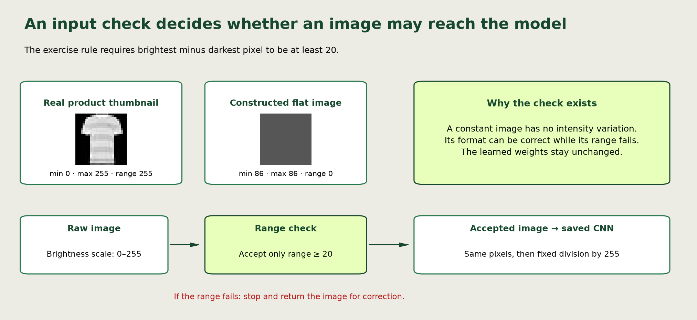

📝
# Adding and validating a bounded pipeline stage

Threadline's catalog specialists use image suggestions to help check product categories. A supplier has now sent thumbnails with the right dimensions but almost no brightness variation. A plain gray square gives the specialists little product detail to inspect, and the classifier can still produce a category score. The team wants those files returned for correction before prediction.

For this exercise, the supplier requires a brightest-minus-darkest pixel value of at least `20` on the raw `0–255` scale. That difference is the image's brightness range. The **intake policy** is the team's rule for accepting incoming files, and this rule detects one specified problem. You will add the check and confirm that accepted images still produce the same predictions.



# 1. Where should the check run?

Open [preprocessing.py](https://github.com/richhiey/ml-llm-ops/blob/main/src/catalog_mlops/preprocessing.py). Find `validate_images()` and `preprocess()`. Both the file-based prediction job and the HTTP request server use this preparation route.

Here, **input validation** checks whether an incoming image follows the agreed rules. Evaluating on **validation images** measures the trained model's mistakes on separate labeled examples. The new file check belongs to the incoming-image route.

Here, **normalization** is the fixed conversion from raw brightness to decimal values by dividing by `255`. The new check belongs before normalization, while threshold `20` still refers to raw pixel units. Keep the saved model and division by `255` fixed. A **contract** states which inputs a step accepts, what it returns and how it signals failure.

| Input | Existing behavior | Required behavior |
|---|---|---|
| Wrong shape or numeric data type | Reject | Continue rejecting |
| All-black image or constant gray `86` | Accept shape and type | Reject for insufficient range |
| Range `19` | Accept | Reject |
| Range `20` | Accept | Accept without changing pixels |

# 2. Observe the missing behavior

The supplied [intake checks](https://github.com/richhiey/ml-llm-ops/blob/main/docs/course/exercises/test_intake_quality.py) create those four range cases and send each through the real batch process. `pytest` runs these automated comparisons between expected and actual behavior. Copy the checks into your project's test directory, then run them from the repository root.

```bash
cp docs/course/exercises/test_intake_quality.py tests/test_intake_quality.py
pytest -q tests/test_intake_quality.py
```

Expect three failures and one pass before the change: the starter accepts the three images the new policy should reject. The checks also verify that an accepted image produces an identified prediction, a rejected delivery remains unpublished and the original image file is preserved.

Open the test file and find its four inputs. Predict which **assertion**, a statement of expected behavior, fails for each rejected case. The test launches a separate Python process running the prediction script. This checks the route a client actually uses, including whether your new stage is connected.

# 3. Add the intake decision

The source file already imports NumPy as `np`. Add this function after `validate_images()`.

```python
def validate_contrast(images: np.ndarray, minimum_range: int = 20) -> np.ndarray:
    raw = validate_images(images)
    if not 0 <= minimum_range <= 255:
        raise ValueError("Minimum range must be between 0 and 255")
    ranges = np.ptp(raw, axis=(1, 2))
    failing_positions = np.flatnonzero(ranges < minimum_range)
    if failing_positions.size:
        raise ValueError(
            f"Insufficient contrast at batch positions {failing_positions.tolist()}"
        )
    return raw
```

The raw array has shape `(N, 28, 28)`, with dimensions for images, rows and columns. `axis=(1, 2)` selects the row and column dimensions. `np.ptp()` therefore calculates maximum minus minimum across each complete image, producing one range per image. `np.flatnonzero()` identifies the failing positions. Accepted arrays are returned with their pixels unchanged. The existing `validate_images()` still handles shape and numeric data type.

Now replace the first assignment inside `preprocess()` with:

```python
raw = validate_contrast(images, minimum_range=20)
```

Keep the remaining tensor conversion and normalization unchanged. This call connects the new decision to both inference routes. The function's default retains the demonstrated supplier rule; a partner can declare a different threshold at this call site and test that requirement separately.

# 4. Check the decision and its effect

```bash
pytest -q tests/test_intake_quality.py
pytest -q
git diff -- src/catalog_mlops/preprocessing.py
```

Expect all four intake cases to pass and the existing checks to remain passing. `git diff` lists the source lines you added or changed. Explain each changed line, including why checking only that the new function exists would miss an omitted call in `preprocess()`.

You have changed which incoming images may reach the classifier. You have not changed what its weights learned, so this step does not require retraining.

# 5. Try a rejected batch and a valid batch

Create a deliberately flat thumbnail and run it through the ordinary prediction script.

```bash
python docs/course/exercises/prepare_quality_intake.py
python scripts/predict_batch.py --run work/runs/baseline --manifest work/quality-intake/manifest.csv --output work/batches/quality-rejection
```

The constructed test input contains one constant-gray image, a CSV manifest listing it and a JSON request body for the server. Expect the batch command to fail with insufficient contrast at position `0`, the first image. Confirm that `work/batches/quality-rejection` was not published. This failure is the intended policy response.

Inspect the file properties as well as the visible picture. In your activated terminal, enter `python` to open its interactive console and run this short inspection with Pillow and NumPy.

```python
from PIL import Image
import numpy as np
for filename in ("work/intake/56368.png", "work/quality-intake/flat.png"):
    with Image.open(filename) as image:
        pixels = np.asarray(image)
        print(filename, image.mode, image.size, pixels.dtype,
              int(pixels.min()), int(pixels.max()))
```

Both files report mode `L`, Pillow's name for grayscale, size `(28, 28)` and data type `uint8`. The product image's minimum and maximum are `0` and `255`. The flat image reports `86` and `86`, giving range `0`. Image mode and size are **metadata**, properties describing how the file is stored. Mode `RGB` would contain red, green and blue channels, while `(32, 32)` would describe a different image size. These properties let you distinguish a format problem from insufficient brightness range. Enter `exit()` to return to your terminal commands. [Pillow image attributes](https://pillow.readthedocs.io/en/stable/reference/Image.html#image-attributes) explains `mode` and `size`; [NumPy range calculation](https://numpy.org/doc/stable/reference/generated/numpy.ptp.html) explains the brightness-range operation.

Now run the original valid intake into a new destination.

```bash
python scripts/predict_batch.py --run work/runs/baseline --manifest work/intake/manifest.csv --output work/batches/after-quality-stage
```

Expect `20` predictions. Compare them with `work/batches/baseline/predictions.csv`: identifiers, classes and scores should agree. Accepted pixels and saved weights are unchanged.

In `batch.json`, the training source hash still identifies the code that trained the baseline. The inference source hash identifies your edited prediction code. The model hash stays the same because you reused the saved learned weights. These records let another engineer identify which part of the pipeline changed.

# 6. Check the HTTP route

In your already activated second terminal, restart the web server so it imports your edited source.

```bash
uvicorn scripts.api:app --host 127.0.0.1 --port 8000
```

In the first terminal, send the constructed low-range input directly with `curl`.

```bash
curl --fail-with-body -sS -H "Content-Type: application/json" --data-binary @work/quality-intake/request.json http://127.0.0.1:8000/predict
```

Expect HTTP `422`, the response status used here for invalid input, and an insufficient-contrast message. curl returns a nonzero exit code to signal the rejected request. On Windows PowerShell, use `curl.exe`.

Send the valid request you retained earlier.

```bash
curl --fail-with-body -sS -H "Content-Type: application/json" --data-binary @work/intake/request.json http://127.0.0.1:8000/predict
```

Expect a successful prediction matching the corresponding batch row and the same saved model identity. Stop the server with `Ctrl+C`.

# Quick reference

| Check | What it establishes |
|---|---|
| Range `19` rejected, range `20` accepted | The declared policy boundary works |
| Batch-process tests pass | Shared preparation actually calls the new stage |
| Valid predictions agree | Accepted input still reaches the same saved classifier |
| curl receives `422` for the flat image | The running HTTP route enforces the same rule |

# Watch out for

Apply the range check before normalization so the units remain correct. Check both sides of the threshold. Preserve source images. Restart the server after edits. A high brightness range can occur in a poor image too; this rule detects one bounded problem and does not establish overall image quality.

## Learning outcome

Follow an expert adding one preprocessing or validation stage to the provided pipeline, then verify its input/output contract and confirm that the unchanged stages still run.

## Summary

Threadline now rejects one specified kind of unusable input before prediction. Your evidence shows that the new stage is connected, its threshold behaves as declared and accepted images still reach the same classifier correctly.
