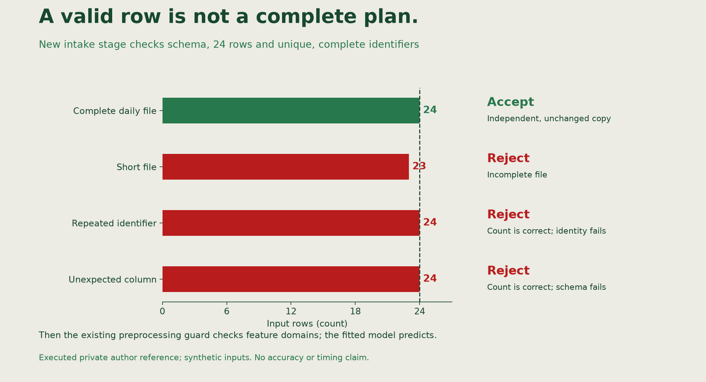

📝
# Adding and validating a bounded pipeline stage

Linden Facilities requires one complete file of `24` planned hourly inputs. The current application checks unique identifiers and valid feature values, but it can still deliver a shorter file. A successful prediction is not necessarily a complete planner delivery.

We will add the missing complete-file validation stage, write an acceptance test that exposes the current behavior, and confirm that valid training and inference still work. Keep the existing domain guard correct. This is a new application requirement, not a script that removes a working feature.

## Agree the new boundary

The new `validate_planned_batch(frame)` belongs in a new module, `src/linden_mlops/batch_input.py`. A **contract** states what a function accepts and the result or failure it guarantees. The planner's intake contract is:

| Requirement | Accepted input |
|---|---|
| Schema | Exactly `row_id`, `temperature_c`, `hour`, `occupancy`, in that order |
| Completeness | Exactly `24` rows |
| Identity | Unique, complete, nonblank string `row_id` values |
| Features | Existing required-feature and finite-number checks still apply |
| Preservation | Values, columns, order and index unchanged in an independent returned table |

The existing `validate_ranges()` still owns temperature `-30..50`, integer hour `0..23` and occupancy `0..100`. Shared `preprocess()` will apply those domain checks after the new intake stage. Dropping a row, inventing a prediction or clipping input would conceal a contract failure.

## 1. Write the missing acceptance check

Create `tests/test_batch_input.py` with the following integration test. A **fixture** supplies a test's starting objects. This one uses the real application to fit and log a small model in a temporary store, so it has no dependency on your original working store.

```python
import pandas as pd
import pytest
from linden_mlops import Config, Workspace, batch_predict
from linden_mlops.pipeline import DATA


def test_partial_plan_is_rejected(tmp_path):
    workspace = Workspace(tmp_path / "state")
    record = workspace.run(Config(range_guard=True), name="intake-contract-test")
    partial = pd.read_csv(DATA / "batch-v1.csv").iloc[:-1].copy()
    input_path = tmp_path / "partial.csv"
    partial.to_csv(input_path, index=False)
    with pytest.raises(ValueError, match="exactly 24"):
        batch_predict(workspace, input_path, output_name="partial-check",
                      model_uri=record["model_uri"])
```

Run `uv run pytest tests/test_batch_input.py::test_partial_plan_is_rejected -q > work/intake-before.txt`.

Expect a failed test containing `DID NOT RAISE`: the existing route writes a `23`-row output. This is an intentionally failing acceptance test for an unmet requirement. An import error or missing model is a different failure; inspect the saved output before editing. If your application already contains this stage, inspect your existing diff and original failing record instead of undoing it.

**Check:** Explain why the same fitted model can make plausible predictions for `23` rows while failing the complete-file requirement.

## 2. Add the expert's validation stage

Create `src/linden_mlops/batch_input.py` with this implementation:

```python
"""Validate the planner's complete daily input before prediction."""
from .pipeline import FEATURES, validate_features


def validate_planned_batch(frame):
    expected = ["row_id", *FEATURES]
    if list(frame.columns) != expected:
        raise ValueError(f"Planned batch columns must be {expected}")
    if len(frame) != 24:
        raise ValueError("Planned batch needs exactly 24 rows")
    identifiers = frame["row_id"]
    complete = identifiers.map(
        lambda value: isinstance(value, str) and bool(value.strip()))
    if not complete.all() or identifiers.duplicated().any():
        raise ValueError("Planned batch needs unique nonblank string row_id values")
    validate_features(frame)
    return frame.copy(deep=True)
```

The schema comparison rejects missing, extra or reordered fields. The row-count check rejects both incomplete and oversized files. The identifier condition rejects missing, blank and duplicate identifiers without rewriting them. `validate_features()` retains the existing numeric checks. The final deep copy preserves accepted input in a separate table; nothing assigns into the caller's input.

Open [lifecycle.py](https://github.com/richhiey/ml-llm-ops/blob/main/src/linden_mlops/lifecycle.py). Add `from .batch_input import validate_planned_batch` with the other imports. Inside `batch_predict()`, replace its input-reading and inline `row_id`-checking block with:

```python
inputs = validate_planned_batch(pd.read_csv(input_path or DATA / "batch-v1.csv"))
features = preprocess(inputs, config)
```

Keep only one `features = preprocess(...)` line. The new stage runs before feature preprocessing; preprocessing still enforces the existing domain guard. Leave fitting, metrics, model selection and data partitions unchanged.

**Check:** Trace how an invalid file stops before a completed output is written. Predict a valid file, `23` rows, `25` rows, one blank identifier and one duplicated identifier. State which condition distinguishes each case.



This executed private author reference uses the bundled planned inputs and explicit short/duplicate/extra-column copies. The horizontal axis counts rows. Correct count alone does not establish identity or schema. These probes concern the new intake stage; existing domain checks and model prediction follow it. Your own tests and output establish your implementation.

## 3. Test preservation and the remaining path

Append this unit test to `tests/test_batch_input.py`:

```python
@pytest.mark.parametrize("fault", ["short", "long", "duplicate", "blank", "extra"])
def test_planned_batch_boundary_and_preservation(fault):
    from linden_mlops.batch_input import validate_planned_batch
    valid = pd.read_csv(DATA / "batch-v1.csv")
    valid.index = range(100, 124)
    before = valid.copy(deep=True)
    checked = validate_planned_batch(valid)
    pd.testing.assert_frame_equal(checked, before)
    pd.testing.assert_frame_equal(valid, before)
    assert checked is not valid
    checked.loc[100, "hour"] = (checked.loc[100, "hour"] + 1) % 24
    pd.testing.assert_frame_equal(valid, before)  # returned writes cannot change input
    broken = valid.copy(deep=True)
    if fault == "short":
        broken = broken.iloc[:-1].copy()
    elif fault == "long":
        additional = broken.iloc[[0]].copy()
        additional["row_id"] = "B-extra"  # isolate count from duplicate identity
        broken = pd.concat([broken, additional], ignore_index=True)
    elif fault == "duplicate":
        broken.loc[123, "row_id"] = broken.loc[100, "row_id"]
    elif fault == "blank":
        broken.loc[123, "row_id"] = " "
    else:
        broken["unexpected"] = 0
    original = broken.copy(deep=True)
    with pytest.raises(ValueError):
        validate_planned_batch(broken)
    pd.testing.assert_frame_equal(broken, original)
```

Run the saved source in fresh Python processes:

```sh
uv run pytest tests/test_batch_input.py -q > work/intake-after.txt
uv run pytest tests/test_spine.py::test_contract_extension_and_unchanged_pipeline -q
```

Expect six new test cases to pass and the existing feature/pipeline regression test to pass. The first new test proves the public delivery route actually calls the stage; unit tests alone could pass even if integration were forgotten. Add missing-field, non-finite-feature or copy-independence probes if your explanation depends on those guarantees.

Use VS Code Source Control to inspect the actual new module, lifecycle call and tests. `git diff -- src/linden_mlops/lifecycle.py` shows the integration change; new untracked files are visible separately in Source Control and `git status --short`. Save the new module and test file with the diff; plain `git diff` does not include untracked files. Explain each added statement before treating the change as ready.

## 4. Verify a real complete delivery

Create `work/verify-delivery.py` using the same baseline model, with a new job name:

```python
from pathlib import Path
import json
import numpy as np
import pandas as pd
from linden_mlops import Workspace, batch_predict
from linden_mlops.pipeline import DATA

record = json.loads(Path("work/baseline-run.json").read_text())
workspace = Workspace("work/baseline-state")
output, metadata = batch_predict(
    workspace, output_name="validated-batch", model_uri=record["model_uri"])
planned = pd.read_csv(DATA / "batch-v1.csv")
assert planned.row_id.tolist() == output.row_id.tolist()
assert len(output) == 24 and np.isfinite(output.prediction_kwh).all()
assert metadata["complete_within_60s"]
assert metadata["run_id"] == record["run_id"]
print(metadata)
```

Run `uv run python work/verify-delivery.py`. Expect `24` aligned finite predictions and completion within `60` seconds in `work/baseline-state/validated-batch.csv` and JSON. This tests the saved serving-source change with the same already-fitted model. It does not pretend the older model was trained from the new source revision. The next experiment records the completed source when it trains its own candidates.

If the output name already exists, inspect the retained files. After another source repair, choose a new job name and keep the first result. Record the actual accepted filename in your notes.

## Watch out for

A feature-range guard cannot establish file completeness. A unit test cannot establish that the delivery route calls your stage. A short prediction file is not repaired by silently adding or dropping rows. A passing model metric cannot replace any of those checks.

## Quick reference

| Evidence | What it establishes |
|---|---|
| `intake-before.txt` | The application accepted an incomplete plan before the change |
| New module, lifecycle diff and explanation | The real stage and integration you added |
| `intake-after.txt` and existing regression test | Contract, preservation and unchanged valid pipeline behavior |
| Actual `validated-batch` CSV and JSON | Complete ordered delivery through saved edited source |

## Learning outcome

Follow an expert adding one preprocessing or validation stage to the provided pipeline, then verify its input/output contract and confirm that the unchanged stages still run.

## Summary

Linden's delivery route now enforces a complete planned-input contract. You added a real module and integration call, explained its conditions, and connected distinguishing tests to actual batch evidence. Keep that change and its tests for review against unfamiliar input.
