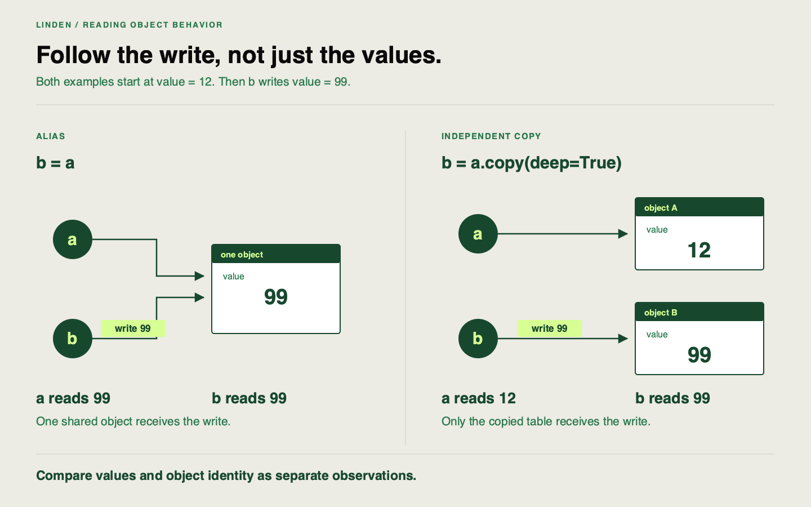

✂️
# Explain-the-code checkpoint

Linden Facilities receives a proposed guard from a coding assistant. Before merging it, the team needs more than a plausible explanation or a successful ordinary input. Your job is to establish what each statement actually does and whether the proposal meets the pipeline's contract.

Keep your new `batch_input.py` stage, its lifecycle call and tests. The existing correct domain guard remains in `src/linden_mlops/pipeline.py`. The [candidate](https://github.com/richhiey/ml-llm-ops/blob/main/docs/course/exercises/generated-stage-candidate.py) is deliberately unsafe assistant-style exercise material, kept outside the installed source. It is an authored review fixture, not a record of a new assistant interaction.

## Starting point

Use the same clone and locked environment. The proposed patch concerns domain validation. Its contract accepts temperature in `-30..50`, integer hour in `0..23`, and occupancy in `0..100`. It rejects invalid inputs, preserves accepted values/order/index, and returns an independent table.

Copy the [attempt starter](https://github.com/richhiey/ml-llm-ops/blob/main/docs/course/exercises/sprint-1-attempt.py) into `work/sprint-1/attempt.py` using VS Code. Complete only `review_candidate()` now; retain the other function for the supplier checkpoint. The starter imports the candidate separately and leaves your reasoning and probes unwritten.

## Your task

Before execution, explain every executable line in the candidate. For each line, identify what it reads, any condition it checks, what it writes, and what it returns or raises. A **side effect** changes state outside the returned value; **mutation** changes an existing object.

Record your predictions for one valid input, `hour=24`, a negative hour, and a fractional hour. For every case, distinguish:

| Question | Observation to record |
|---|---|
| Does the call accept or reject? | Returned table or raised exception |
| Which values remain in the caller's table? | Before/after comparison |
| What table does the caller receive? | Values/index and returned-object identity |

Write your probes, then run:

```sh
uv run python work/sprint-1/attempt.py review
```

Keep a fresh input for each case. Show at least one failed assertion against the required contract and contrast that same case with the application's existing `validate_ranges()`. Preserve the observed failure in your notes, including any prediction you corrected after running it.

Finish with a merge recommendation: name every correction needed and the contract check supporting it. A statement such as “this validates the data” is insufficient unless you explain which invalid inputs it actually rejects. Reuse the existing feature tests and your new planned-batch tests. If the real source changes, rerun affected tests and make a freshly named delivery before relying on its evidence.

## Working with documentation

| Use it when… | Reference |
|---|---|
| You need the meaning of clipping | [pandas Series.clip](https://pandas.pydata.org/docs/reference/api/pandas.Series.clip.html) |
| You need to compare a copy with its source | [pandas DataFrame.copy](https://pandas.pydata.org/docs/reference/api/pandas.DataFrame.copy.html) |
| You need to compare values, index and types | [pandas assert_frame_equal](https://pandas.pydata.org/docs/reference/api/pandas.testing.assert_frame_equal.html) |
| You need the declared pipeline guarantees | [Contracts](https://github.com/richhiey/ml-llm-ops/blob/main/docs/contracts.md) |

## Keep values and ownership separate



Both examples start with the same value. Follow the write through `b`: two names for one table observe the same change, while an independent copy leaves the original table untouched. Equal values before a call do not establish ownership. Use separate observations of values and identity to investigate the candidate yourself.

## Hints

<details>
<summary>Hint 1 — choose a distinguishing input</summary>

Which contract rule would still be untested if every example used an ordinary integer hour?

</details>

<details>
<summary>Hint 2 — observe more than the return value</summary>

Retain a deep copy before each call. Compare the caller's table afterward, then test whether the returned object `is` the input object.

</details>

<details>
<summary>Hint 3 — inspect the direction of a check</summary>

An upper limit does not establish a lower limit or an integer requirement. Read the assignment and return as well as the condition.

</details>

## Checkpoints

You are finished when your review predicts behavior line by line, exposes a failure that an ordinary input misses, and justifies the correction using the contrast with your working guard. Keep this review beside your stage explanation in the same script comments or `notes.md`. No second pipeline implementation is needed.

<details>
<summary>Solution — open after recording your review and observed probes</summary>

**Result you should get:** The candidate rejects an empty table, clips `hour=24` to `23` in the caller's table, accepts a negative or fractional hour unchanged, and returns the caller's same object. It lacks temperature/occupancy checks and the other required feature checks. Even an ordinary valid input exposes the independent-copy failure if you inspect identity. Request changes before merging.

**How:** In `proposed_guard`, `len(frame)` reads row count; the condition and `raise` address only emptiness. The assignment reads `hour`, applies `clip(upper=23)`, and writes into `frame`. `return frame` returns that same object. For a concrete refutation:

```python
sample = pd.DataFrame({"temperature_c": [12.0], "hour": [24.0], "occupancy": [40.0]})
original = sample.copy(deep=True)
returned = proposed_guard(sample)
assert returned is sample
assert sample.loc[0, "hour"] == 23  # observed silent repair
try:
    pd.testing.assert_frame_equal(sample, original)
except AssertionError as error:
    print("Candidate violates input preservation:", error)
else:
    raise AssertionError("This candidate should expose a changed input")
try:
    validate_ranges(original)
except ValueError as error:
    print("Working guard rejects:", error)
else:
    raise AssertionError("Invalid hour was accepted")
```

Check negative/fractional hours and valid-object identity separately. If your review says “all valid values change,” narrow it: an assignment targets the caller's object, but already-valid numeric values can remain equal. Replace silent repair with explicit rejection and retain all taught feature checks before an independent-copy return.

</details>

## Learning outcome

Given an AI-generated addition to the pipeline, explain line by line what it does, test its input/output contract, and identify any part that needs correction before merging.

## Summary

You have an evidence-backed review of a proposed pipeline addition. Your explanation connects statements to rejection, preservation and ownership, so a plausible description cannot substitute for the required behavior.
