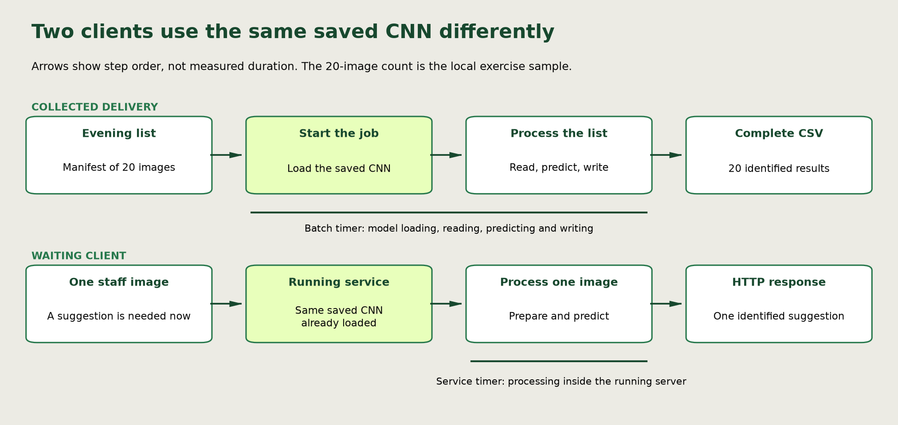

🏷
# Batch vs real-time inference tradeoffs

Threadline's catalog specialists check category suggestions from a trained image model. Two teams need those suggestions in different ways. The supplier-import team receives a completed list of product images each evening and wants a prediction file ready for the next review. A specialist checking one item wants a suggestion while that item is open on screen.

Both workflows use the saved CNN, the image model whose learned weights are already stored. **Inference** means using those weights to predict a category. The choice here concerns when images arrive and how their predictions reach the people who need them.

# Match the arrival pattern to the delivery

**Batch inference** processes a collected group of inputs as one job. A **manifest** is the CSV checklist containing each image's unique identifier and filename. Threadline checks that list, selects one saved model for the whole job and produces a complete prediction CSV. The output preserves every accepted identifier and its order so staff can match suggestions to products.

**Real-time inference** responds to an individual request while a client waits. The **client** sends an image, and the **server** runs the model and sends back a suggestion. Your local HTTP service uses this request/response exchange. It loads the model at startup and must remain reachable during the hours specialists depend on it.

| Question | Evening supplier import | Individual staff review |
|---|---|---|
| When do images arrive? | A completed manifest | One at a time |
| When is the output needed? | Before the next review batch starts | During the current interaction |
| What is success? | Complete, identified output and recoverable failure | An identified response within the client's acceptable wait |
| What must be operated? | A job and retained result | A continuously reachable process while clients need it |

The [inference brief](https://github.com/richhiey/ml-llm-ops/blob/main/docs/inference-brief.md) identifies the evening import as the primary client. A batch route fits that arrival pattern. The staff-review route has a different reason to use request/response delivery.

# Measure the right work

**Latency** is the elapsed time until the required result is available. The import team waits for the complete prediction file. An individual specialist waits for one reply. **Throughput** is how many images a system processes per unit time, such as images per second. Processing many images efficiently can still leave someone waiting for a whole batch to finish.

Open your batch's `batch.json`. Its `elapsed_seconds` includes loading the model, reading images, predicting and writing the prediction CSV inside the batch function. Divide delivered images by those seconds to describe observed throughput for that run. For the 20-image exercise, the calculation is `20 / elapsed_seconds`, in images per second.

The HTTP response's `inference_seconds` measures processing inside a server that has already loaded its model. The specialist's complete wait also includes sending the request, receiving the reply and any time waiting for other requests. Record which work a timer includes when quoting it.

A fair performance comparison needs a stated workload, the images and requests the team expects to process. Check input size, hardware, saved model and how many clients request predictions at the same time. The local demonstrations supply observations for their own small jobs. A delivery decision for larger traffic needs measurements of that traffic pattern.

# Cost follows operating requirements

A batch process can start when a manifest is ready and finish after writing its output. A request server needs computing resources during the hours clients depend on it, including quiet periods between requests. Repeating failed jobs, handling busy periods and retaining files also use resources.

Use these requirements to explain cost drivers. Estimating a hosting bill also requires a resource choice, its price and the expected operating hours and traffic. Your local elapsed time is one observation to contribute to that investigation.

# Failure handling belongs in the recommendation

Threadline's batch contract, its agreement about acceptable input and output, publishes a complete file after every listed input has been processed. An invalid thumbnail causes the job to fail before that file is published. The team can set aside rejected files, record their identifiers and reasons, then submit a list containing the accepted images.

A request service checks each arriving request and returns HTTP `422`, an invalid-input status, when the image fails the rules. A client also needs a response when the server is unreachable or the wait exceeds its allowed time. Both delivery patterns report the model's identity so the team can determine which saved weights produced a suggestion.

# Check for Understanding

The import team suggests sending every evening thumbnail as a separate HTTP request because one interactive demonstration felt fast. Write a recommendation for the primary brief. Name two measurements you would collect before claiming that this delivery change improves performance or cost. Explain how the staff-review client's recommendation can differ.

Solution

**Result you should get**

A defensible recommendation keeps batch delivery for the completed nightly manifest and supports request/response for interactive staff review. Measure the time to deliver a representative complete file and the number of images processed per second. For the request service, measure the client's complete wait and how many requests it can handle under a stated workload. Cost claims also need resource prices and operating-hours assumptions.

**How**

Start with each client's arrival pattern and deadline. Check what the demonstration timer included. A single quick response demonstrates a working request path, while the primary client needs complete, identified batch delivery. Compare the whole proposed workload before changing that architecture.

## Learning outcome

Compare batch and real-time inference patterns - latency, cost, throughput - and justify which pattern the provided inference brief requires.

## Summary

Threadline can choose delivery patterns from client needs and measured behavior while keeping its saved classifier and input contract consistent. Your recommendation identifies latency, throughput, cost drivers and failure handling in terms the catalog team can evaluate.
