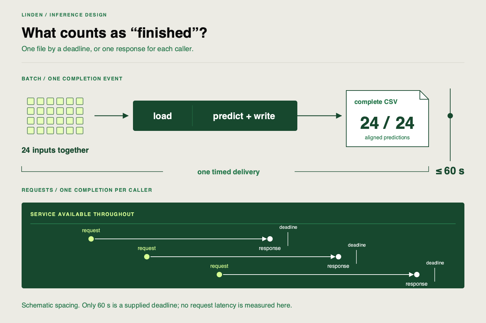

🏷️
# Batch vs real-time inference tradeoffs

Linden Facilities can now reject invalid inputs and produce a complete prediction file. The planner asks whether the team should replace that job with a permanent prediction endpoint. Before choosing an architecture, read what the planner actually needs.

All 24 planned hourly inputs arrive together. One complete CSV must be ready within 60 seconds. There is no interactive caller. Your existing batch files let you connect a recommendation to an observed delivery, rather than a preference for a familiar technology.

## Identify what is waiting

**Batch inference** processes a bounded group of inputs as one job. **Real-time inference** responds to requests as they arrive, within a response-time budget. Neither name guarantees that a particular implementation is fast or inexpensive.

**Latency** is elapsed time until the required result is available. For Linden, the waiting party is the planner waiting for the complete file. For an interactive application, it may be a person waiting for one response. These are different completion events.

The spacing and route lengths illustrate the two contracts; they are not benchmarks. Overlapping request lanes show that callers can arrive before earlier requests finish. The `60 s` batch deadline belongs to the supplied brief. No request-serving implementation or measured request latency is supplied.

| Dimension | Batch job | Request service | Linden's requirement |
|---|---|---|---|
| Arrival | Inputs collected together | Requests arrive individually | 24 rows together |
| Latency | Time to complete the required job | Time from each request to its response | Complete file within 60 seconds |
| Throughput | Completed rows per unit time over the job | Completed requests per unit time under stated load | All planned rows delivered |
| Resource obligations | Load/process/write during the job | Maintain the required availability and handle concurrent callers | A bounded local job |

**Throughput** counts completed records per unit time. Linden's metadata records `rows_per_second` for the whole timed batch. Dividing job duration by 24 gives an average time per completed row within that job; it does not establish the response latency of 24 independent network requests.

## Compare resource obligations before price

A batch can load a fitted model once, process the input and exit. A request service often keeps the model in memory to avoid loading it per request. It also needs to handle its availability window, startup, queuing and failures. A busy service may use resources efficiently; an infrequent batch may avoid idle capacity.

Those observations identify what to investigate, not a universal price ranking. An actual cost claim requires workload, resource consumption and pricing evidence. The [inference brief](https://github.com/richhiey/ml-llm-ops/blob/main/docs/inference-brief.md) supports batch because it meets a shared-arrival, whole-file need with fewer availability obligations. Model size alone does not justify an endpoint.

The fitted scaler and regressor could support either pattern. Changing the delivery pattern changes how inputs arrive, execution is scheduled, and outputs are returned. It does not require fitting preprocessing again on new requests.

## Use the evidence you already have

Open your actual `work/baseline-state/validated-batch.json` and matching CSV, or the new job name you used after a repair. These files record delivery through the source you edited. Its `run_id` must match the fitted baseline artifact you deliberately supplied; the model was not retrained merely to validate the new input boundary.

| Evidence | Supported conclusion | Limit |
|---|---|---|
| 24 finite predictions with matching `row_id` order | Complete, aligned output | Does not establish future prediction accuracy |
| `elapsed_seconds` and `complete_within_60s` | Measured batch met its deadline | Excludes environment setup and training |
| `rows_per_second` | Observed throughput for that job | Does not establish service throughput under load |
| `run_id` and `model_uri`; registered version when using an alias | Which fitted artifact produced the file | `resolved_version=None` is expected for your direct-artifact job; it does not establish price or availability |

Inspect the actual figures; do not generate another batch just for this page. If the record is missing or source changed, return to the saved-source verification before claiming completion.

## Check for Understanding

Write a short recommendation in the same working notes. Address latency, throughput and resource cost, citing your retained batch evidence. Then consider a changed brief: inputs arrive separately and each caller must receive an answer within 200 ms. Explain which part of your recommendation changes and what new measurements would be required. The 200 ms budget is hypothetical, not a measured result.

Solution — compare after writing both decisions

**Result you should get:** Batch fits the actual brief: all 24 inputs arrive together and a complete file is needed within 60 seconds. Cite your observed completion, aligned rows and throughput. Cost remains a qualitative resource comparison unless you have consumption/pricing data.

For the changed brief, request serving becomes a candidate because each caller has its own deadline. The existing batch result does not prove a 200 ms response budget can be met.

**How:** Match the waiting party and completion event to the architecture. The changed brief needs end-to-end request latency, including queue/network time, under the expected arrival rate and concurrency, plus availability and resource-cost evidence. Reuse the fitted artifact; do not substitute local per-row compute time for those measurements.

## Learning outcome

Compare batch and real-time inference patterns - latency, cost, throughput - and justify which pattern the provided inference brief requires.

## Summary

Your inference choice follows Linden's input arrival and delivery deadline. You can support it with the completed batch while naming the measurements still missing for a request service. Keep that recommendation with the validated stage and code explanation for the acceptance task.
