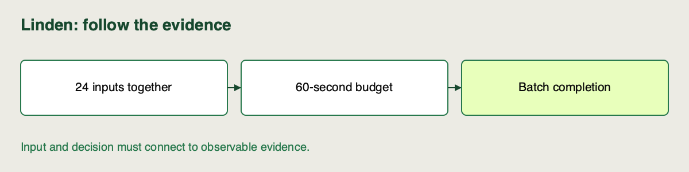

🏷️
# Batch vs real-time inference tradeoffs

Linden Facilities receives all 24 planned hourly inputs together. The planner needs one complete file within `60` seconds; nobody is waiting on individual HTTP responses. The inference pattern should follow that use case.

Read this explanation alongside the [repository setup](https://github.com/richhiey/ml-llm-ops/blob/main/docs/setup.md). Use your existing project evidence for the checks; no new model execution is needed.

## Which latency matters?

Use the comparison below to connect each pattern to the waiting time and resource obligation it creates. Latency is elapsed time until the required result is available; throughput counts completed records per unit time.

| Dimension | Batch | Real-time requests |
|---|---|---|
| Inputs | A bounded group available together | Arrive individually over time |
| Useful latency | Whole job completes before deadline | Individual response budget |
| Resource cost | Resources needed during the job | Often keep a service warm and available |
| Throughput | Can reuse one model load for many rows | Depends on workers, concurrency and queuing |
| Linden fit | Matches the supplied planning brief | Adds an availability obligation the brief does not need |

The [inference brief](https://github.com/richhiey/ml-llm-ops/blob/main/docs/inference-brief.md) selects batch. Request serving remains a prepared architectural comparison, not a measured endpoint in this scaffold. Neither pattern is universally cheaper or faster; hardware, workload and availability needs matter.

## What a permanent service adds

Real-time inference accepts inputs as callers submit them and returns responses within a request budget. The model is often kept in memory so each request avoids loading it again. That can help response latency, but the system must also handle startup, concurrent callers, failures and periods with no traffic. “The model is small” does not remove those obligations.

Batch inference can load the model once, process a bounded input and exit after writing results. This fits work that arrives together and has a completion deadline. It may be a poor choice when a caller must wait for the next scheduled batch to get an urgent answer. The same fitted model can support either pattern; the surrounding input, execution and delivery contract changes.

## Reason about cost without inventing a price

Cost depends on resource use and availability requirements, not the word “batch” or “API”. Compare what must run and for how long:

| Question | Linden's brief | What a different request brief would need |
|---|---|---|
| When do inputs arrive? | All 24 planned rows together | Arrival rate and peak bursts |
| When is output useful? | Complete file within 60 seconds | Budget for each caller |
| What must stay available? | The process while a job executes | A service during its availability window |
| What should be measured? | Complete rows, elapsed job time, selected version | Request latency distribution, throughput under load, availability |

A busy service can use hardware efficiently. An infrequent batch can avoid keeping a worker idle. Neither observation provides a universal price ranking. Linden's defensible recommendation is that batch meets the stated delivery need with a smaller availability obligation; actual cost would require resource and pricing evidence.

## What our evidence can establish

Reuse the edited-project batch already produced by the walkthrough; do not execute another job for this page. `work/edited/batch.json` record the row count, elapsed seconds, rows per second, source run and resolved model version. Timing includes loading the model and writing the CSV. We check completion against `60` seconds, not against one author's exact observed time.

The supplied delivery wrapper records which fitted model produced the batch. Interpreting that identity is enough here; configuring model selection is later work.

## Check for Understanding

Use your answer in the same short recommendation, addressing latency, throughput and resource obligations. There is no extra endpoint build or benchmark.

A teammate recommends a permanent endpoint because one local batch row takes little compute. Identify the missing evidence and decide which completion measure Linden should accept now.

Check your answer after attempting the diagnosis

> **Result you should get:** choose batch completion for all `24` rows within `60` seconds. One row's compute time does not establish request latency or justify a permanent service.
>
> **How:** map the input arrival pattern and planner deadline to the measured job. For an endpoint, request arrival rate, network/queue latency and availability costs would still need evidence.

## Learning outcome

Compare batch and real-time inference patterns - latency, cost, throughput - and justify which pattern the provided inference brief requires.

## Summary

Linden’s shared input arrival and whole-job deadline support batch inference. You can justify that choice without inventing request-serving timings or universal cost claims.
