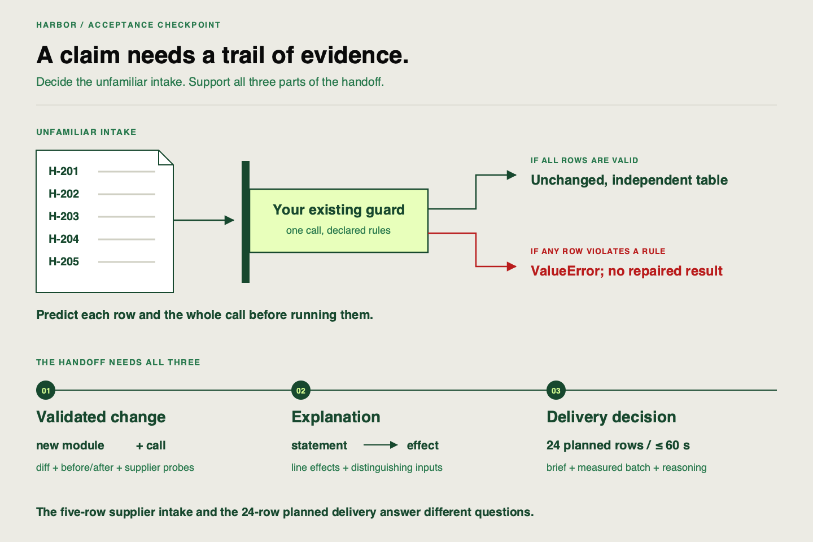

✂️
# Pipeline extension deliverable

Harbor Facilities wants to use the pipeline you have extended. Its supplier sends an unfamiliar intake containing boundary values and contract violations. Before accepting the data, Harbor needs you to explain which rules apply, demonstrate their behavior, and justify the delivery pattern.

Use the same clone, your new planned-batch stage and lifecycle call, existing domain guard and retained evidence. Harbor is a new acceptance client within this project; it does not require a replacement model or another pipeline build.

## What you will work with

Open the [supplier intake](https://github.com/richhiey/ml-llm-ops/blob/main/docs/course/exercises/harbor-intake.csv). It contains `row_id`, `temperature_c`, `hour` and `occupancy`, without a historical target or partition. Preserve the raw file. Use the feature guard directly; historical `ingest()` expects a different schema.

Your [contract](https://github.com/richhiey/ml-llm-ops/blob/main/docs/contracts.md) accepts inclusive temperature `-30..50`, integer hour `0..23`, and occupancy `0..100`. Accepted inputs must retain their values, columns, order and index in an independent returned table. Invalid input must reject; dropping rows or clipping values changes the agreement.



Use the picture to distinguish an intake decision from a model-delivery result. It deliberately does not classify Harbor's rows for you. A valid output produced earlier does not establish that this unfamiliar intake is acceptable.

## Quick diagnosis

Before running the supplier input, record an inventory with one row per identifier: predicted accept/reject, responsible condition, and the guard line supporting your reasoning. Then predict what happens when the complete mixed intake enters the guard as one call.

Harbor asks: “Can we clip invalid measurements and still describe them as the supplied input?” State an acceptance decision you can test. Keep your predictions before the observations so a corrected misunderstanding remains visible.

## Task A — Demonstrate the validated extension

Complete `check_supplier()` in your existing `work/sprint-1/attempt.py`. If you are joining here, copy the [unsolved starter](https://github.com/richhiey/ml-llm-ops/blob/main/docs/course/exercises/sprint-1-attempt.py) and use the [setup guide](https://github.com/richhiey/ml-llm-ops/blob/main/docs/setup.md) to restore the required working state. The completed-stage evidence must exist before this acceptance task.

Test individual rows and the whole intake using the saved `validate_ranges()` function. Check the original table after accepted and rejected calls, including its index. For accepted rows, check that the returned table is independent. Compare observed decisions with your inventory and explain any mismatch before correcting it.

```sh
uv run python work/sprint-1/attempt.py supplier
```

Retain the new `batch_input.py` module, its lifecycle integration diff, learner-owned tests, intended failing-before test and passing-after test, plus the complete valid batch. Those demonstrate the addition and unchanged downstream path. This supplier investigation adds transfer evidence; it does not replace the earlier checks with a single exception.

## Accept complete client plans

Harbor also supplies three constructed full-file intake cases: [plan A](https://github.com/richhiey/ml-llm-ops/blob/main/docs/course/exercises/harbor-plan-a.csv), [plan B](https://github.com/richhiey/ml-llm-ops/blob/main/docs/course/exercises/harbor-plan-b.csv) and [plan C](https://github.com/richhiey/ml-llm-ops/blob/main/docs/course/exercises/harbor-plan-c.csv). Before execution, inventory each file's schema, row count and identifier completeness/uniqueness. Predict its acceptance at your new stage and cite the responsible condition. These synthetic client cases use the bundled planned features; they are not observed building traffic.

Test each unchanged file with `validate_planned_batch()`, including input preservation after rejection. Deliver an accepted complete plan through `batch_predict()` with the retained baseline model URI and a fresh client output name. Check the actual identifiers, finite predictions and deadline; a direct unit call alone cannot establish integration. Keep the existing five-row supplier intake for individual domain probes. That five-row file is incomplete as a whole planner batch, even when a particular row has valid features. Explain which boundary each probe is testing.

## Task B — Explain changed and proposed logic

Use your line-by-line explanation of the new planned-batch stage and its integration call. Keep the separate review of the proposed domain guard. Cover each read, condition, exception, copy and return. Link each rule to a distinguishing input and point to your review of the unsafe candidate, including an observed failed assertion and the correction needed before merging.

Choose one planned-file and one supplier-row decision and predict where execution stops or reaches the return. Compare that explanation with the actual probe. A correct classification without a correct explanation is incomplete evidence.

## Task C — Justify inference

Reuse your recommendation for the [provided inference brief](https://github.com/richhiey/ml-llm-ops/blob/main/docs/inference-brief.md): all 24 planned inputs arrive together and the complete CSV is required within 60 seconds. Address latency, throughput and resource cost. Point to the actual batch metadata and identifier check supporting completion, and identify what you cannot claim from those records.

Harbor's five-row intake tests the input contract. It is not the 24-row planned delivery file. Do not change its values or train on it to make the checkpoint pass.

## Final check

Keep one working project with the source change and your existing script/notes. Check that another engineer can find these three pieces without guessing:

| Deliverable | Evidence to point to |
|---|---|
| At least one validated stage | New module and integration diff; failing-before/passing-after tests; planned-file and supplier predictions/probes; valid batch |
| Line-by-line explanation | Statement effects, stopping points, preservation/copy behavior and candidate correction |
| Justified inference recommendation | Brief requirements, latency/cost/throughput reasoning and observed completion evidence |

If source has changed since the saved batch, run your contract/regression tests and invoke the actual delivery function from a fresh process with a new output name. Otherwise reuse the existing proof. Use the explicit fitted artifact URI; this checkpoint does not require registry configuration or another model search.

<details>
<summary>Solution — open after completing the intake decision and three deliverables</summary>

**Result you should get:** Plan A has `24` unique complete identifiers and passes unchanged. Plan B has a duplicated identifier and rejects; plan C has `23` rows and rejects. The accepted plan reaches actual batch inference without changing its identifiers. Separately, `H-201` and `H-203` pass unchanged in separate returned tables. `H-202` rejects its fractional hour `22.5`; `H-204` rejects temperature `51`; `H-205` rejects occupancy `-0.5`. The complete five-row intake raises an error and returns no filtered or repaired result. Its original values and index survive. Clipping would conceal an input-contract violation.

**How:** Compare your predicted inventory with individual probes, then test the mixed intake separately. For example:

```python
intake = pd.read_csv("docs/course/exercises/harbor-intake.csv")
original = intake.copy(deep=True)
for index in intake.index:
    row = intake.loc[[index]].copy(deep=True)
    before = row.copy(deep=True)
    try:
        checked = validate_ranges(row)
    except ValueError as error:
        print(row.iloc[0]["row_id"], "rejected", str(error))
    else:
        pd.testing.assert_frame_equal(checked, before)
        assert checked is not row
        print(row.iloc[0]["row_id"], "accepted; independent unchanged table")
    pd.testing.assert_frame_equal(row, before)
try:
    validate_ranges(intake)
except ValueError as error:
    print("Mixed intake rejected:", error)
else:
    raise AssertionError("Mixed invalid intake was accepted")
pd.testing.assert_frame_equal(intake, original)
```

If `H-202` passes, inspect the integer-hour condition. If either valid boundary row rejects, inspect inclusivity. If later-feature violations pass, inspect an early return. Retain the wrong observation, explain the responsible condition, repair it and rerun the affected probe and saved-source checks.

A complete inference answer recommends batch for shared arrival and the whole-file deadline, citing 24 aligned finite predictions and measured completion. It discusses resource obligations without inventing prices or request-serving benchmarks. Validation RMSE describes held-out historical error; it cannot establish service cost.

</details>

## Learning outcome

Deliverable: the provided pipeline scaffold extended with at least 1 validated stage, a line-by-line explanation of the changed logic, and a justified batch-vs-real-time recommendation for the inference brief.

## Summary

You have applied an explained pipeline extension to unfamiliar supplier input and connected the delivery choice to observed evidence. Keep the new module and integration, existing domain guard, tests, actual batch metadata and explanation. The next controlled comparison uses this same saved source but creates its own declared runs; the illustrative delivery baseline is not a model-selection decision.
