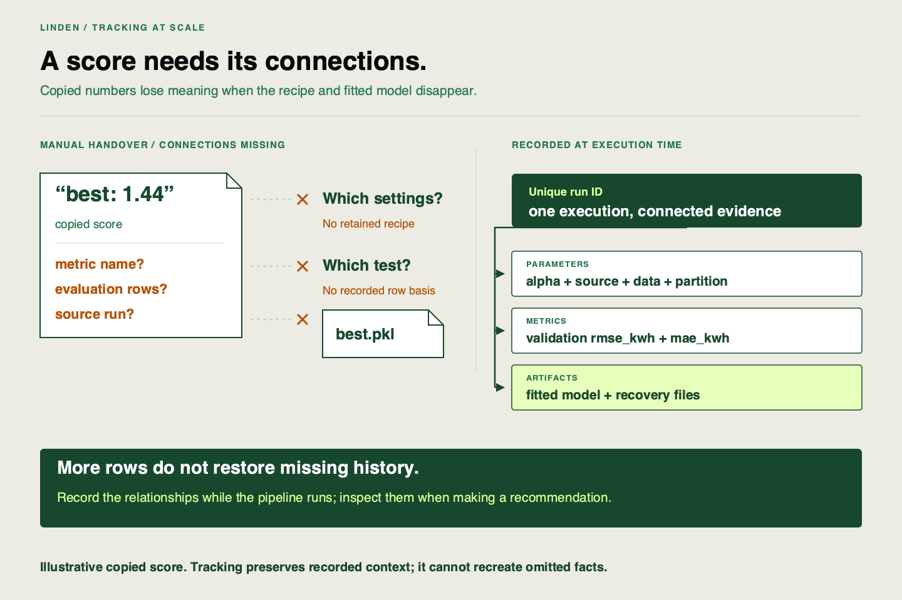

🏷️
# Why ad hoc tracking breaks down at scale

Linden Facilities can produce the planner’s daily prediction file. Now the team is trying several model settings. One spreadsheet row says “best”, another contains a slightly smaller score, and a file is named `best.pkl`. Nobody can tell whether those three things belong together.

The challenge is no longer producing a score. It is keeping enough context to explain a choice after someone closes the editor or runs another experiment.

Continue with the completed planned-batch stage, existing domain guard and retained evidence. The demonstration baseline showed that the pipeline runs; a controlled comparison will create separately identified candidates under one declared plan. Keep the source fixed while comparing them.

## Broken connections

Imagine this deliberately incomplete handover: `alpha=1, score=1.44`, `alpha=10, score=1.40`, and `best.pkl`. These are illustrative notes, not new pipeline results.

| Missing connection | Decision Linden cannot make | What to retain |
|---|---|---|
| Score → measurement | Is `1.40` better, and on which rows? | Metric name, direction and evaluation rows |
| Result → settings and data | Was this a fair comparison? | Configuration, fixed data copy and source identity |
| Recommendation → fitted model | Which object should make tomorrow’s predictions? | Full execution ID and saved model address |
| Old execution → separate record | What changed after another run? | Earlier records without overwriting them |

A spreadsheet can still help people read results. The failure comes from making manual copying the only connection between training and its record. The same omissions become harder to detect as the number of runs grows.

## Put the record around the execution

An **experiment run** is one execution with a unique identifier. `MLflow`, the tracking tool you have used for basic logging, stores its settings, measurements and files together:

- A **parameter** records a setting, such as `alpha=1`.
- A **metric** records a measured result, such as validation `rmse_kwh`.
- An **artifact** is a saved file, such as the fitted model or the recipe used to train it.

Validation rows are the held-out examples used to compare configurations; the estimator did not fit on their target values. A **data snapshot** is the fixed copy of the data used for a run. Recording its content fingerprint lets someone check whether two records refer to the same copy.

The connections matter more than the storage format. Another engineer should be able to follow a recommendation to its full run ID, inspect the settings and evaluation, and find that run’s fitted model.

## Make a recommendation inspectable

**Auditability** means being able to inspect how a decision was reached. “This run has the smallest validation error among our five comparable configurations” is checkable if its record names the candidates, metric and controls. “This is the best model” leaves those conditions hidden.

Tracking integrated into the pipeline creates the record when the execution happens. It reduces forgotten fields and copied-score mistakes. It cannot recover facts that were never retained, and it cannot make different evaluation conditions comparable. Linden still needs to decide what will stay fixed before running the comparison.

## Check for Understanding

The incomplete handover contains `run-A: alpha=1, score=1.44`, `run-B: alpha=10, score=1.40`, and `best.pkl`. It omits metric name, evaluation rows and the connection from either run to the file. Produce a repair list for the handover: name three decisions you must withhold and the evidence needed to unlock each one.

Check the repair list after your attempt

**Result you should get:** withhold the metric winner, the fair-comparison claim and the choice of model file. Retrieve the metric definition/direction and raw value; each run’s data/settings/evaluation conditions; and the saved-model connection to its source run.

**How:** trace each decision backward to the missing record. A smaller unexplained score does not settle any of these questions. Copying it into MLflow afterward cannot reconstruct the missing context.

## Learning outcome

Identify 3+ failure modes of tracking experiments manually (spreadsheets, notebook print statements) once a team runs many models, and explain why systematic tracking matters for auditability.

## Summary

You can now explain why a believable score may still be unusable. Linden needs connected execution records and a fair comparison plan before it can defend a model recommendation.
