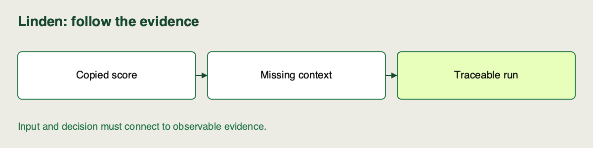

🏷️
# Why ad hoc tracking breaks down at scale

Linden Facilities has five model results copied into a spreadsheet. Two rows say “best”, one notebook was rerun, and the planner cannot connect either recommendation to the model that produced it. More rows have made the record harder to trust.

Read this explanation alongside the [repository setup](https://github.com/richhiey/ml-llm-ops/blob/main/docs/setup.md). Use your existing project evidence for the checks; no new model execution is needed.

## Notebook workspace

Use the [sprint notebook](https://github.com/richhiey/ml-llm-ops/blob/main/notebooks/02-tracking-and-evidence.ipynb) in your local project environment. Find the section for **Why ad hoc tracking breaks down at scale** using its Campus activity ID **A-S2-01**. It imports the shared core modules for the demonstrations; keep your own decisions and checks in the attempt cells. Reuse this same clone and saved work between activities.

## A score needs its context

An **experiment run** is one execution with a unique identifier and recorded inputs, settings and results. MLflow stores runs with parameters, metrics and artifacts. A **parameter** describes a setting such as `alpha`; a **metric** measures a result such as validation RMSE; an **artifact** is a file such as the fitted model or source bundle.

| Manual failure | Consequence | Evidence systematic tracking should retain |
|---|---|---|
| Copy score without run ID | Cannot find its model | Run → model artifact link |
| Overwrite saved output | Cannot reconstruct earlier comparison | Separate run records |
| Omit split or snapshot | Compare unlike evaluations | Data hash and partition |
| Rename a model file “final” | Selection becomes ambiguous | Registered version and active alias |
| Record alpha but omit environment | Rerun may use different behavior | Source revision and dependency lock |

A spreadsheet can be a useful evidence view. The problem is depending on manual copying as the only connection between an execution and its context. Tracking integrated into the pipeline records that connection when the work happens.

## Follow one claim through its supporting records

Take the claim “we recommend this configuration because it has the lowest validation RMSE among the controlled runs”. To inspect it, follow this chain:

1. The recommendation names a full run ID, not just `alpha=1`.
2. That run's parameters identify the data snapshot, source and evaluation partition.
3. Its metric dictionary contains the declared held-out `rmse_kwh` value.
4. The selected comparison population shows that the other candidates used the same controls.
5. The model URI and reproduction artifacts connect that execution to its fitted result and recipe.

This is **auditability** in practical terms: another person can inspect how the recommendation was reached. It is stronger than a chart with no source records. It is still limited by what was actually recorded and whether the content remains available.

## Tracking still needs judgment

Logging every run does not make comparisons valid. A run with a different evaluation partition should not win because its score looks smaller. Linden must declare controls and a primary metric before interpreting the tracked table. Automatic records reduce transcription work; they do not choose the business question.

## Check for Understanding

Linden's handoff sheet contains: `run-A: alpha=1, score=1.44`; `run-B: alpha=10, score=1.40`; and a file named `best.pkl`. The sheet omits metric name, evaluation rows and the link from either run to the file. Name three distinct decisions this record cannot support, then specify what you would retrieve before recommending either run.

Check your diagnosis after attempting it

> **Result you should get:** it cannot establish the metric/direction winner, comparability of evaluation conditions, or which artifact would be selected. Retrieve the metric definition/raw value, snapshot/split/config, and source-run-to-model link.
>
> **How:** follow each proposed decision backward to the missing evidence. Copying the two scores into MLflow later would not recover missing context.

## Learning outcome

Identify 3+ failure modes of tracking experiments manually (spreadsheets, notebook print statements) once a team runs many models, and explain why systematic tracking matters for auditability.

## Summary

Linden’s scores can now be questioned through the context each record must retain. You can name how manual omissions break a model decision’s traceability.
