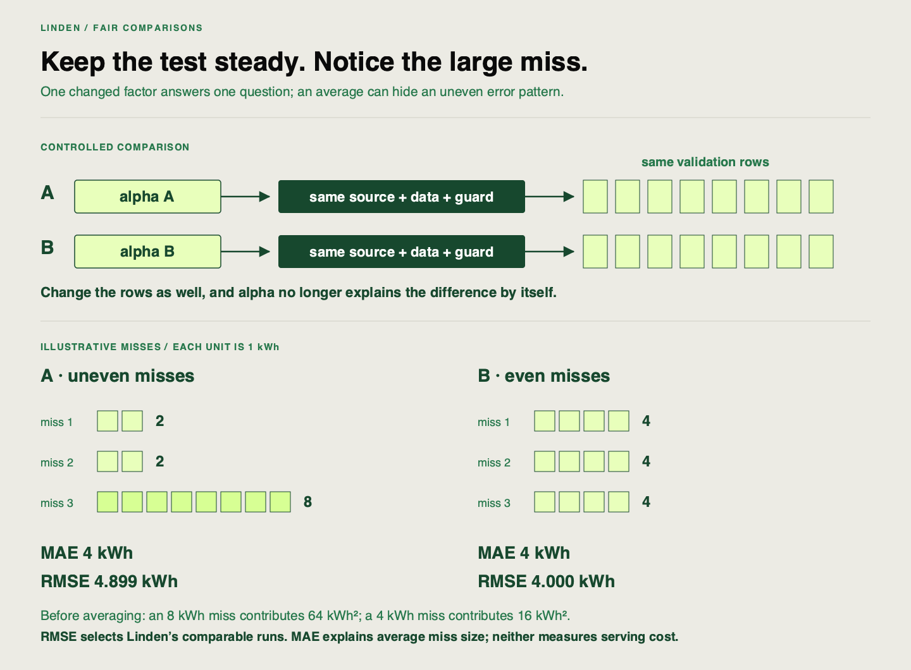

🏷️
# Controls, confounders, and decision metrics

Linden Facilities changes a model setting and sees a smaller error. A teammate also changes the rows used for evaluation. Did the model improve, or did it receive an easier test?

To answer, keep the evaluation question steady while changing the setting you intend to investigate.

## Give the experiment one moving part

The pipeline uses **Ridge regression**: a linear model that learns a weight for each feature, with a restraint on how large those weights become. That restraint is called **regularization**. Its strength is controlled by `alpha`.

Think about temperature’s contribution to predicted energy demand. A learned weight determines how much that contribution changes as the input changes. A larger `alpha` discourages large weights more strongly. Too much restraint can make the model miss useful patterns; this is **underfitting**. Less restraint is not automatically better either. We will compare settings rather than assume which one wins.

A **factor** is the setting deliberately varied. A **control** is a condition held fixed. A **confounder** is another changed condition that could explain the result. Here, change `alpha` while keeping this recipe fixed:

| Fixed condition | Practical reason |
|---|---|
| Same snapshot and train/validation rows | Every candidate learns from and is tested on the same examples |
| Same feature order and input guard | Inputs keep the same meaning and validity rules |
| Same training-only scaler | Feature rescaling learns from training rows, then is reused unchanged |
| Same Ridge solver, `svd` | The numerical method that fits the weights stays fixed |
| Same metric and direction | The rule for deciding the winner does not move |

Changing `alpha` and the split together prevents us from isolating `alpha`’s effect. Changing the guard at the same time introduces another difference even if the valid fixture happens to produce identical predictions. Test input safety separately from the model comparison.

## See the individual misses before the score

An error is predicted demand minus observed demand. A miss of `-8` kWh and one of `+8` kWh both have magnitude `8` kWh. Signs should not cancel when we describe how far predictions miss.

Consider two illustrative lists of error magnitudes: `A=[2, 2, 8]` and `B=[4, 4, 4]` kWh. Each totals `12` kWh across three predictions. A includes one much larger miss.

**Mean absolute error (MAE)** is the average miss magnitude: both are `4` kWh. **Root mean squared error (RMSE)** gives larger individual misses more influence by squaring errors before averaging, then returns the score to kWh by taking the square root. A’s RMSE is about `4.899` kWh; B’s is `4` kWh. You do not need to derive this measure to interpret what it rewards.



These errors illustrate the measures; they are not Linden run results. A larger RMSE penalty for the isolated miss does not tell us its financial cost.

## Declare which measure decides

A **primary decision metric** is the measure chosen before results are seen to rank candidates. Linden uses lower validation `rmse_kwh`. Larger misses matter in this declared comparison. **Diagnostic metrics** help explain behavior; validation `mae_kwh` is one of them. A training metric describes predictions on the rows used for fitting and answers a different question.

The planner also needs a complete `24`-row file within `60` seconds. Error and delivery time are separate requirements. Neither metric proves serving cost, and the synthetic snapshot cannot establish performance across real buildings.

Two rounded display values can look equal while their underlying numbers differ. A small numerical lead identifies the winner under the declared rule; it does not establish a meaningful improvement on future demand. Keep that limit in the recommendation.

## Check for Understanding

These are illustrative observations, not evaluations of the reserved final rows. Candidate C has validation errors `[0, 0, 9]` kWh; D has `[3, 3, 3]` kWh under identical controls. A third observation reports final-partition RMSE `2` kWh. Calculate C’s and D’s MAE/RMSE, recommend the comparable winner under Linden’s rule, and explain which observation must stay outside the ranking.

<details>
<summary>Check after recording your numbers and recommendation</summary>

**Result you should get:** both MAEs are `3` kWh. C’s RMSE is about `5.196` kWh; D’s is `3` kWh. D wins the validation comparison. The final-partition observation evaluates different rows and is excluded.

**How:**

```python
import numpy as np
for label, errors in {"C": [0, 0, 9], "D": [3, 3, 3]}.items():
    errors = np.asarray(errors, dtype=float)
    print(label, "MAE", np.abs(errors).mean(),
          "RMSE", np.sqrt(np.square(errors).mean()))
```

If the smaller final score seemed to win, check the row basis before sorting. This exercise does not authorize opening the actual final holdout, which stays reserved until configuration selection is fixed for the final handoff.

</details>

## Learning outcome

Explain why a run comparison is invalid when dataset split, evaluation conditions, or multiple uncontrolled factors change, and distinguish a primary decision metric from diagnostic metrics.

## Summary

You can distinguish a smaller error from a fair comparison. Linden’s experiment will vary one intended factor, keep the test fixed and use a declared primary metric instead of whichever number looks most favorable.
