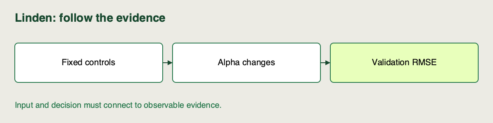

🏷️
# Controls, confounders, and decision metrics

Linden Facilities sees a smaller error after a teammate changed both regularization and evaluation rows. The team wants to attribute the improvement to the model change, but two explanations now fit the evidence.

Read this explanation alongside the [repository setup](https://github.com/richhiey/ml-llm-ops/blob/main/docs/setup.md). Use your existing project evidence for the checks; no new model execution is needed.

## Hold the question steady

A **control** is a condition held fixed across a comparison. A **factor** is the setting deliberately varied. A **confounder** is another changed condition that could explain the observed difference. To compare `alpha`, hold the data snapshot, split, features, scaling, solver, guard and evaluation metric fixed.

| Run change | What you can conclude |
|---|---|
| Alpha only; identical validation rows | Difference under those controlled conditions |
| Alpha and split changed | Cannot isolate alpha's effect |
| Same alpha, final instead of validation rows | Different evaluation, not a new alpha comparison |
| Added input guard; valid rows unchanged | Validate operational contract separately from model improvement |

## Primary and diagnostic metrics have different jobs

A **primary decision metric** is the measure chosen in advance to rank candidates. Here it is validation RMSE, in kWh, lower is better. Squaring errors before averaging makes larger errors count more. A **diagnostic metric** helps explain behavior without silently replacing the selection rule; here MAE measures average absolute error.

A teammate cannot choose RMSE when it favors one run and switch to training score when it favors another. Training metrics describe fit to known rows; they do not measure the same held-out question. The inference brief also has a completion budget: good RMSE and acceptable batch completion are separate requirements.

## Connect an error measure to a decision

For a prediction, the error is the predicted demand minus the observed demand. **MAE** averages the absolute errors: signs cannot cancel, and each extra kWh contributes equally. **RMSE** squares each error, averages the squares, then takes the square root. Squaring gives a large miss more influence; the square root brings the final result back to kWh.

For the illustrative error lists `A=[2,2,8]` and `B=[4,4,4]`, both MAEs are `(2+2+8)/3 = 4` kWh. A's RMSE is `sqrt((4+4+64)/3) = sqrt(24)`, about `4.899` kWh. B's RMSE is `4` kWh. The distinction matters when the brief wants larger misses to count more heavily. It does not make RMSE the right metric for every business problem.

Linden declares validation RMSE as the primary model-selection metric. MAE helps interpret the result, and batch completion checks whether the output is delivered in time. Those measures answer different questions; the report should preserve each instead of letting the most favorable number decide.

## Interpret a tiny winning margin carefully

A deterministic ranking can distinguish two raw values that round to the same display value. That tells you which row wins the declared metric rule. It does not quantify uncertainty about unseen facility demand. Nor does the `1e-6` reproduction tolerance do that: it checks whether a repeated execution agrees with its original result.

Keep three statements separate in your explanation: which candidate ranks first, what operational checks it still needs, and what the synthetic evaluation cannot establish. This prevents a correctly sorted table from becoming an unsupported deployment recommendation.

## Check for Understanding

A run on `final` scores better than all five validation runs. Linden's assistant recommends it as the winner. Identify the invalid comparison and specify the evidence needed to rank the five configurations.

Check your diagnosis after attempting it

> **Result you should get:** exclude the final-partition score from the validation ranking. Require the same snapshot, partition, source, features, solver and guard, then sort validation RMSE ascending.
>
> **How:** inspect `evaluation_partition`, `data_sha256` and the declared matrix, not just the score column. Keep the final result as a separate post-selection report.

## Learning outcome

Explain why a run comparison is invalid when dataset split, evaluation conditions, or multiple uncontrolled factors change, and distinguish a primary decision metric from diagnostic metrics.

## Summary

You can separate an alpha comparison from a changed evaluation question. The declared primary metric and fixed controls now determine how the result table should be read.
