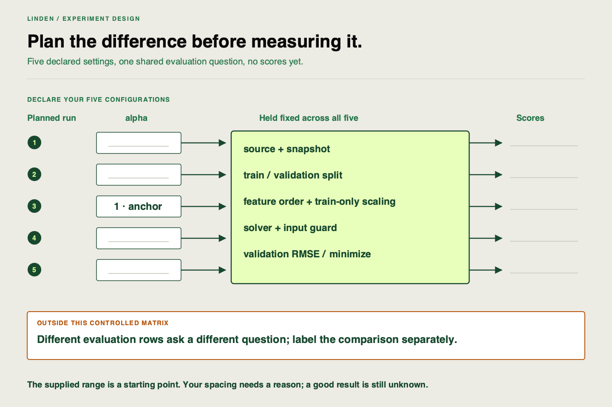

✂️
# Building the five-run experiment matrix

Linden Facilities is ready to investigate the model, but first it needs a plan that makes the result interpretable. Your job is to choose five configurations before seeing their scores and explain what each comparison will tell the team.

## Starting point

Work in your existing VS Code clone. Your new planned-batch stage and existing domain guard stay in place. The pipeline uses Ridge regression: a linear model whose `alpha` setting restrains the size of learned feature weights. Larger `alpha` means stronger restraint. Too much can miss useful variation in demand; this is underfitting. The experiment must discover the result rather than assume that either the smallest or largest value wins.

An **experiment matrix** is the table of configurations you intend to run. This investigation needs five configurations; the application can execute other declared plan sizes for another investigation. An **anchor** is a reference setting you compare the others with; use `alpha=1` here so the same execution can support a later logging comparison.



## Your task

Edit `configs/experiment.json`. Keep these supplied fields and choose your own five `alphas`:

| Field | Meaning / constraint |
|---|---|
| `alphas` | Five distinct finite positive values, including `1` |
| `primary_metric` | `rmse_kwh`, the held-out error used for ranking |
| `direction` | `minimize`, because a smaller error wins |
| `partition` | `validation`, the fixed comparison rows |

Choose values that explore weak through stronger regularization. Explain the spacing in a short note. Multiplying by a common amount, such as ten, explores substantially different strengths; adding the same small amount explores a narrower neighborhood. Neither pattern guarantees a winner. The supplied values are one possible range: justify them or replace them before execution.

Name the factor varied and the controls held fixed: data copy and split, feature order, training-only scaling, Ridge fitting method (`solver="svd"`), guard and metric. Scaling learns feature-rescaling settings from training rows; the solver is the numerical method used to fit weights. Keep both unchanged. A data hash is a fingerprint for checking that the data bytes stayed the same.

Write one prediction about when too much restraint might hurt; label it a hypothesis, not a result. Choose the metric from the declared comparison brief rather than a later favorable score. The `24`-row/`60`-second delivery contract is a separate check, not the model-ranking metric.

Add an excluded comparison example to your note that changes the evaluation partition. Explain what question it could answer and why it cannot select the validation winner. Do not execute it or open the final holdout. Also diagnose this proposal: a teammate increases `alpha` and disables the guard, then calls the result an alpha comparison. State what else changed and how to make the comparison interpretable.

## Save the plan, without training yet

Once your choices and rationale are recorded, register the plan:

```sh
uv run linden-mlops plan --config configs/experiment.json
uv run linden-mlops status
```

Expect `planned_alphas` to match your five values. No new training run is created. Keep your short note beside the config, or use the [blank matrix sheet](https://github.com/richhiey/ml-llm-ops/blob/main/docs/course/exercises/experiment-matrix-starter.csv). A completed comparison cannot silently be replaced by a different plan; use a new work directory for a deliberate new experiment.

## Working with documentation

| Use it when… | Reference |
|---|---|
| You need the fixed input and evaluation conditions | [Pipeline contracts](https://github.com/richhiey/ml-llm-ops/blob/main/docs/contracts.md) |
| You need alpha’s parameter definition | [Ridge API](https://scikit-learn.org/1.7/modules/generated/sklearn.linear_model.Ridge.html) |
| You need saved-plan behavior | [Experiment workflow](https://github.com/richhiey/ml-llm-ops/blob/main/docs/experiments.md) |

## Hints

<details><summary>Hint 1 — State the question</summary>

Complete “When only ___ changes, what happens to validation ___?” before choosing the values.

</details>
<details><summary>Hint 2 — Check each row against the anchor</summary>

If another field changes, decide whether it is a deliberate separate question or an uncontrolled difference. A shared run name cannot prove shared data or evaluation rows.

</details>

## Checkpoints

Someone else should be able to reconstruct all five configurations from your plan. Your partition field and recorded control checks must keep evaluations on different rows outside the ranking. Keep the excluded example separate from the five controlled configurations. Your chosen values need not produce the same winning alpha as an author example.

## Check your work after attempting the task

<details><summary>Compare after recording the plan and rationale</summary>

**Result you should get:** five distinct positive alphas including `1`, lower-is-better validation `rmse_kwh`, a named factor and explicit fixed conditions. A changed-partition example is excluded, and changing guard plus alpha is recognized as changing two conditions.

**How:** compare each planned configuration with the anchor, field by field. One valid reference range is `0.01`, `0.1`, `1`, `10`, `100`; adjacent values multiply by ten. It explores several strengths but does not predict the winner. If you cannot explain the spacing or a control, revise the plan before training. Keep the final holdout unopened.

</details>

## Learning outcome

Define a five-run experiment matrix for the provided training and inference pipeline starter that holds the dataset split and evaluation conditions constant, names the factor varied in each comparison, selects a primary metric tied to the inference brief, and labels any run that is not directly comparable.

## Summary

Your configurations now answer a question declared before the results. Linden can execute the plan without guessing which conditions were intended to stay fixed.
