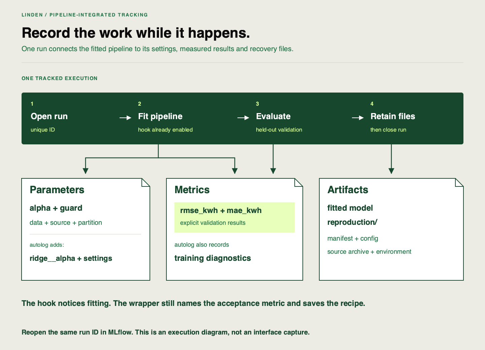

📝
# Revisiting MLflow in a pipeline context

Linden Facilities has a five-configuration plan. The team already knows basic MLflow logging; now it needs the training pipeline to create a complete record whenever a configuration runs. We will execute the plan once and trace one execution from Python code to its saved record and local interface.

## Starting point and finished state

Work in the existing VS Code clone and [locked environment](https://github.com/richhiey/ml-llm-ops/blob/main/docs/setup.md). Your planned-batch stage is integrated and the existing domain guard is enabled and `configs/experiment.json` has been declared with `plan`. Keep the source fixed while the five configurations run.

You will finish with five full run IDs in `work/project.json`, their exported rows in `work/runs.csv`, and one run whose settings, measurements and artifacts you can locate in both Python and MLflow. A **tracking store** is the local database and file storage holding those records; this project uses `work/tracking`.

## Follow these steps

### Step 1 — Execute the saved plan once

```sh
uv run linden-mlops status
uv run linden-mlops matrix
uv run linden-mlops compare
```

Check that `status` shows your five planned alphas before execution. `matrix` runs them and saves five unique IDs. `compare` prints their parameters and measured validation errors. Repeating `matrix` reopens those same IDs; it does not silently create a fresh experiment.

Check for five distinct alpha values and `evaluation_partition=validation`. If source changed after execution, the helper refuses to reuse the comparison. Preserve it and use a deliberate new work directory for a newly declared experiment; do not overwrite history to hide the mismatch.

### Step 2 — Open one actual record in Python

Create `work/inspect-run.py` with the following code, then run `uv run python work/inspect-run.py`:

```python
from linden_mlops import Workspace
from linden_mlops.project import Project

project = Project()
workspace = Workspace(project.tracking)
rows = project.matrix(workspace)
run_id = rows.iloc[0]["run_id"]
run = workspace.client.get_run(run_id)
print("Store:", workspace.path)
print("Run:", run_id)
print("Parameters:", run.data.params)
print("Metrics:", run.data.metrics)
print("Files:", [item.path for item in workspace.client.list_artifacts(run_id)])
print("Saved model:", run.data.tags["model_uri"])
print("Recovery files:", [item.path for item in
      workspace.client.list_artifacts(run_id, "reproduction")])
```

`Project` reopens saved project decisions; `Workspace` opens their tracking store. Neither call trains a model. Expect a full run ID, the configured `alpha`, validation `rmse_kwh`/`mae_kwh`, and recovery files including `manifest.json`, `config.json` and `source.tar.gz`. The **manifest** is this run’s saved recipe and identity record. The model’s **URI** is its loading address, retained in `model_uri`.

Keep this small script: you can extend the same inspection pattern when comparing logging modes. Do not choose a different store just because its display names look familiar.

### Step 3 — Connect the fields to the code that writes them

Open [`Workspace.run`](https://github.com/richhiey/ml-llm-ops/blob/main/src/linden_mlops/lifecycle.py). These are the relevant calls, abbreviated from the wrapper:

```python
mlflow.sklearn.autolog(disable=not config.autolog, log_models=False, silent=True)
# Inside mlflow.start_run(...):
model, metrics, frame = run_pipeline(config, partition=partition)
# mlflow.log_params(...) records config, evaluation partition and source/data identity.
mlflow.log_metrics(metrics)
# mlflow.sklearn.log_model(...) saves the fitted model explicitly.
# mlflow.log_artifacts(...) saves the reproduction files.
# In finally: mlflow.sklearn.autolog(disable=True)
```

**Autologging** attaches recording code to library operations such as `fit`. It is enabled before fitting, so it can capture estimator parameters and training diagnostics. Explicit logging still records our held-out validation metrics, model and recovery files. `log_models=False` stops the automatic hook from saving an extra model because the wrapper already saves one deliberately. The `finally` block disables the hook even if the run fails.

Find `ridge__alpha` among the automatically captured parameters. That nested name means the `alpha` setting of the pipeline’s Ridge estimator. Compare it with the explicit `alpha`. Find a training metric and explain why it is separate from validation `rmse_kwh`.

### Step 4 — Inspect the same execution in MLflow

In a **second terminal**, run:

```sh
uv run linden-mlops ui
```

The server stays running and occupies that terminal. Open `http://127.0.0.1:5050` in your browser, choose `linden-demand`, and locate the exact ID printed by your script. Inspect its parameters, metrics and artifacts; expand `reproduction` to find the saved recipe. The model address is also recorded as the `model_uri` tag. Names can repeat; the full ID must agree.

Keep this server open for your comparison work. `Ctrl+C` stops the server and leaves its saved runs intact. An occupied port usually means a server is already running; inspect that server’s store before launching another.



## Watch out for

A default chart can show a training diagnostic. Locate the explicit held-out `rmse_kwh` field rather than treating whichever graph appears first as the selection rule. If Python and the interface disagree, compare full run IDs and the printed store path before executing another matrix.

## Quick reference

| Action | Evidence to check |
|---|---|
| `matrix` | Five saved execution IDs for the declared plan |
| `get_run(run_id)` | Raw parameters, metrics and tags |
| `list_artifacts(run_id, "reproduction")` | Saved recipe, config and source archive |
| `ui` | Same run, opened through the local interface |

## Check your result

Retain the inspection script and identify the exact code call responsible for one parameter, one held-out metric and one artifact. Record the matching run ID in your notes. Five completed executions alone do not explain how their records were created.

## Learning outcome

Use the provided MLflow setup to log parameters, metrics, and artifacts automatically as part of the cumulative pipeline, building on basic experiment logging from T4 (AI track).

## Summary

The pipeline now records experiments as it runs. You can follow one execution from its logging calls to its raw fields and the same MLflow screen, which makes the five-run comparison inspectable.
