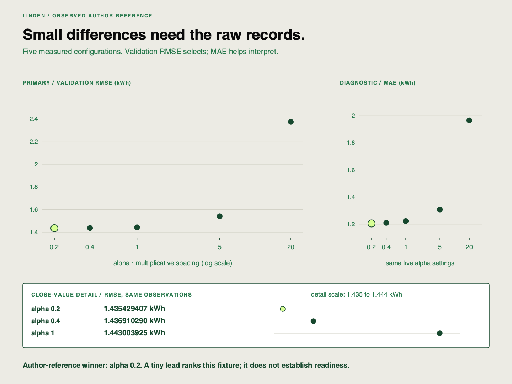

✂️
# Comparing multiple runs systematically

Linden Facilities has logged the matrix, but the planner needs a selection with comparable evidence. Your job is to use the MLflow interface to compare the runs and then verify the winning row against raw records.

## Starting point

Use the five configurations saved in `work/project.json` and raw rows in `work/runs.csv`. Reopen the same store for UI comparison; no new runs are needed.

| Starting evidence | What to inspect |
|---|---|
| `work/project.json` → `matrix_run_ids` | Five actual execution identities |
| MLflow comparison | Parameter controls and primary/diagnostic metrics |
| Raw selected rows | Unrounded values and source/data identity |

## Your task

Keep the existing MLflow server open, or run `uv run linden-mlops ui` in a separate terminal if it is stopped. The command stays running. Browse to `http://127.0.0.1:5050`. In `linden-demand`, select the five relevant runs and use the comparison control. Display alpha, guard, evaluation partition, validation RMSE and MAE. Find the best configuration for `rmse_kwh` and record the full run ID, value and metric direction.

Save evidence from the actual UI: a comparison capture or a written UI inspection record naming the displayed rows and columns. Check the chosen ID and score with `workspace.client.get_run(chosen_id)`, using the same `workspace` opened in your inspection script and your actual `chosen_id`. If older baseline runs also exist, explicitly select the five declared runs rather than treating every visible row as part of your declared experiment.

Explain one rejected comparison and why a training metric cannot replace the primary validation metric. If two displayed RMSE values look tied, decide how to resolve that before saving your selection. State which raw evidence would make you withhold a recommendation even if a row shows the lowest score. Keep final-partition results separate.

After checking the raw values, save your chosen full ID:

```sh
uv run linden-mlops select --run-id ACTUAL_RUN_ID
uv run linden-mlops status
```

Replace the placeholder. Expect `work/selected-config.json` and `selection` in `work/project.json` to describe that run. This saved recipe is the model candidate carried into the registry; successful ranking alone does not activate an artifact.

## Working with documentation

| Use it when… | Reference |
|---|---|
| You need run UI context | [MLflow tracking](https://mlflow.org/docs/3.5.1/ml/tracking/) |
| You need raw comparison data | [API lookup](https://github.com/richhiey/ml-llm-ops/blob/main/docs/api-reference.md) |

## Hints

1. Inspect controls before sorting any score.
2. RMSE is an error measure. Decide its direction explicitly.
3. Run display names repeat; the unique run ID ties your choice to the artifact.

## Checkpoints

Check five distinct configurations, rather than five executions of the same alpha. The comparison chart may default to `training_mean_squared_error`; read the **Metrics** table’s `rmse_kwh` row or select `rmse_kwh` explicitly. Training rows cannot decide the held-out comparison. Verify the winning row's raw `data_sha256`, `evaluation_partition` and score. If the UI and export disagree, stop and compare workspace paths before making a recommendation.

## Check your work after attempting the task

<details>
<summary>Open the self-check after recording your own result</summary>

**Result you should get:** the chosen ID belongs to your five saved configurations and has the smallest unrounded validation `rmse_kwh` among comparable rows. Its data/source controls match the group. Your UI record identifies those rows, the alpha values and the displayed primary metric; the raw record supplies the precision needed to settle rounded ties. A different source hash or evaluation partition is a reason to exclude a row, not a reason to celebrate its lower score.

**How to check:** filter by the saved full IDs, check controls, then rank ascending by `rmse_kwh`. For an exact numeric tie the scaffold orders by `run_id`; record that rule rather than inventing a meaningful quality difference. A training diagnostic measures fitted-data behavior and cannot answer the held-out selection question. If your UI and raw winner differ, check the metric selector, rounding and tracking URI before running anything again.

### Inspect the author reference after your selection



This verified reference uses five declared alpha values: 0.2, 0.4, 1, 5 and 20. The horizontal axis is logarithmic: equal steps multiply alpha rather than add the same amount; each point is an observed run, without interpolation. The lime-highlighted point identifies the smallest unrounded validation RMSE: alpha 0.2, approximately 1.435429 kWh. MAE is diagnostic. Your declared matrix can rank differently; a small lead here does not establish statistical significance or production readiness.

The optional companion notebook can regenerate a figure from your actual records. The [editable SVG](https://github.com/richhiey/ml-llm-ops/blob/main/docs/course/sprint-2/05-comparing-multiple-runs-systematically/assets/experiment-comparison__01__en.svg) and [reference observations](https://github.com/richhiey/ml-llm-ops/blob/main/docs/course/figures/reference-observations.json) make this author example inspectable.


</details>

## Learning outcome

Use the MLflow UI to compare 5+ experiment runs against each other and identify the best-performing configuration for a given metric.

## Summary

You used the comparison view to identify a configuration and checked its raw run record. The choice is now tied to specific evaluation conditions and a full run ID.
