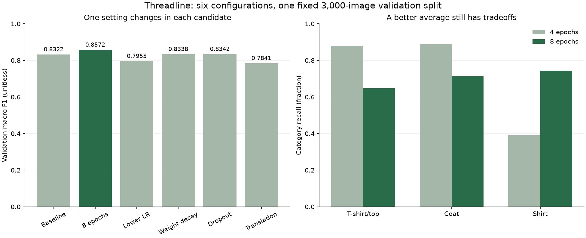

✂️
# Comparing multiple runs systematically

Threadline's catalog lead needs a model recommendation supported by the experiment results. Some changes may improve category suggestions, while others may make mistakes more often. Your task is to compare the six training runs, choose by the declared rule and explain the tradeoffs the specialists should review.

Use your MLflow experiment, the group containing these related runs, and your run ledger, the list of their full identities. The **baseline** is the reference recipe. Each of the five **candidates** changes one setting against it. Start the MLflow browser interface using the README command if it is not running. Work from your own IDs and observations before opening the author reference.

# Your task

Open **Experiments → threadline-cnn**. Select the baseline and five candidate rows, then choose **Compare**. Confirm the page says it is comparing six runs. Inspect parameter differences before ranking metrics: every candidate should change one declared factor against the same baseline.

Find `validation_macro_f1` in the comparison's Metrics section. F1 combines correct category suggestions with how many actual members of that category were found. This primary metric averages the ten category F1 scores equally, with larger values better. Clicking it opens a comparison view with each run's recorded value. Choose using the final saved number with all its recorded decimals. A rounded display or an earlier epoch's score can answer a different question.

Produce `work/selection.md` containing the six full IDs, checks that the runs share the required conditions, unrounded primary scores, selected configuration and gain over baseline. Explain at least one **regression**, a category result that became worse, and the measured training-time tradeoff. Keep results from different image groups or uncontrolled recipe changes outside this ranking, with a reason for each exclusion.

Retain a screenshot of your actual six-run comparison. Use the UI to make the decision first, then check it against the recorded predictions.

# Verify the comparison against raw evidence

The comparison implementation reads MLflow records and retrieves the recipe. It uses scikit-learn to calculate metrics again from each prediction CSV, so the summary can be checked against individual predictions. It also checks the same code, data, image split, package environment and initial weights, plus the connection between each model and its evaluated run. Inspect these operations before using the project verification file. [Comparison implementation](https://github.com/richhiey/ml-llm-ops/blob/main/src/catalog_mlops/comparison.py)

Replace the six capitalized ID tokens below with the full IDs from your ledger. These tokens identify your runs; they are not filenames or literal values to submit.

```bash
python scripts/compare_runs.py --state work/mlflow --baseline BASELINE_ID --runs LONGER_ID LOWER_LR_ID WEIGHT_DECAY_ID DROPOUT_ID TRANSLATION_ID --output work/comparison.json
```

Expect five distinct candidates that satisfy the comparison conditions, plus a selected run and model URI. The URI is MLflow's address for loading the saved model. Reconcile the output with your UI decision. If a condition is mismatched, preserve the exclusion reason and repair the experiment before making a comparative claim. Keep an earlier comparison decision when recording a new one.

# Hints

<details><summary>Hint 1</summary>

The larger macro F1 wins among eligible configurations. A repeat ID does not add a configuration, and a larger accuracy cannot replace the primary metric.

</details>

<details><summary>Hint 2</summary>

Compare category recall, the fraction of actual category members found, with the baseline. Precision, the fraction of category suggestions that were correct, can reveal a different drawback. Runtime is an observation on a stated machine. Examine what its timer includes before drawing an operational conclusion.

</details>

# Checkpoints

Verify the same `3000` validation identities and class order, a shared source/environment, and one changed training field per candidate. Match the selected raw metric and model URI to the same run. Keep your written decision before opening the reference observations.

<details>
<summary>Reference feedback</summary>

**Result you should get**

The author's actual CPU study selected `longer-training` by validation macro F1. Different hardware may produce different observations; apply the declared rule to your own eligible results.

| Configuration | Macro F1 | Accuracy | Shirt recall |
|---|---:|---:|---:|
| Baseline | 0.8322 | 0.8380 | 0.3900 |
| Longer training | 0.8572 | 0.8570 | 0.7433 |
| Lower learning rate | 0.7955 | 0.8033 | 0.2967 |
| Weight decay | 0.8338 | 0.8400 | 0.3800 |
| Dropout | 0.8342 | 0.8383 | 0.4333 |
| Translation | 0.7841 | 0.7997 | 0.1767 |

**How**

The selected run `99ce416e13ee4eeba47f6adf05d4ed7c` improved raw macro F1 by `0.0250368652` over baseline `c538c971fdf44099b750af1d9513458b`, about `2.50` percentage points on the `0–1` scale. It also reduced T-shirt/top recall from `0.88` to `0.6467` and coat recall from `0.89` to `0.7133`. Training took about `14.21 s` versus `7.07 s` on the author's machine, including weight updates, epoch validation and measurement logging. Those tradeoffs belong in the handoff, alongside the predeclared selection rule.



The [actual reference evidence](https://github.com/richhiey/ml-llm-ops/tree/main/docs/course/evidence/sprint-2) includes full-precision scores, controls and raw validation predictions. Run IDs refer to the author store, not records preloaded into your local MLflow database. One-seed results identify a candidate for further validation, not a proven universal winner.

</details>

## Learning outcome

Use the MLflow UI to compare 5+ experiment runs against each other and identify the best-performing configuration for a given metric.

## Summary

Your selection is supported by a real six-run UI comparison and raw prediction evidence. The recommendation names both the observed improvement and the category/resource tradeoffs the next validation step must consider.
