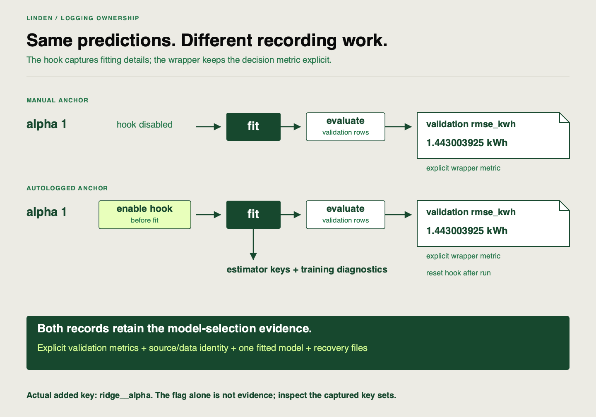

✂️
# Autologging and reducing manual tracking overhead

Linden Facilities wants less manual logging work without losing control of its acceptance metric. **Autologging** attaches recording code to operations such as `fit`; these attachments are called hooks. It does not know which business metric the team intended to use.

## Starting point

Extend your `work/inspect-run.py` inspection pattern: `Project()` reopens decisions and `Workspace(project.tracking)` opens their runs. Use the [API lookup](https://github.com/richhiey/ml-llm-ops/blob/main/docs/api-reference.md) to choose and connect the calls. Use the tracked pipeline and [MLflow autolog guidance](https://mlflow.org/docs/3.5.1/ml/tracking/autolog/). When passed to `Workspace.run`, `Config(autolog=True)` enables the scikit-learn hook before fitting. The application disables automatic model logging and explicitly logs the fitted model once.

| Held fixed | Deliberately changed |
|---|---|
| Model/data/evaluation | Autologging disabled versus enabled |
| Primary validation metric | Compare added parameter/metric key sets |
| Explicit model artifact | Automatic model logging remains disabled |

## Your task

Identify the saved matrix run with `alpha=1`: this is your autologged anchor. Reuse it and create one otherwise identical manual run, retaining its alpha, guard and validation-partition settings while changing only `autolog=False`. Use separate run IDs and compare raw parameter and metric keys. Before executing, predict one parameter or diagnostic that should appear only with autologging and one acceptance field that should remain in both records. Configure the matching run through `Config`, then identify actual added keys and compare them with that prediction. Explain why the auto-generated training score is not the validation decision metric.

Inspect [`Workspace.run`](https://github.com/richhiey/ml-llm-ops/blob/main/src/linden_mlops/lifecycle.py) and justify its `mlflow.sklearn.autolog(..., log_models=False)` call. Record where the hook is enabled relative to fitting, what is still logged explicitly, and how the hook is reset after the run. Use those observations to explain the convenience/control tradeoff. Keep the two saved records and add your configuration explanation; do not repeat the pair of runs.

Persist the two IDs once with `project.save(logging_pair={"autolog": auto_id, "manual": manual_id})`. On reopening, inspect `project.data.get("logging_pair")` and reuse the saved pair instead of training again. Write that reuse branch yourself. A key such as `ridge__alpha` is the nested `alpha` setting of the pipeline’s Ridge estimator.

## Working with documentation

| Use it when… | Reference |
|---|---|
| You need hook behavior and settings | [MLflow autolog](https://mlflow.org/docs/3.5.1/ml/tracking/autolog/) |
| You need actual logged keys | `workspace.client.get_run(run_id).data` |

## Hints

1. Compare sets of keys, not just the displayed RMSE. MLflow stores parameter values as text; compare alpha numerically with `float(...)` so `"1"` and `"1.0"` are recognized as the same setting.
2. A hook must be enabled before `fit` to observe training.
3. Log the business metric explicitly even when training diagnostics appear automatically.

## Checkpoints

Both runs should have the same validation result within `0.000001` kWh (`1e-6`), the small permitted score difference when only logging changed. Confirm an actual autolog-specific field exists; a config flag alone is weak evidence. Changing logging mode does not justify changing the split or model factors.

## Check your work after attempting the task

Open the self-check after recording your own result

**Result you should get:** two distinct IDs with matching alpha, guard, data/source and evaluation partition; only the logging flag differs. Both contain explicit validation `rmse_kwh` and agree within `1e-6` kWh. The autologged record additionally has estimator keys such as `ridge__alpha` and training diagnostics. The `autolog=True` parameter alone does not prove the hook captured anything.

**How to check:** construct the manual `Config` from the anchor's settings with `autolog=False`, save its returned ID, and compare `run.data.params` and `run.data.metrics` key sets. In `Workspace.run`, the sklearn hook is configured before `run_pipeline` fits the estimator; the `finally` block disables it afterwards. `log_models=False` avoids an additional automatic model copy because `log_model` explicitly records the model with its recorded input/output schema (signature) and example. These checks explain convenience and retained control using actual fields. If scores differ, inspect controls before blaming logging. The [worked comparison](https://github.com/richhiey/ml-llm-ops/blob/main/docs/experiments.md#compare-logging-without-repeating-the-matrix) is available after your attempt if script structure is blocking progress.

## Learning outcome

Configure autologging for the pipeline and explain the tradeoff between autologging convenience and control over what gets logged.

## Summary

You can show which fields autologging adds and which acceptance fields remain explicit. Less manual logging has not changed the model-selection question.
