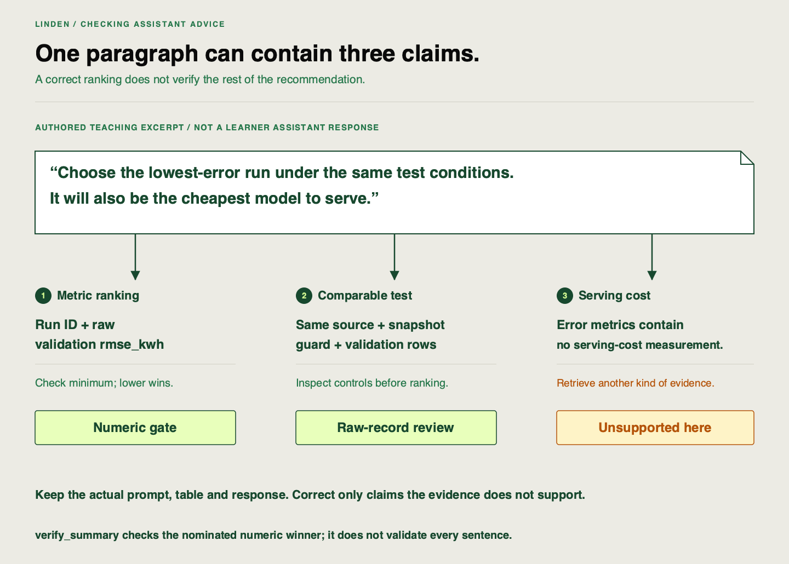

📝
# Validating an assistant-generated experiment summary

Linden Facilities has a selected configuration and a table supporting it. An assistant can help summarize the comparison, but fluent prose may mix training error with validation error or promise a cost advantage the table never measured. We will check the numeric recommendation and the claims around it separately.

## Starting point and finished state

Reuse your five saved run IDs, `work/runs.csv`, UI inspection and selected recipe. Use your institution-approved assistant; the project needs no provider API integration or credential. Finish with the actual prompt, input table and response, plus a compact claim-check table you can reuse at the checkpoint.

## Follow these steps

### Step 1 — Prepare the comparison the assistant should see

Extend your inspection script to export only the declared matrix:

```python
from linden_mlops import Workspace, verify_summary
from linden_mlops.project import Project

project = Project()
workspace = Workspace(project.tracking)
rows = project.matrix(workspace)
print(rows.to_csv(index=False))
```

Expect five unique IDs and five distinct alphas, shared source/data identity, guard enabled and validation evaluation. This keeps unrelated runs outside the request. Keep the final holdout closed.

### Step 2 — Request and retain the actual response

Supply that table to your approved assistant with this request:

> Recommend one run using lower validation `rmse_kwh`. Name its full run ID and raw value. Explain which recorded controls make the candidates comparable. Separate measured findings from claims that require more evidence, including serving cost and readiness for use.

Keep the prompt, table and actual response in one working note, such as `work/experiment-review.md`. No second report is needed. If assistant access is unavailable, you can practice with the [labeled example](https://github.com/richhiey/ml-llm-ops/blob/main/docs/course/exercises/assistant-summary-reference.md), but the actual-request part remains unfinished.

### Step 3 — Check the nominated ID, including a known wrong choice

Add the response’s actual nominated ID to the script:

```python
proposed_run_id = "REPLACE_WITH_THE_RESPONSE_RUN_ID"
result = verify_summary(rows, proposed_run_id)
print(result)
worst_id = rows.sort_values(["rmse_kwh", "run_id"]).iloc[-1]["run_id"]
wrong = verify_summary(rows, worst_id)
print("Deliberately wrong recommendation:", wrong)
assert not wrong["recommendation_matches_metric"]
```

For a valid nomination, `recommendation_matches_metric` is `True` when the ID matches the lowest comparable unrounded validation RMSE. The deliberately worst nomination returns `False`. This **negative control** is a deliberately wrong example that checks whether our check can reject a bad choice.

Incompatible input rows produce a `ValueError` rather than a winner verdict. Read the message and repair the comparison scope before ranking; do not suppress it. The [API contract](https://github.com/richhiey/ml-llm-ops/blob/main/docs/api-reference.md) lists its input checks. A `True` result checks one ID against one numeric rule. It does not validate every sentence in the response.

### Step 4 — Review each claim against the evidence it needs

Here is an **authored teaching example**, not a response obtained from your assistant: “Choose the smallest validation RMSE. That run must also be the cheapest to serve.”

| Claim | Where to check | Verdict for this teaching example |
|---|---|---|
| Select the smallest comparable validation RMSE | Declared metric/direction and five raw rows | Supported selection rule; verify the nominated ID separately |
| It is cheapest to serve | Cost or resource-use measurements | Unsupported: the error table does not measure cost |



Apply that method to the actual response. Record each recommendation or factual claim, its supporting field or missing evidence, and a verdict: supported, inaccurate or unsupported. Correct an inaccurate number; qualify a claim that exceeds the evidence. If the response is accurate, record that without inventing a mistake.

## Watch out for

A training diagnostic cannot replace held-out validation `rmse_kwh`. A tiny winning margin on the synthetic snapshot cannot establish the best alpha for every building. The numeric verifier has no cost data and does not read or approve the response’s prose.

## Quick reference

| Question | Required check |
|---|---|
| Does the nominated run win? | Full ID, raw primary metric and direction |
| Is it a fair comparison? | Source/data, features, guard and evaluation conditions |
| Does an operational claim follow? | Relevant measurement, or an explicit evidence gap |

## Check your result

Your retained note contains the actual request and response, a supported numeric recommendation or correction, and a verdict for each other claim. The known wrong ID fails. Reuse this evidence when the client introduces unfamiliar observations.

## Learning outcome

Direct an approved assistant to generate a summary comparison across logged experiment runs, validate every recommendation against the raw MLflow data and the declared primary metric, and flag any inaccuracy or invalid comparison.

## Summary

You can turn assistant advice into claims someone else can inspect. Linden’s recommendation now has a checked numeric choice and clear limits on what its experiment measured.
