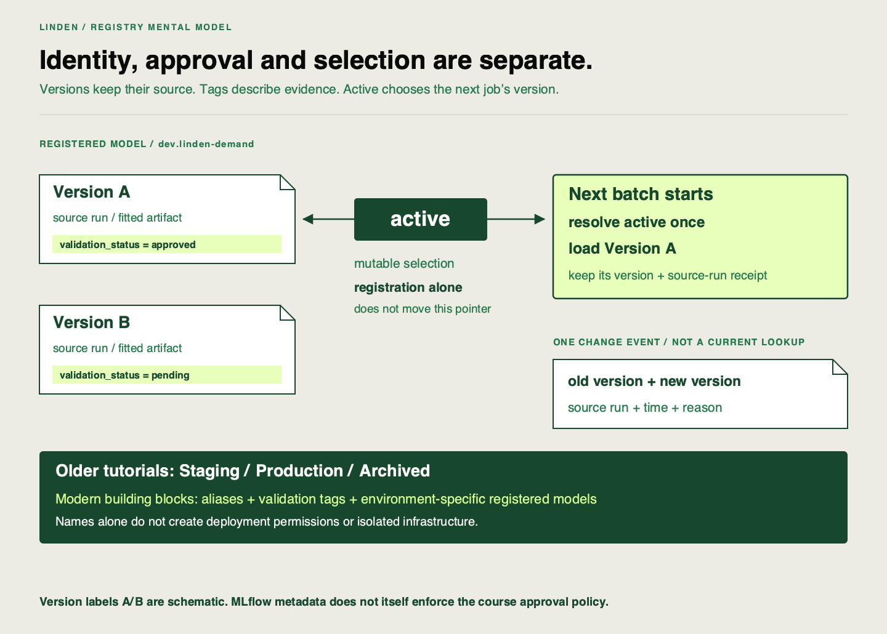

🏷️
# From "which file is production?" to a registry

Linden Facilities has chosen a run using comparable validation results. Its fitted model already exists. Now a planner asks which saved model tomorrow’s batch will load, and an engineer answers with two files: `model-final.pkl` and `model-final-new.pkl`.

A filename does not reliably distinguish what the artifact is, whether it passed the required checks and whether it is currently selected. Those are separate questions.

## Give each question its own record

A **model registry** is a catalog of named models and their versions. A **registered model**, here `dev.linden-demand`, groups the versions for one named purpose. Each **version** identifies a logged fitted artifact and the training run that produced it. Registering an existing artifact does not train another model.

A **tag** is descriptive metadata attached to a version, such as `validation_status=approved`. An **alias** is a name pointing to one chosen version. It is mutable, meaning it can be reassigned. Our alias is `active`.

| Question | Record to inspect | What that record cannot prove alone |
|---|---|---|
| Which artifact is this? | Version → source run → saved model | That its checks passed |
| What validation decision was recorded? | Status/evidence tags | That tests actually ran or selection moved |
| What will the next job choose? | Current `active` alias | What an earlier job loaded |

The saved model’s **URI** is the address used to load it. The run-to-artifact connection already exists from tracking; registration adds a version identity for lifecycle decisions, meaning decisions about validation, selection and later replacement.

## Approval and selection require different actions

The scaffold registers a pending version. After checking its validation result and input contract, an engineer records approval and a reason. The helper permits `active` to point only to an approved version. This is the course application’s policy; MLflow tags are metadata, rather than automatic proof that checks ran.

Each new batch resolves `active` once at its start, then uses that fixed version for the job. Moving the alias changes the next resolution. It does not retrain a model, delete the prior artifact or prove that an already-running consumer reloaded anything. The batch’s own metadata records the version and source run it actually used.

## Translate older stage vocabulary

Older tutorials may move a model through `Staging`, `Production` and `Archived`. Those stage labels are superseded vocabulary. Modern workflows use aliases for named selections, tags for validation information and environment-specific registered models when separate development/production organization is needed.

The `dev.` prefix in our name is a teaching convention. A name alone does not configure permissions or isolate infrastructure. Translate an older tutorial’s intended behavior into explicit validation and selection decisions instead of copying the stage label and assuming it deploys the model. See the [MLflow registry workflow](https://mlflow.org/docs/3.5.1/ml/model-registry/workflow/).

## Keep history as well as current state

A current alias lookup answers “what is selected now?” To explain a change, retain the previous version, new version, source run, time and reason. These connections are **lineage**: a path from a result or decision to what produced it.

The helper appends an event to `audit.jsonl`, a text file with one JSON event per line. Its limits are concrete: a direct edit through another interface can bypass the helper; the local file can be edited; and the alias can move even if writing its event then fails. Compare current registry state, retained event and new job metadata rather than treating any one as the entire history.

## Check for Understanding

A colleague registers a new version and announces that tomorrow’s batch will use it. The old version still has `active`. Diagnose the handover and specify the evidence and separate action needed before that claim is justified. Then translate an older instruction, “move the validated model from Staging to Production”, into a version, validation tags and an alias action. Explain what historical record you would retain.

Check after diagnosing the selection

**Result you should get:** registration has created an identity, but has not moved the alias. A new batch still resolves the old version. Inspect the new version’s source artifact and validation evidence before deciding whether it should be selected.

**How:** validate under the application policy, record approval, explicitly reassign `active`, and inspect a newly executed batch’s version and source run. Retain the change event with previous/new versions, source run, time and reason. Translate the older stage instruction into approval evidence on a named version and assignment of the intended alias. Separate environment-specific registered models when isolation is needed; a `dev.` name alone does not create that isolation. An approved tag alone is insufficient evidence that all of those actions occurred.

## Learning outcome

Explain 3 problems a model registry solves that ad hoc file-saving does not - versioning, alias/tag-based lifecycle control, and auditability - and recognise staging, production, and archived as superseded stage vocabulary replaced by aliases, tags, and environment-specific registered models.

## Summary

You can separate which artifact exists, what validation was recorded and what a new job will select. Linden can now replace a selection without losing the identity or history of the model it replaces.
