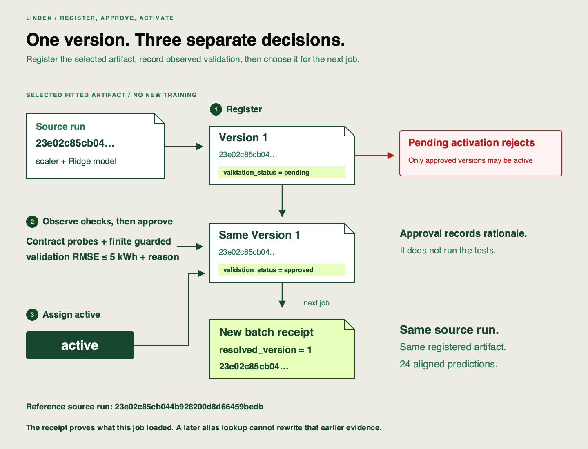

📝
# Registering and promoting a model

Linden Facilities has selected a guarded validation run. We will register that run’s fitted artifact, record the validation decision and select it for a new batch. No additional model training is needed.

## Starting point and finished state

Use the existing VS Code clone, saved `selection` in `work/project.json` and local tracking store. A **model version** identifies a registered artifact; its **tags** describe validation; the mutable `active` **alias** selects which version a new job loads. A model **URI** is its saved loading address.

Finish with a usable planner CSV and a traceable run → version → new batch connection, plus the deliberate rejection of an attempt to activate a pending version. The commands are ordinary application operations. Keep the actual run and version IDs from their outputs; the example labels below must be replaced with your observed values.

## Follow these steps

### Step 1 — Register the selected artifact

```sh
uv run linden-mlops status
uv run linden-mlops register --run-id ACTUAL_SELECTED_RUN_ID
uv run linden-mlops inspect
```

Check the selected run ID in `status`. `register` returns that ID and a version string. `inspect` prints registered versions and their tags; the new version has `validation_status=pending`. The version’s `run_id` must match the selection. Registration adds an identity to an already logged artifact.

Keep the returned identities. Reopening this activity reuses the saved version; local version counters are not universal identifiers. If it is already approved, inspect your retained first-run evidence rather than claiming it is newly pending.

### Step 2 — Observe the pending boundary fail

For the newly pending version, deliberately try:

```sh
uv run linden-mlops activate --version ACTUAL_REGISTERED_VERSION --reason 'Deliberate pending-status probe'
```

Expect a nonzero exit and `Only approved versions may be active`. This is an intentionally rejected action. Check the current state before continuing; a new registration must not have selected the candidate. The helper enforces this approval policy; a plain MLflow tag does not enforce it by itself.

### Step 3 — Inspect checks before recording approval

```sh
uv run pytest tests/test_batch_input.py tests/test_spine.py::test_contract_extension_and_unchanged_pipeline -q
uv run linden-mlops compare
```

Expect the saved-source contract test to pass. Your batch-input tests check the added `validate_planned_batch` stage, including a partial plan rejection, identity/completeness and valid-input preservation. The existing spine test separately checks domain rejection and unchanged training behavior. The student-created `src/linden_mlops/batch_input.py` and `tests/test_batch_input.py` must be present in the selected source, not only in an unsaved editor buffer. In the selected run’s raw record, check `range_guard=True`, `evaluation_partition=validation` and finite `rmse_kwh` at most `5` kWh. **Finite** means a real numeric value, rather than `NaN` or infinity.

The `5` kWh limit is the scaffold’s teaching approval gate. It is separate from choosing the smallest error among the five comparable candidates. Passing the gate does not mean every production concern has been tested.

Only after observing the checks, record your own reason:

```sh
uv run linden-mlops approve --version ACTUAL_REGISTERED_VERSION --reason 'REPLACE_WITH_YOUR_OBSERVED_CHECKS_AND_SCORE'
uv run linden-mlops inspect
```

Replace the placeholder with the tests and selected score you actually inspected. Expect `validation_status=approved` and `validation_evidence` containing your rationale. The measured score remains inspectable in the source run. `approve` checks the helper’s metric/guard policy and records your reason; it does not execute the test command for you.

### Step 4 — Select it, then inspect a new batch

```sh
uv run linden-mlops activate --version ACTUAL_REGISTERED_VERSION --reason 'REPLACE_WITH_YOUR_EVIDENCE_BASED_SELECTION_REASON'
uv run linden-mlops batch
uv run linden-mlops inspect
```

The activation event names previous and new versions, source run, time and reason. The batch resolves `active` once, loads that version and writes `work/tracking/batch.csv` and `batch.json`. Use a new `--output-name` for a distinct later job; reopen a retained job instead of overwriting it. Check that its `resolved_version` equals the registered version and its `run_id` equals the selected run. Also inspect `24` aligned finite predictions and `complete_within_60s=True`.



The reference diagram shows one actual connected execution. Your IDs may differ. The next job’s metadata proves what it loaded; a later alias lookup alone cannot prove what an earlier job used. An alias change does not force an already-running process to reload.

## Watch out for

If version, run and batch disagree, compare full IDs and store paths before approving anything else. Keep existing artifacts. The helper’s `audit.jsonl` contains one JSON event per line, but only for helper-mediated changes. The file can be edited, and an alias change can succeed even if saving its event fails. Report and reconcile such a mismatch rather than claiming a complete history.

See the [source/API lookup](https://github.com/richhiey/ml-llm-ops/blob/main/docs/api-reference.md) for the registry client and each helper’s exact acceptance conditions.

## Quick reference

| Command | Intended effect | Check |
|---|---|---|
| `register` | Create/reopen candidate version | Correct source run, initially pending |
| `approve` | Record validation under the local gate | Honest reason and observed checks |
| `activate` | Move `active` and append an event | Actual old/new version and source run |
| `batch` | Load the selected version for a job | New job’s own version/run and output |

## Check your result

Explain “registered”, “approved” and “selected” by pointing to their different records. Retain the pending rejection and the run/version/new-batch identities in your existing notes. The approval reason must describe checks you actually observed. A copied claim that tests passed is not test evidence. Do not repeat the lifecycle simply to generate another screenshot.

## Learning outcome

Use the provided model registry scaffold to register a new model version, record its validation status with tags, and promote it by assigning the scaffold's active-model alias.

## Summary

Linden’s selected training result is now a registered, validated selection backed by a new batch. You can show which action created each record and which artifact the job actually used.
