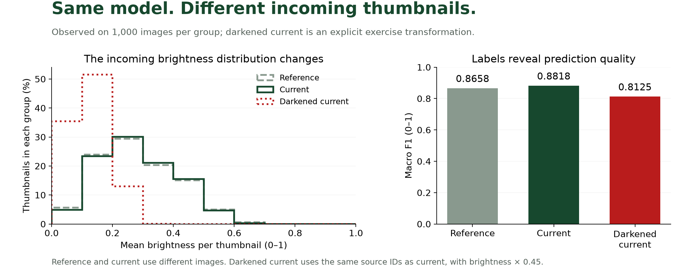

📝
# Registering and promoting a model

Threadline's catalog staff need the selected clothing classifier to be retrievable and checked before it starts supplying category suggestions. You will register the model from your experiment, repeat its recorded training recipe, select its version and inspect predictions from a fresh consumer. Then you will check what happens when incoming thumbnails become darker.

Use your completed intake pipeline and actual MLflow run ledger. The guided case follows **Threadline's equal-category comparison**, not Morrow's different recall requirements. In the author's study, eight epochs had the largest comparable validation macro F1, `0.8572382087673285`. Use the selected full run ID from your own comparison; do not copy the author's native IDs into your store.

Work in three phases with stopping points; each can be a separate guided sitting. Your current repository terminal stays at its root with `.venv` activated. A separate replay terminal will use the archived code's own environment. The [README](https://github.com/richhiey/ml-llm-ops/blob/main/README.md) repeats the sequence; [setup](https://github.com/richhiey/ml-llm-ops/blob/main/docs/setup.md) gives Windows equivalents.

# Phase 1: check the selected model's recorded recipe

## 1. Register an identified model

A registered **version** connects a saved MLflow model to a name such as `threadline-catalog`. Its validation tag begins as `pending`: registration alone is not approval.

Inside the provided registration file, the key native operation is `mlflow.register_model(model_uri, name)`. Here, `model_uri` is the address already recorded for the selected run. The file verifies that model against the run's predictions and records its data and source identities. [Registration implementation](https://github.com/richhiey/ml-llm-ops/blob/main/src/catalog_mlops/registry.py)

Replace `SELECTED_ID` with your full selected run ID.

```bash
python scripts/register_model.py --name threadline-catalog --run-id SELECTED_ID --actor catalog-engineer --reason "Retain the selected Threadline experiment"
python scripts/inspect_registry.py --name threadline-catalog
```

Expect a numbered version with `validation_status=pending` and no `active` alias yet. A new name normally starts at version `1`; record the actual number. Replace every `VERSION` token below with it. In the MLflow registry, inspect the version's source run and model address and match them to your ledger.

## 2. Retrieve the original recipe

The **recipe** contains the code, data identity, settings, environment and saved model needed to repeat the run. An **artifact** is one of these saved files. MLflow's native artifact command retrieves the files from your existing store.

Check that `work/replay` does not already exist. Preserve an earlier attempt and choose a fresh directory, updating its paths consistently, rather than downloading over it. Native downloads, archive extraction and shell redirection can overwrite files.

Run in the current repository terminal. The environment variable below tells the native MLflow command which tracking database to read. Its relative address assumes this terminal remains at the repository root.

```bash
export MLFLOW_TRACKING_URI=sqlite:///work/mlflow/tracking.db
mlflow artifacts download --run-id SELECTED_ID --artifact-path recipe --dst-path work/replay
python -m zipfile -l work/replay/recipe/source.zip
python -m zipfile -e work/replay/recipe/source.zip work/replay/code
```

Expect `work/replay/recipe` to contain the retained run files and `work/replay/code` to contain the original Python source, `scripts/`, `pyproject.toml`, `uv.lock` and `.python-version`. The `zipfile` commands list and extract the archive; they do not train a model.

Open the retrieved `config.json`, `dataset.json` and `environment.json`. Match the configuration to your selected run. The dataset record identifies the original bytes and exact validation images. The environment records the Python, platform and package versions. The archive is the code that produced this run; current registry inspection files are separate tools.

## 3. Execute the archived code in a fresh environment

Open a **new replay terminal** at the repository root. Leave the current project terminal unchanged. The extracted project must have no existing `.venv` or repeated-training output. Record that fresh starting state. The new environment below belongs to the archived project, so activate it once in this terminal. The **interpreter** is the Python program executing the files.

```bash
cd work/replay/code
uv sync --frozen
source .venv/bin/activate
python -c "import sys, catalog_mlops; print(sys.executable); print(catalog_mlops.__file__)"
python scripts/prepare_data.py
python scripts/evaluate.py --run ../recipe > ../saved-evaluation.json
python scripts/train.py --config ../recipe/config.json --output ../retrained
python scripts/evaluate.py --run ../retrained > ../retrained-evaluation.json
```

The printed interpreter and import path must belong to `work/replay/code`, rather than your main checkout. Save them and the command outputs as execution evidence. Preparation verifies the research data. The first evaluation reloads the **original saved weights**; the training command constructs a new CNN from scratch using the archived recipe; the last evaluation checks that newly trained model. Both evaluations use the recorded validation images. The official test set stays closed here.

Expect a new `work/replay/retrained` directory and two evaluation JSON files. Do not copy the original model directory to manufacture the repeated result. Exact learned weights can be a valid outcome of an independent deterministic training execution; an identical copied execution record is not one.

The author observed accuracy `0.8570` and macro F1 `0.8572382087673285` from both the original and independently trained eight-epoch models. Those are reference observations, not values to paste into your files. Close the replay terminal after retaining its evidence.

## 4. Apply the declared checks

Return to the original project terminal, still at the repository root with its original `.venv` activated.

```bash
python scripts/verify_reproduction.py --run-id SELECTED_ID --recipe work/replay/recipe --retrained work/replay/retrained --saved-evaluation work/replay/saved-evaluation.json --retrained-evaluation work/replay/retrained-evaluation.json --output work/replay/verification.json
```

Open `verification.json`. A **tolerance** is the allowed numerical difference, declared before measuring the replay. This [clean-state specification](https://github.com/richhiey/ml-llm-ops/blob/main/docs/reproducibility.md) requires matching code, data, split, configuration, environment and initial weight values. It also checks the native model's connection to the original run and recalculates metrics from raw predictions.

Saved-model scores must agree within absolute `1e-12`. Newly trained accuracy and macro F1 may each differ by at most `0.002`, or **0.2 percentage points**. A close score cannot compensate for a failed identity check. The report preserves whether learned weights match exactly; the new checkpoint file need not have the same byte fingerprint.

Stop if the report fails. Keep the failed evidence and diagnose the named condition. A matching report alone does not prove a fresh environment was created, so retain the interpreter and command observations too.

**Stopping point:** you have an original recipe, a genuinely new training output and an explained verification result. Do not proceed to selection with failed checks.

# Phase 2: select the checked artifact and use it

## 5. Record validation and assign the active alias

A **tag** records status; an **alias** selects a version. These are separate native MLflow operations:

```python
client.set_model_version_tag(name, version, "validation_status", "passed")
client.set_registered_model_alias(name, "active", version)
```

Here, `client` is the configured `MlflowClient`, and `name` and `version` identify your registered artifact. These lines explain the operations inside the project files. The project additionally rechecks the evidence and expected previous alias before acting.

```bash
python scripts/validate_model.py --name threadline-catalog --version VERSION --evidence work/replay/verification.json --actor catalog-engineer --reason "Clean archived-source replay passed"
python scripts/assign_alias.py --name threadline-catalog --version VERSION --expected-current none --evidence work/replay/verification.json --actor catalog-engineer --reason "Threadline comparison and category tradeoffs reviewed"
python scripts/inspect_registry.py --name threadline-catalog
```

Expect `validation_status=passed`, `validation_scope=clean-cpu-replay-v1`, and a retrievable `validation_evidence_uri` on the version. The actual report is retained on the original MLflow run, with its content fingerprint. Expect `active` to point to your recorded version and the local journal to contain completed actions with actor, reason and time.

This validation scope establishes replay consistency. Your separate experiment recommendation establishes suitability for Threadline's brief. Morrow's recall policy can require a different model even when this one has the highest overall macro F1.

## 6. Check a newly loaded batch and service

A consumer resolves the alias once, then loads the exact version it found. The native operations inside the registry consumer are:

```python
selected = client.get_model_version_by_alias(name, "active")
model = mlflow.pytorch.load_model(f"models:/{name}/{selected.version}")
```

Resolving once prevents the process from silently switching models halfway through a delivery. [Registry consumer implementation](https://github.com/richhiey/ml-llm-ops/blob/main/src/catalog_mlops/registry.py)

Use the incoming samples retained from the pipeline work.

```bash
python scripts/predict_registry_batch.py --name threadline-catalog --manifest work/intake/manifest.csv --output work/batches/registry-selected
```

Expect a short terminal summary and `20` identified predictions in the saved output. The complete input observations remain in the file. In `batch.json`, match the registered name, version, source run ID and model fingerprint to the selected artifact. The record distinguishes the older training source from the code now performing inference.

Open a **new service terminal** at the repository root. Its explicit deployment choices are visible in [registry_api.py](https://github.com/richhiey/ml-llm-ops/blob/main/scripts/registry_api.py).

```bash
source .venv/bin/activate
uvicorn scripts.registry_api:app --host 127.0.0.1 --port 8000
```

Wait for startup. Back in the original project terminal, send an actual HTTP request.

```bash
python scripts/prepare_request.py --image work/intake/56368.png --image-id train:56368 --output work/registry/request.json
curl --fail-with-body -sS http://127.0.0.1:8000/health
curl --fail-with-body -sS -H "Content-Type: application/json" --data-binary "@work/registry/request.json" http://127.0.0.1:8000/predict
```

`/health` reports the identity held by that running process; it does not resolve the alias again. Match its loaded version and model fingerprint, and those returned by `/predict`, to the batch record. The matching image's class and top score should agree, with score difference no larger than `1e-6`. Keep the response as evidence, then stop this service with **Ctrl+C** in its terminal.

**Stopping point:** the checked artifact is selected, and both consumers identify the actual model they loaded.

# Phase 3: observe incoming images and measured quality

## 7. Compare image groups before labels arrive

A **cohort** is a group observed together, such as one supplier delivery. The course fixture exports two disjoint research groups of `1000` images each: reference and current. It also constructs darker copies of the current group by multiplying brightness by `0.45` and rounding. Their dimensions and known categories remain the same. This is an exercise transformation, not a reported retailer incident.

```bash
python docs/course/exercises/prepare_monitoring_cohorts.py
python scripts/predict_registry_batch.py --name threadline-catalog --manifest work/cohorts/reference/manifest.csv --output work/batches/reference
python scripts/predict_registry_batch.py --name threadline-catalog --manifest work/cohorts/current/manifest.csv --output work/batches/current
python scripts/predict_registry_batch.py --name threadline-catalog --manifest work/cohorts/shifted-current/manifest.csv --output work/batches/shifted-current
python scripts/monitor_batch.py --batch work/batches/reference --output work/monitoring/reference-unlabeled.json
python scripts/monitor_batch.py --batch work/batches/current --output work/monitoring/current-unlabeled.json
python scripts/monitor_batch.py --batch work/batches/shifted-current --output work/monitoring/shifted-current-unlabeled.json
python scripts/compare_cohorts.py --reference work/monitoring/reference-unlabeled.json --current work/monitoring/current-unlabeled.json --output work/monitoring/current-unlabeled-comparison.json
python scripts/compare_cohorts.py --reference work/monitoring/reference-unlabeled.json --current work/monitoring/shifted-current-unlabeled.json --output work/monitoring/shifted-unlabeled-comparison.json
```

The model and preparation code must match across these comparisons. The batch records brightness and fingerprints from the same image bytes used for prediction. Monitoring reads those retained observations rather than later rereading possibly changed PNG files.

For each thumbnail, monitoring calculates **mean brightness**, its average pixel value divided by `255`. It groups these `1000` image averages into ten brightness ranges. This differs from counting individual pixels inside one image. It also counts how often each category was predicted.

The brightness comparison uses **total variation**, a difference between the proportions in corresponding histogram groups. `0` means the proportions match; `1` means they occupy entirely separate groups. This exercise declares `0.20` as an investigation threshold before observing results. It is not a universal statistical cutoff or a complete detector of every image change.

In the author run, ordinary current versus reference gave `0.019`, while shifted-current versus reference gave `0.573`. Inspect your own counts and comparison. The unlabeled reports contain no accuracy or macro F1: a changed image or category distribution does not establish how often the model is correct.

## 8. Use known labels to check quality

The fixture keeps known categories in separate label files. Prediction does not read them. Supply them only to the evaluation observation.

```bash
python scripts/monitor_batch.py --batch work/batches/reference --labels work/cohorts/reference/labels.csv --output work/monitoring/reference-labeled.json
python scripts/monitor_batch.py --batch work/batches/current --labels work/cohorts/current/labels.csv --output work/monitoring/current-labeled.json
python scripts/monitor_batch.py --batch work/batches/shifted-current --labels work/cohorts/shifted-current/labels.csv --output work/monitoring/shifted-current-labeled.json
python scripts/compare_cohorts.py --reference work/monitoring/reference-labeled.json --current work/monitoring/shifted-current-labeled.json --output work/monitoring/shifted-labeled-comparison.json
python scripts/compare_cohorts.py --reference work/monitoring/current-labeled.json --current work/monitoring/shifted-current-labeled.json --output work/monitoring/paired-brightness-comparison.json
```

Expect category metrics and macro F1 only after labels cover the delivered image identities. The exercise declares a macro-F1 drop of `0.05`, or **5 percentage points**, as another investigation threshold.



Reference to shifted-current drops about `5.3` points. Comparing the ordinary current images with their own darkened copies drops about `6.9` points. These comparisons have different starting groups; keep them distinct. [Raw author observations and limits](https://github.com/richhiey/ml-llm-ops/blob/main/docs/course/evidence/sprint-3/README.md)

For this constructed input change, inspect the supplier's thumbnail export before changing the model. Restoring the original export keeps the saved model fixed and returns the known current images to the original input conditions. The input-range check still accepts these darker files; passing a file check does not guarantee unchanged model quality. If evaluating another model instead, compare it on identical delivered bytes and labels, retaining the original selection policy and category results.

For a later **model change**, the [paired-quality command](https://github.com/richhiey/ml-llm-ops/blob/main/scripts/compare_model_quality.py) accepts `--first` and `--second` labeled observation files and `--output`. It requires identical consumed image bytes, ordering and labels, plus fixed inference code. Its macro-F1 alert is a diagnostic; inspect the original reports' category metrics and declared business requirements too. Read `python scripts/compare_model_quality.py --help` before that task.

## 9. Report the fixed model's final holdout result

Once the selection is fixed, report official-test quality without using it to rank more recipes.

```bash
python scripts/evaluate_holdout.py --name threadline-catalog --output work/final-holdout.json
```

Expect `10000` observations and the actual approved model identity. The author's fixed eight-epoch model reached accuracy `0.8552` and macro F1 `0.8553040811661556`. This reports performance on these research images, not arbitrary product photographs. Retain your own result as the final report for this selection.

# Watch out for

A missing run usually means the wrong local tracking store or an incomplete preceding study. A close metric with different source, data or environment is not a passed same-environment replay. Project training, verification and batch outputs reject existing destinations. Native artifact downloads, extraction and shell `>` redirection can overwrite; use a fresh replay folder and preserve earlier attempts. A tag alone does not move the alias, and an alias change does not reload an existing service. Preserve the observed failure before repairing it.

# Quick reference

| Need | Visible tool or file |
|---|---|
| Retrieve the original recipe | Native `mlflow artifacts download` |
| Run the original implementation | Extracted `scripts/prepare_data.py`, `train.py`, `evaluate.py` |
| Interpret the acceptance checks | `docs/reproducibility.md` and your `verification.json` |
| Register, validate and select | Direct `register_model.py`, `validate_model.py`, `assign_alias.py` files |
| Restore an earlier approved selection | Same `assign_alias.py` operation with `--rollback`; it requires recorded previous selection evidence |
| Check the actual loaded model | Batch record or HTTP response |
| Distinguish drift from correctness | Unlabeled versus labeled monitoring observations |

## Learning outcome

Use the provided model registry scaffold to register a new model version, record its validation status with tags, and promote it by assigning the scaffold's active-model alias.

## Summary

Threadline's selected model is now connected to a replayed recipe, retained validation evidence and an observed active version. The catalog team can check what consumers loaded and distinguish changed incoming images from measured classification mistakes.
