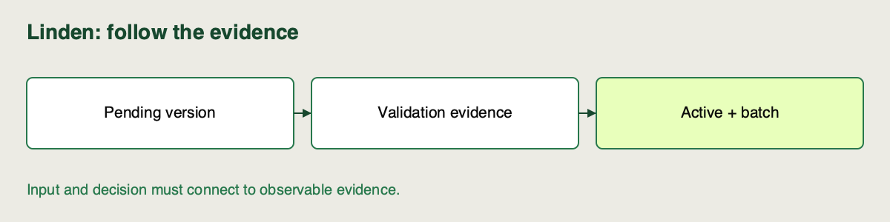

📝
# Registering and promoting a model

Linden Facilities has selected a guarded run. We will give its artifact a registered version, attach validation evidence and make it the version used by the next batch.


## Notebook workspace

Use the [sprint notebook](https://github.com/richhiey/ml-llm-ops/blob/main/notebooks/03-registry-and-reproduction.ipynb) in your local project environment. Find the section for **Registering and promoting a model** using its Campus activity ID **A-S3-02**. It imports the shared core modules for the demonstrations; keep your own decisions and checks in the attempt cells. Reuse this same clone and saved work between activities.

## Work in the repository

Carry forward the actual selected validation run:

```sh
uv run linden-mlops status
uv run linden-mlops register
uv run linden-mlops activate --reason 'Probe pending boundary'
```

On the first registration, expect a pending version and the deliberate activation error `Only approved versions may be active`. Registration reuses the saved version when repeated; if it was already approved, inspect the retained earlier result rather than claim a new pending failure. Run the contract checks and inspect selected validation RMSE first:

```sh
uv run pytest tests/test_spine.py::test_contract_extension_and_unchanged_pipeline -q
uv run linden-mlops compare
uv run linden-mlops approve --reason 'Observed passing range contract and finite validation RMSE within 5 kWh'
uv run linden-mlops activate --reason 'Selected comparable validation run after contract checks'
uv run linden-mlops batch
uv run linden-mlops inspect
```

Expect the saved selected run → returned version → `batch.json` source run/version to match. Inspect actual tags with `inspect`; replace rationale if your checks differ. Approval records your reason and a metric policy; it does not execute tests.


## Follow the artifact into active selection

Use the commands above to register, probe pending status and validate the selected artifact. A model version is a named registry record; `active` is a mutable alias pointing to one version.

1. **Register the fitted artifact.** Register the selected Sprint 2 run and its logged model URI; do not train another baseline. Keep the returned run ID, model URI and version. Expect `validation_status=pending`; registration alone does not select it.
2. **Probe the boundary.** Try to activate the pending version. Expect a deliberate rejection. This is the course helper's policy: MLflow tags and aliases do not enforce approval by themselves.
3. **Validate, then approve.** Inspect valid-copy and invalid-hour probes and the finite held-out RMSE. The helper requires guard enabled and validation RMSE at most `5` kWh, plus a reason. It records approval but does not run your tests for you.
4. **Select and inspect the next batch.** Assign `active` using the returned version and a reason. Verify the registered version's source run matches the training run and the next batch's resolved version. An alias assignment changes future resolution; it does not prove every already-running consumer reloaded.

## Watch out for

Version counters are local to a registered model/store. Reuse actual returned identities. The helper's JSONL event records old/new selection, time, source run and reason; it is mutable and its update is not atomic with the alias change.

## Quick reference

| Operation | Effect |
|---|---|
| `register` | Create a pending version |
| `approve` | Check the teaching gate and record rationale |
| `activate` | Reassign `active` and append a helper event |
| `batch_predict` | Resolve `active` once for the job |

## Check your result

Explain the difference between “registered,” “approved” and “selected.” Point to the run → version → batch chain and the rejected pending-selection output in your working notes.



## Check your work after attempting the task

<details>
<summary>Compare your result after the attempt</summary>

**Result you should get:** The selected run's model is registered pending; pending activation rejects. After observed contract checks and valid approval, the active alias and next batch resolve to that same version/source run. Reopening saved evidence need not create another pending attempt.

**How:** Match the returned identities rather than assume a counter. Approval records rationale and checks the teaching gate; it does not run tests. If registration alone seemed to deploy a model, compare version identity, tags, alias and the next job's own metadata.

</details>

## Read the notebook figure


This diagram is derived from the verified reference records, rather than a UI screenshot. The full selected run ID agrees with the registered version's source and the new batch's recorded source; the batch resolved version 1. Compare your own full IDs and recorded batch resolution. A later alias lookup alone does not prove what an earlier batch loaded.

Regenerate this figure from your actual records in the sprint notebook. The [editable SVG](https://github.com/richhiey/ml-llm-ops/blob/main/docs/course/sprint-3/02-registering-and-promoting-a-model/assets/model-identity__02__en.svg) and [reference observations](https://github.com/richhiey/ml-llm-ops/blob/main/docs/course/figures/reference-observations.json) make this author example inspectable.

## Learning outcome

Use the provided model registry scaffold to register a new model version, record its validation status with tags, and promote it by assigning the scaffold's active-model alias.

## Summary

The candidate has moved from a logged artifact to a tagged version and a verified active batch. Each lifecycle action now points back to the same source run.
