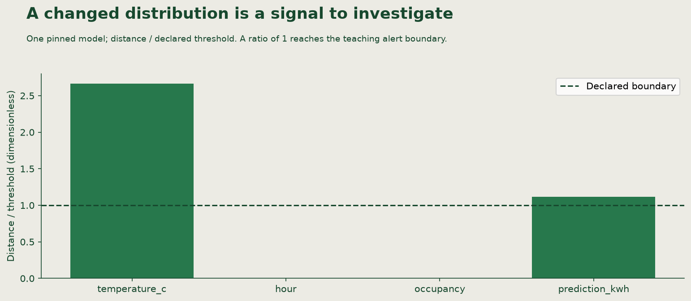

🏷
# Recognising drift and choosing a response

Linden Facilities has selected a model for its 24-row planning batch. A later input window contains warmer temperatures. The input guard still accepts every row. Does that mean the model is wrong, or that the building simply needs different predictions?

## Three signals answer different questions

**Data drift** is a change in the distribution of incoming feature values relative to a declared reference window. **Prediction drift** is a change in the output distribution; compare both windows using the same pinned model version so a model change is not the explanation. **Performance degradation** is worse measured prediction quality on labeled examples, where the actual `demand_kwh` is known. Neither of the first two establishes the third.

| Evidence | What it supports | What is still missing |
|---|---|---|
| Valid temperatures shift by `8` °C | Inputs changed | Whether demand errors increased |
| Predictions shift using one model | Its output distribution changed | Actual demand labels |
| Labeled validation RMSE exceeds the policy bound | The model misses the required quality on that cohort | Whether a candidate fixes it |
| Invalid `hour=24` | Input-contract failure | Repair the source; do not call invalid data acceptable drift |

The teaching monitor uses **Wasserstein distance**, the amount of movement between two distributions. Raw distances have the column's units: °C, hours, occupancy percentage points or kWh. A threshold is a declared action boundary, not a probability of model failure. Review the [operations source](https://github.com/richhiey/ml-llm-ops/blob/main/src/linden_mlops/operations.py) and [SciPy definition](https://docs.scipy.org/doc/scipy/reference/generated/scipy.stats.wasserstein_distance.html).

The figure is an actual synthetic reference execution. In these supplied windows, every reference temperature was shifted by `8` °C. The one-dimensional Wasserstein distance is therefore approximately `8` °C: the distribution moved that far, even though its shape did not change. Dividing by the declared `3` °C threshold gives `8 / 3 ≈ 2.67`, the plotted ratio. This ratio has no units; it is not a `267%` probability that the model failed. A ratio of `1` reaches the configured boundary. The chart does not measure prediction error, causal change or statistical certainty.

## Decide before you execute

A **response policy** joins a signal, threshold and action. The provided policy requires at least `96` observations per monitoring window. Its distance boundaries are `3` °C, `3` hours, `8` occupancy percentage points and `5` kWh. With at least `32` separately labeled validation examples, RMSE above `3` kWh permits training a candidate. A candidate must reach RMSE at most `3` kWh and improve by at least `0.5` kWh on the same validation rows. These are bounded teaching criteria, not universal production thresholds.

Check the evidence in order: enough monitoring rows, any distance flags, enough independent labels, then measured error. **RMSE**, root mean squared error, summarizes prediction error in kWh; larger errors receive more weight. No labels means no measured RMSE, even when the distance ratio is large.

Insufficient monitoring data means collect more. Drift without sufficient labeled degradation means investigate or re-evaluate. Confirmed degradation permits a candidate; approval and activation are separate decisions. Retain the incumbent if the candidate fails. Roll back only when a version is already active and an approved alternative satisfies the recovery requirement. Avoid training on model-generated predictions as if they were true demand labels: that feedback loop can reinforce the model's errors.

## Translate the idea to an LLM system

**Model drift** can mean a changed input-to-target relationship or measured quality loss. Name which claim the evidence supports. In an LLM application, the output also depends on the prompt: the instructions supplied to the model. A **behavior baseline** is a versioned set of representative requests, expected behavior and evaluation criteria. Changes in requests, prompts and models need separate records.

Imagine Linden's support assistant extracts building names and requested planning hours. It uses prompt `p1` with model `m1`. Its held-back evaluation cases require the requested hours to be preserved and unsupported building names to be flagged.

| Observation | What changed? | What would establish degradation? | Proportionate response |
|---|---|---|---|
| More incoming requests concern unfamiliar building names; `p1` and `m1` are unchanged | Request mix; an input-distribution change | Evaluate representative new requests against known expected behavior | Investigate coverage and collect labeled examples; do not assume a prompt/model defect |
| Prompt `p2` says “use tomorrow when no date is given”; the same requests now produce different dates | A known instruction change | Compare `p1`/`p2` with the same model on fixed cases and an explicit date-handling requirement | Keep or revert the prompt according to that requirement, then verify the resulting behavior |
| `p1` is unchanged, but model `m2` drops requested hours on the same fixed cases | A model-version change with measured behavior loss | Recorded case-level failures under identical prompt, cases and criteria | Retain/recover a qualifying version or evaluate a remedy before release |

**Prompt/behavior drift** describes a change relative to that declared behavior baseline. A changed output is an observation; a failed requirement is a quality judgment. Replaying identical cases makes a prompt/model comparison interpretable, just as scoring two demand models on the same validation rows does. A prompt edit, model replacement and numeric-model retraining are different remedies. None follows automatically from an alert. This comparison needs no new LLM service or framework.

## Try a diagnosis

The same-model prediction distribution changed, but labels have not arrived. Write the signal, the missing evidence and the next action. Also explain why a valid warmer batch should not be rejected by the range guard.

For the assistant, new building-name requests arrive after a prompt deployment. You have changed outputs but no case-level evaluation. State which versions and request sets you must compare before blaming the prompt. Give one observation that would justify reverting it and one that would instead call for better request coverage.

Check after recording your own decision and evidence

**Result you should get:** Investigate the changed inputs and seek suitable labels or re-evaluation evidence; retain the current active model.

**How:** A changed output distribution cannot establish RMSE without actual targets. The guard checks domain validity, while the monitor checks distributions. Retraining immediately or clipping valid temperatures confuses these contracts.

For the assistant, keep the model and evaluation requests fixed while comparing the recorded old/new prompts. Separately evaluate representative new requests with expected outputs. Revert the new prompt if it introduces date/hour failures on the same cases under the unchanged requirement; a request-mix gap alone calls for coverage investigation. Without versions and matched cases, the two explanations remain confounded.

## Learning outcome

Distinguish data drift, prediction drift and measured performance degradation; compare model drift with prompt or behavior drift; and justify investigation, re-evaluation or retraining from the available evidence.

## Summary

Linden can distinguish a changed distribution from demonstrated model error. Its policy names the evidence needed before a candidate is trained; an alert alone does not change the active model.
