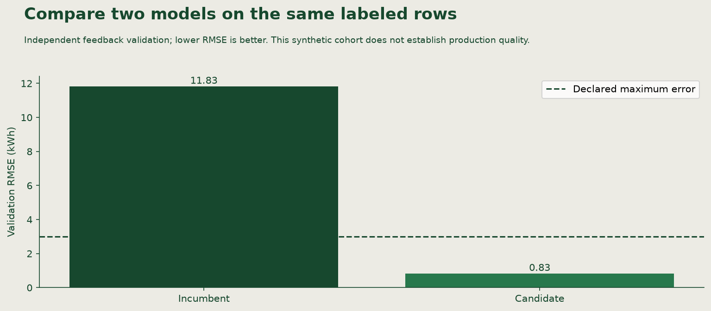

📝
# From a monitoring signal to an evaluated candidate

Linden Facilities receives a warmer planning window and, later, independent labeled feedback from the same simulated condition. You will operate its monitoring and response workflow, producing a decision record, a candidate comparison and a new planner batch.

## Starting point and useful result

Use the existing clone and guarded, approved active model. Keep the original five-run selection fixed. The **active alias** selects a registered version; the monitor resolves that version once for both windows. The response must remain attached to the version it observed.

The supplied [Linden intake](https://github.com/richhiey/ml-llm-ops/tree/main/docs/course/exercises/monitoring/linden) contains synthetic reference/current cohorts, labeled feedback, a policy and a data card. It is incoming task data, not real building traffic. Generating a classroom case is separate from operating the application.

Start `uv run python` from the clone root. Execute the following Python blocks in order in the same session. They call the application's reusable functions directly; the [operations source](https://github.com/richhiey/ml-llm-ops/blob/main/src/linden_mlops/operations.py) shows the policy and evidence checks behind each call. Retain actual arguments, returned IDs and observations in your operational notes. On resuming, reopen retained JSON and IDs; do not repeat completed training or overwrite a job.

## 1. Inspect the inputs and pin the incoming selection

```python
from pathlib import Path
import json
from linden_mlops import Workspace, batch_predict
from linden_mlops.lifecycle import MODEL_NAME
from linden_mlops.operations import (
    monitor, train_candidate, compare_candidate,
    promote_candidate, write_incident,
)

workspace = Workspace("work/tracking")  # Use your existing tracking location.
inputs = Path("docs/course/exercises/monitoring/linden")
outputs = Path("work/operations")
outputs.mkdir(parents=True, exist_ok=True)
print(json.loads((inputs / "data-card.json").read_text()))
print(json.loads((inputs / "policy.json").read_text()))
incumbent = workspace.client.get_model_version_by_alias(MODEL_NAME, "active")
print("Incoming version/source:", incumbent.version, incumbent.run_id)
```

Expect `192` reference and `192` current feature-only rows, with different IDs. The stable control copies the reference features; the warmer window changes temperature by `8` °C inside valid bounds. Feedback has `168` training, `48` validation and `24` reserved final rows. Its changed target relationship is an explicit simulation. Training and evaluation IDs differ. Keep final rows out of the response and do not edit thresholds after seeing scores.

Why inspect first? A distribution difference has no interpretable action until the model, population, units and policy are known.

## 2. Observe before labels arrive

```python
unlabeled = monitor(
    workspace,
    inputs / "reference.csv", inputs / "current.csv",
    inputs / "policy.json", outputs / "monitor.json",
)
print(json.dumps(unlabeled, indent=2))
```

Expect `action=investigate`, the incoming model's version/source, input hashes and distances with thresholds. There is no observed RMSE. The command does not train or change `active`. State what additional evidence would justify a candidate before continuing.

## 3. Inspect independent labeled evidence

```python
labeled = monitor(
    workspace,
    inputs / "reference.csv", inputs / "current.csv",
    inputs / "policy.json", outputs / "labeled-monitor.json",
    feedback_path=inputs / "feedback.csv",
)
print(json.dumps(labeled, indent=2))
```

Expect `48` labeled validation rows and `action=retrain_candidate` in this supplied condition. Read the actual validation RMSE and compare it with the declared `3` kWh bound. Validation labels measure error; training labels fit the candidate; final labels do neither here. The labeled rows are independent observations from the simulated condition, not targets secretly added to the feature-only monitoring window.

## 4. Train only after the trigger, then compare

```python
candidate = train_candidate(
    workspace, outputs / "labeled-monitor.json",
    inputs / "feedback.csv", alpha=1.0,
)
(outputs / "candidate.json").write_text(json.dumps(candidate, indent=2) + "\n")
print(candidate)
comparison = compare_candidate(
    workspace, outputs / "labeled-monitor.json",
    inputs / "feedback.csv", candidate["version"], outputs / "comparison.json",
)
print(json.dumps(comparison, indent=2))
```

This demonstrated configuration produces a pending candidate. Registration alone does not select it. Check that the incumbent and candidate errors use exactly the same `48` validation IDs, disjoint from candidate training. Explain both the candidate's absolute error and its improvement in kWh. The declared requirements are RMSE at most `3` kWh and improvement at least `0.5` kWh; a newer version number is irrelevant.



This is an executed synthetic author reference. Your report establishes your actual result and IDs. No final scores appear in the figure.

## 5. Make the selection decision and serve the planner

Only continue with promotion if your actual comparison passes both requirements. Write the reason using your observed values, then call:

```python
reason = input("Observed validation and improvement supporting this decision: ").strip()
event = promote_candidate(workspace, outputs / "comparison.json", reason)
print(event)
predictions, job = batch_predict(workspace, output_name="response-batch")
print(job)
print(predictions)
```

Promotion recomputes acceptance from retained observations and models. An edited `passed` field cannot authorize it. A changed active version makes the trigger stale and stops the response. If acceptance fails, retain the incumbent and the failed comparison; do not force promotion. Run the new response batch from the resulting intended version.

Inspect `resolved_version` and `run_id` against the actual decision. Independently check all `24` IDs once in input order, finite predictions, matching input hash and completion within `60` seconds. The CSV is the useful planner output; the job record establishes which model served it. Use a distinct output name for a later job and retain the original evidence.

## 6. Retain an incident another engineer can use

```python
explanation = input("Why did the evidence justify this response? ").strip()
follow_up = input("Owner, next check and observable success condition: ").strip()
incident = write_incident(
    workspace, outputs / "labeled-monitor.json", outputs / "comparison.json",
    outputs / "incident.json", explanation, follow_up,
    batch_name="response-batch",
)
print(json.dumps(incident, indent=2))
```

Check the recorded trigger, comparison, actual alias event and fresh batch timestamps. Explain why labels changed the action and why comparison justified selection. The function checks evidence connections; it cannot judge whether your explanation is convincing or your follow-up is useful.

## Watch out for

An alert with no labels supports investigation, not immediate retraining. Small cohorts return `collect_more`. Invalid inputs reject before monitoring. Changed feedback, a stale trigger or a failed candidate must not move the alias. A candidate can remain pending without being useful enough to serve.

If a destination already exists, read its retained evidence. Choose a new observation/job name only for a genuinely new execution. Do not recreate evidence merely to obtain another passing picture.

## Quick reference

| Operational need | App function | Evidence to inspect |
|---|---|---|
| Observe two windows | `monitor` | Pinned model, hashes, counts, units and action |
| Fit a justified response | `train_candidate` | Trigger, actual data and pending run/version |
| Compare alternatives fairly | `compare_candidate` | Same validation IDs, errors and improvement |
| Select a qualifying candidate | `promote_candidate` | Rechecked acceptance and actual alias event |
| Deliver predictions | `batch_predict` | Actual output, time and resolved model/source |
| Explain the response | `write_incident` | Connected observations plus your reasoning |

See the [operations API and runbook](https://github.com/richhiey/ml-llm-ops/blob/main/docs/operations.md) for signatures and failure conditions. Your finished work is a monitored, justified model response and a usable new batch, with enough evidence for another engineer to inspect it.

## Learning outcome

Use the provided statistical monitoring scaffold to compare reference and current inference data with one pinned model, apply a declared signal-threshold-action policy, train a candidate only when labeled evidence justifies it, and compare incumbent and candidate on the same separate validation rows.

## Summary

Linden can respond to demonstrated degradation without confusing an alert with permission to train. You have connected explicit incoming data, a declared policy, fair candidate evaluation, a selection decision and actual planner output.
