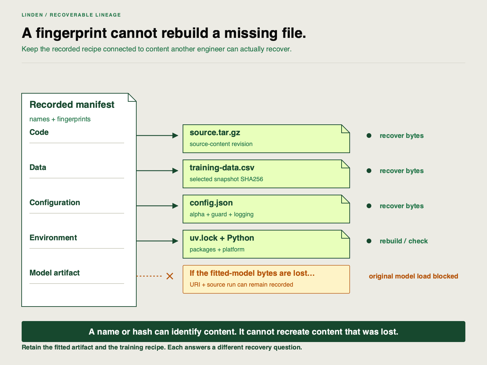

🏷
# What full reproducibility requires

Linden Facilities can change a model in response to evidence. Another engineer now needs to rebuild the selected result without the original installation. Which dataset should they use if the current model was trained from feedback rather than the original historical snapshot?

## A fitted artifact and a recipe serve different purposes

A **fitted artifact** contains the learned scaler and model used for prediction. A **training recipe** records the ingredients and conditions needed to build it again. Loading the fitted artifact proves it can be used; fitting a new model from the recipe tests reproducibility. Missing model bytes can block loading while intact ingredients still permit retraining. A complete handoff retains both.

| Ingredient | What to identify | Why it matters |
|---|---|---|
| Code | Source bundle and content revision | A similar function name can hide changed behavior |
| Data | Exact selected training/validation snapshot and hash | Feedback-trained models need their feedback data |
| Configuration | `alpha`, range guard and logging settings | Defaults can differ between installations |
| Environment | Exact Python patch, packages, platform and lock | Numerical and serialization behavior can change |
| Model | Fitted bytes, source run and registered version | Connect selection to the actual predictor |

This diagram describes required artifacts, not a completed recovery. Both the model and its recipe belong in the handoff.

## Two levels of proof

A **replay** retrains in a new store using the current source and environment. The final receiving proof adds restored source, a newly installed environment and a new store, with the original store unavailable. A successful replay is useful diagnosis; it is not that complete receiving proof.

Recovery must compare the same validation population as the original selected run. Absolute RMSE difference must be at most `0.000001` kWh under the [clean-state contract](https://github.com/richhiey/ml-llm-ops/blob/main/docs/clean-state.md). New run IDs, timestamps and version counters are expected. Batch delivery has its separate `24`-row, `60`-second requirement. The response comparison, in contrast, asks whether one model improves over another; exact reproduction asks whether the same recipe yields the same result.

## Keep operational evidence with the recipe

The portable export indexes `training-data.csv` when the run records that dataset artifact. It must match `manifest.json`'s data hash. Replacing feedback data with the original bundled CSV changes the recipe even if the schema matches. Declare the actual intended active version and source run in the application's release descriptor before export; the original experiment selection and later operational selection answer different questions.

Retain the policy, monitoring observation, candidate comparison and incident record alongside the model export. Those explain why selection changed. Checksums detect changes relative to the supplied index; they do not establish external authenticity or correctness of a learner's explanation.

## Try a diagnosis

A colleague supplies source, lock, configuration and a model, but substitutes the old historical data for the feedback snapshot. Explain which recovery invariant fails and why a similar RMSE would not repair it.

Check after recording your own decision and evidence

**Result you should get:** Data lineage fails: the selected feedback-trained recipe needs the exact recorded snapshot.

**How:** Compare the exported data bytes with the manifest hash and restore the canonical snapshot. Do not change the index or widen the numerical tolerance. A coincidentally similar result cannot substitute for matching ingredients.

## Learning outcome

Identify the code version, data snapshot, parameters/configuration, environment, and model artifact that must be traceable together for a training run to be reproducible, including the feedback dataset used by an operational response.

## Summary

A reproducible handoff carries both a usable fitted model and the ingredients for retraining it. Feedback data belongs to that recipe whenever it changed the model.
