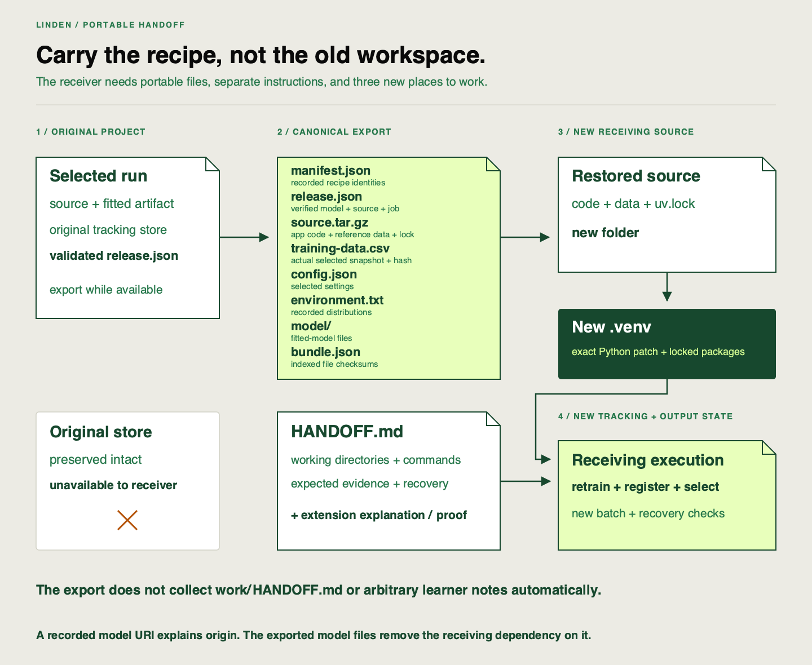

✂️
# Setup, run, and expected-evidence instructions

Linden Facilities needs someone who has never used your checkout to run the pipeline. The handoff must carry both the recoverable recipe and instructions that explain where to start, what to execute and how to judge the result.

## Keep four locations distinct

A **portable export** is a copy of the selected run’s retained source, data, settings, environment record and fitted model. It can be read without the original MLflow database. A **checksum index**, `bundle.json`, records the expected content fingerprints of its files; checking those fingerprints detects a missing or changed copy.

| Place | Purpose |
|---|---|
| Original project | Existing source, `.venv`, selected validation run and `work/tracking` |
| Canonical export, such as `work/handoff-export` | Preserved reference package for the selected run |
| Receiving source, such as `../linden-received` | New folder restored from the package, with a newly installed `.venv` |
| Receiving store, such as `work/received` inside that source | New training, registry, audit and batch outputs |

The original model URI is a historical loading address. The receiver does not need that old address to remain reachable: the export retains the model files, and recovery trains/logs a new result locally.



The environment is rebuilt from the lock and recorded Python version; the diagram does not imply that the export contains an installed interpreter.

## Your task

Use the [export and receiving reference](https://github.com/richhiey/ml-llm-ops/blob/main/docs/recovery.md) to produce a receiver-ready `work/HANDOFF.md`. Continue the note you started; do not create another assignment report. Export the actual release once. Replace the paths if your descriptor or destination differs; the descriptor names the intended active source run and its real serving job:

```sh
uv run linden-mlops export --release work/release.json --destination work/handoff-export
```

If that export already exists, verify its recipe and reuse it instead of overwriting it. Compare its `manifest.json` source run with `release.json` and the actual intended active version before reuse. Training, serving and current source must agree at release; a source change after fitting needs a deliberately revalidated run/version and fresh batch before another export. An export of an older matrix winner cannot stand in for a later feedback-selected release. Neither a final observation nor a convenient new baseline is the intended recipe.

Explain the three operations in your instructions. `export` freezes retained run files into a package. `restore-source` unpacks its code/data/lock into a new folder. `reproduce-export` reads the exported recipe, retrains there into a new store, then logs/registers/selects the result and exercises batch inference. Choose exact receiving commands from the reference and replace every placeholder with your locations.

Your runbook must provide:

- The validated release descriptor and its selected source run, source-content revision, snapshot hash and recorded config: actual `alpha`, guard, autolog setting and validation partition. `reproduce-export` reads these from the manifest; do not invent extra model flags or substitute default `alpha=1`.
- The working directory and absolute package location for each command group. Include `uv run pytest tests/test_batch_input.py tests/test_spine.py::test_contract_extension_and_unchanged_pipeline -q` in the restored source so the added planned-batch stage is checked as well as the original guard. Read `manifest.json` → `environment.python` and install that **exact Python patch** with `uv sync --locked --python RECORDED_PATCH`. A matching `3.12` family alone may choose a different patch. Package versions, lock, operating system and architecture must also agree for this reproduction claim.
- A genuinely new source folder, newly installed environment and absent receiving-state path. Explain how you will temporarily make the original store unavailable, preserve it and restore it to its exact original location even if the test fails. Use the reference’s reversible isolation pattern; keep the export available.
- Expected output locations and checks: lineage fields that must agree, absolute validation RMSE difference at most `0.000001` kWh, newly resolved model/source identity, `24` finite predictions in input order and complete delivery within `60` seconds. New IDs, timestamps, paths and version counters are allowed.

An **invariant** is a field that must remain equal between the original recipe and receiving execution. A matching score with a different data fingerprint fails that rule. Exact-environment reproduction is also different from deliberately investigating another platform.

The automatic export does **not** include `work/HANDOFF.md` or your arbitrary working notes. Include this runbook beside the export in the handoff, with the extension’s changed logic/line-by-line explanation and relevant probe/diff evidence copied or quoted from your existing work. Use package-relative filenames for those supplementary records, so they remain available without the original checkout. Do not add them to or rewrite an existing checksum index; distinguish supplementary explanation from indexed runtime inputs.

## Working with documentation

The [recovery reference](https://github.com/richhiey/ml-llm-ops/blob/main/docs/recovery.md) includes `verify_bundle` for read-only integrity inspection and the reversible store-isolation pattern. Read it before the receiving investigation. Diagnose in order: package integrity, recorded source/data/config/environment, repeated evaluation, then delivered output. Later checks have not been tested when an earlier boundary stops execution.

For installation behavior, consult [uv locked synchronization](https://docs.astral.sh/uv/concepts/projects/sync/) and [Python version requests](https://docs.astral.sh/uv/concepts/python-versions/). Add recovery instructions for an existing destination, wrong interpreter, changed source or missing artifact. Preserve the first failure instead of editing a record to make it pass.

## Hints

<details><summary>Hint — Read as the receiver</summary>

For each command, trace every input to the transferred package, supplementary explanation or declared clean machine. If a path exists only in your original workspace, repair that dependency before running.

</details>

## Checkpoints

Your runbook includes resolved paths, exact setup/execution and acceptance criteria. The explained extension travels with it. The next clean receiving attempt will test this same runbook; use that one attempt as both documentation feedback and execution proof.

## Check your work after attempting the task

<details><summary>Compare after drafting the receiving instructions</summary>

**Result you should get:** a handoff comprising a verified selected-run export plus portable instructions and extension explanation. It reconstructs new source/environment/state using the exact recorded patch, keeps the original store unavailable during receiving and restores it afterward. It names independent output checks as well as the helper report.

**How:** trace command inputs backward and expected outputs forward. Use `verify_bundle` to inspect indexed files; it does not train. Check the manifest rather than assume a reference alpha or Python patch. If a note, diff or model file is outside the handoff, include the necessary content without altering the canonical export. Resolve uncertainty by testing this runbook once, not by making a second report.

</details>

## Include a light incident record

Add a short section to the same `HANDOFF.md`; do not write a second project report. Use the observed cycle, not a hypothetical story. Include the trigger signal, units, threshold, window and affected version; observation/action/verification times; the chosen response and its rationale; the resulting active version and fresh batch; and one follow-up with an owner and success check. Describe safe containment or an unresolved condition honestly if recovery was not established.

`write_incident` in the [operations source](https://github.com/richhiey/ml-llm-ops/blob/main/src/linden_mlops/operations.py) can package the raw observations with your explanation and follow-up. It checks that the report/comparison agree and the recorded batch is newer than the comparison and matches the resulting version. It does not assess whether your prose explains the decision. Review that separately. A deliberately worse candidate should leave explicit failure evidence, not disappear from the narrative.

The application consumes and validates `release.json` during export. Confirm its actual source run and job rather than relying on an implicit selection. When exporting a known run directly, supply its observed `--run-id` explicitly; use `--state` as well for an isolated client store. Keep `training-data.csv` inside its indexed bundle and preserve policy/monitor/comparison/incident evidence beside that bundle. Explain how to restore the recorded source and exact environment using the [receiving runbook](https://github.com/richhiey/ml-llm-ops/blob/main/docs/recovery.md).

<details>
<summary>Check after recording your own decision and evidence</summary>

**Result you should get:** A compact incident record and portable runbook point to actual observations and the exact export that will be tested.

**How:** Check the timeline against report and audit timestamps, version identity against the job, and data identity against the manifest. If a claim says rollback but the candidate was never active, correct the action description. Add an owner and observable follow-up check rather than a generic reminder.

</details>

## Learning outcome

Produce reproducible setup and run instructions naming the selected recipe and expected receiving evidence, plus a short incident record linking an observed trigger, affected version, timeline, response, verified resulting state and one owned follow-up action.

## Summary

Your instructions now describe a handoff someone else can execute and judge. Linden’s selected recipe, explained extension and acceptance rules can travel without depending on your installed workspace.
