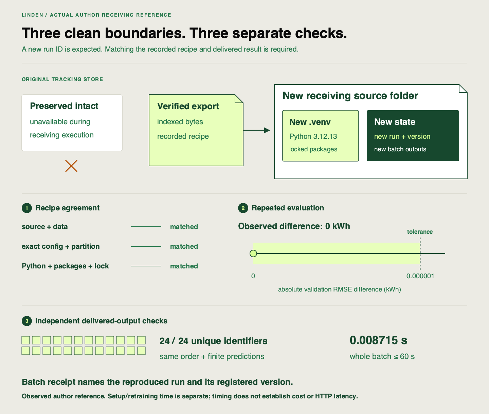

✂️
# Proving the pipeline reproduces

Linden Facilities has the exported recipe and your runbook. The remaining question is whether those instructions are sufficient without your original tracking store or installed project state. This attempt tests the handoff itself.

## Starting point

Use the canonical selected-validation export, `HANDOFF.md` and supplementary extension evidence. A smaller replay created a new store in the existing installation; this test additionally requires restored source and a fresh environment. Keep the same recorded configuration and validation rows.

| Context | What belongs there |
|---|---|
| Original-project terminal | Prepare/verify the export; stop producer processes; isolate and later restore the original store |
| Receiving terminal in restored source | Install the recorded environment, run contract tests and inspect outputs |
| Receiving source/environment, invoked by isolation script | Execute `reproduce-export` once while the original store is offline |
| Receiving store | Inspect the new run, registered version, alias event, output and recovery report |

## Your task

The deliverable is a receiver that actually works from the transferred package. Follow your own runbook verbatim. Use the [receiving reference](https://github.com/richhiey/ml-llm-ops/blob/main/docs/recovery.md) only to investigate missing instructions, then record the correction. Restore the archived application source into a new folder and confirm `.venv` does not already exist there. The receiver needs the runtime, selected data and environment; it must not depend on lesson dispatchers or an assessment generator. Read the original manifest’s Python patch before the locked installation; install that exact version. Verify the imported `linden_mlops` path belongs to the restored source and the interpreter belongs to its new `.venv`.

Make the original store unavailable during the receiving command using the reference’s reversible isolation pattern. Keep the canonical export readable and preserve the store intact. Record its original/offline locations, the absence check during execution and its restoration afterward. Stop the producer’s MLflow server and other commands that might reopen the old path; a newly created replacement store would invalidate the isolation claim. Do not delete the store or copy its SQLite database into the receiver.

Run `uv run pytest tests/test_batch_input.py tests/test_spine.py::test_contract_extension_and_unchanged_pipeline -q` in the receiving source. This checks your added planned-batch stage and the original domain guard from transferred source. Then use your runbook’s isolation script to invoke `reproduce-export` once in that source/environment, pointing at the absolute canonical-export path and a **new** receiving destination. Do not execute it separately before running the wrapper. Recovery retrains the recorded validation recipe; it does not merely load an old model and declare success. A destination refusal protects earlier evidence: inspect it or choose a new destination instead of deleting a prior attempt.

Inspect the outputs rather than stopping at a successful command:

| Check | What establishes it |
|---|---|
| Clean starting conditions | Restored source path, newly installed `.venv`, absent output store and original-store isolation record |
| Recipe agreement | Source/data/config/partition/environment comparisons in `recovery-check.json`, checked against the original manifest |
| Repeated evaluation | Original/repeated validation RMSE and their absolute difference `<=0.000001` kWh |
| Connected lifecycle | New run → registered version → `active` → batch’s recorded version/source; approval tags and alias event |
| Actual delivery | Input hash, all `24` IDs once in order, finite predictions and complete batch within `60` seconds |

The tolerance compares repeated evaluation scores; it is not an allowed error for each prediction. IDs, timestamps, paths and local version counters can change. Job timing is measured anew against the deadline, not against its old duration.

`recovery-check.json` has a useful `passed` field, but that flag alone does not establish the clean-folder history or independently check prediction order/finiteness. Read the actual `batch.csv` and its matching `batch.json` alongside the planned input. Explain which facts you observed directly.

Record commands, observed comparisons and pass/fail in the same `HANDOFF.md`. If something diverges, preserve the failed command/output and identify the first layer that failed: integrity, recipe/environment, evaluation or delivery. Repair the affected package/instruction and retry only the failed receiving proof from another fresh destination. Do not rerun the five-run search or widen tolerance to hide a mismatch.

Before opening feedback, diagnose two hypothetical reports: one has an equal score with a different snapshot; the other has new IDs with identical recipe and an accepted score difference. State which can count as reproduction and why. No extra training is needed for this reasoning.

## Working with documentation

Use the [clean-state specification](https://github.com/richhiey/ml-llm-ops/blob/main/docs/clean-state.md), [recovery command/inspection reference](https://github.com/richhiey/ml-llm-ops/blob/main/docs/recovery.md) and [`reproduce_bundle`](https://github.com/richhiey/ml-llm-ops/blob/main/src/linden_mlops/recovery.py). A failed preflight can leave later stages untested; do not infer their outcome from the failure time.

## Hints

Hint 1 — Check identities before the number

A familiar filename or equal score cannot compensate for changed source/data/environment. Start with the failed layer, not a different alpha.

Hint 2 — Separate what the command reports from how you ran it

The report cannot show that you created a new environment or made the original store unavailable. Your setup/isolation observations establish those facts.

## Checkpoints

The receiving execution uses only its transferred inputs and new installation/store. The original store is restored intact afterward. Both lineage and score tolerance pass, and actual output/model/timing checks agree. Keep this successful evidence for the final checkpoint; do not repeat it solely for another lesson page.

## Check your work after attempting the task

Compare your receiving proof and the author reference after your attempt

**Result you should get:** a new execution from restored source, a fresh exact-patch locked environment and a new store, completed while the original store was unavailable. Recipe invariants agree, absolute validation RMSE difference is within `0.000001` kWh, and a new approved active version produces `24` aligned finite predictions within the deadline. An equal score with different data fails; new execution IDs with matching lineage are expected.

**How:** compare the original manifest, installation/isolation record, receiving report, raw new run/version/audit and actual output. The receiving version’s source must be the newly trained run, not the original producer run. Restore mismatched prerequisites or repair instructions before a new receiving attempt. Preserve the first failure and keep numeric agreement separate from claims about the machine setup.

This is a verified **author reference**, not your execution. It separates recorded recipe checks from independently inspected output and the setup/isolation evidence. The delta axis is absolute validation RMSE difference in kWh; the boundary is `0.000001` kWh. Batch timing covers delivery only. Your IDs and observed duration can differ. The [reference observations](https://github.com/richhiey/ml-llm-ops/blob/main/docs/course/figures/reference-observations.json) retain the actual measured values and scope; the [optional notebook](https://github.com/richhiey/ml-llm-ops/blob/main/notebooks/04-cumulative-handoff.ipynb) can inspect your own receiving records.

## Verify the selected feedback recipe

If the intended active model was retrained from labeled feedback, the export's indexed `training-data.csv` must match that run's recorded hash. The receiver retrains from those bytes rather than silently substituting `demand-v1.csv`. Inspect both original and receiving manifests and calculate the validation RMSE delta on the same recorded partition. Keep the operational decision evidence beside the export; reproduction verifies that selected recipe, not the causal explanation for drift.

A failed checksum must stop before training. Preserve the failed output, restore the changed file from the canonical export, verify the unchanged index and all indexed bytes, and rerun any proof whose prior conditions no longer hold. Do not rewrite a checksum to bless altered data. A changed snapshot can retain the same schema and still invalidate the handoff.

## Learning outcome

Re-run the completed pipeline from the declared clean state, verify its lineage and result against the tolerance declared in the clean-state verification specification, and document and diagnose any divergence.

## Summary

The handoff is now supported by an actual clean receiving execution. You can explain both what reproduced and which observations establish independence from the original installation and store.
