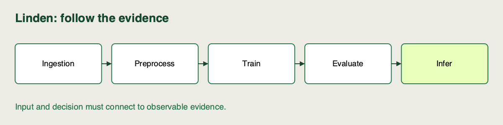

🏷️
# From notebook to pipeline

Linden Facilities can fit an energy-demand model in a notebook, but the planner needs the same 24-row prediction job tomorrow. A cell run out of order can silently use yesterday's features or a model fitted on different rows. A successful printout does not explain how to rebuild it.

**Continue here:** [Sprint 1 · continue in the same notebook](https://colab.research.google.com/github/richhiey/ml-llm-ops/blob/main/module-a/notebooks/01-pipeline-and-extension.ipynb#scrollTo=stage-map). Keep your code and answers in the same sprint notebook. [Local setup](https://github.com/richhiey/ml-llm-ops/blob/main/module-a/docs/setup.md).

## A pipeline makes dependencies explicit

A **pipeline** connects stages through declared inputs and outputs. Reproducibility means another engineer can recover the source, data, configuration and environment and obtain an agreed result. Neither requires a large orchestration framework: our Python functions already expose the boundaries.

| Stage | Linden input → output | Failure the boundary can expose |
|---|---|---|
| Ingestion | Fixed CSV → checked table | Duplicate `row_id` or absent fields |
| Preprocessing | Checked table → ordered features | Missing or invalid measurements |
| Training | Train features and target → fitted model | Fitting on held-out rows |
| Evaluation | Held-out features and target → RMSE/MAE | Scoring different rows across comparisons |
| Inference | Active fitted model and planned inputs → predictions | Loading a different version than intended |

The target is `demand_kwh`. The inputs are `temperature_c`, `hour`, and `occupancy`. `row_id` aligns records; `partition` fixes their evaluation role. Neither belongs among the model features. A **fitted model** includes learned preprocessing: Linden's scaler stores training means and scales alongside the regression coefficients.

## Walk a historical row and a planned row through the system

Consider an illustrative historical record with `temperature_c=12`, `hour=9`, `occupancy=40` and a known `demand_kwh`. Those values describe a teaching example, not a claimed row from the snapshot. Ingestion reads and checks its table. Preprocessing selects the three features in the declared order. If its `partition` is `train`, training may use its known target to fit the model. If the partition is `validation`, evaluation compares a prediction with that target without fitting on the row.

A planned record may have the same three feature values but no known demand yet. Inference can transform those features using the already fitted scaler and return `prediction_kwh`. It cannot compute the prediction's error until an actual demand value is observed. This is why “the CSV was produced” and “the model met its error requirement” need different checks.

| Object | Learns from training rows? | Used again at inference? |
|---|---|---|
| Feature-column list | No; it is a declared interface | Yes, in the same order |
| Fitted scaler | Yes; it learns means and scales | Yes, without fitting again |
| Fitted Ridge estimator | Yes; it learns coefficients | Yes, to predict |
| Validation RMSE | No; it measures a held-out result | No; it is decision evidence |

## Training and inference share a contract

A **contract** names what a stage accepts and guarantees. Training sees known demand values; inference sees only planned features. Both need the same column order and transformations. Fitting another scaler on tomorrow's batch changes the meaning of its inputs even if the code runs.

The helper stores a `StandardScaler` and a Ridge regressor together. Ridge is a linear model with a penalty that limits coefficient size. Evaluation happens on the snapshot's fixed validation rows; the separate final rows are reserved until configuration selection is complete.

## Check for Understanding

Linden's teammate fits a new scaler on the planned batch and says the model is unchanged because the regression coefficients came from yesterday's file. Diagnose the resulting contract failure and specify the artifact that must be handed over.

▶️ **Solution** *(toggle)*

> **Result you should get:** the batch is transformed with different learned statistics, so the regression receives a different feature representation. Hand over the fitted scaler and regressor together.
>
> **How:** trace which object learned means/scales during training. Inference must reuse that fitted object; it may validate/extract planned features but must not fit on the batch.

## Learning outcome

Explain why a reproducible training/inference pipeline replaces a one-off notebook workflow, and identify the 5 stages a production ML pipeline must cover - ingestion, preprocessing, training, evaluation, inference.

## Summary

Linden’s notebook result now has an explicit path from source data to prediction. You can inspect the stage boundaries and see why fitted preprocessing must travel with the model.
