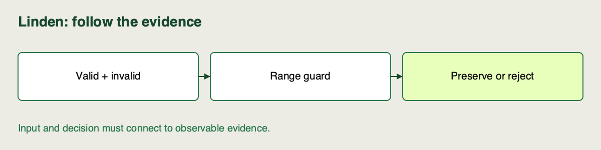

📝
# Adding and validating a bounded pipeline stage

Linden Facilities receives `hour=24`, which is numeric but outside its planning contract. We will edit a starting validation stage, observe its missing behavior, add explicit rejection rules, and prove that valid predictions still work.

**Notebook section:** **3 · Add the validation stage** in your [existing Sprint 1 notebook](../../../notebooks/01-pipeline-and-extension.ipynb). Read this page, then work through that section once. Keep answers in the same notebook. [Local setup](https://github.com/richhiey/ml-llm-ops/blob/main/module-a/docs/setup.md) · [Optional Colab section](https://colab.research.google.com/github/richhiey/ml-llm-ops/blob/main/module-a/notebooks/01-pipeline-and-extension.ipynb#scrollTo=stage-edit).

## Make one bounded change

Start at **Add the validation stage** in the sprint notebook. The notebook creates an editable project, runs its deliberately failing test, writes the explained expert change and tests the result. The project is retained in the printed local `work/sprint-1-.../project` folder; keep it for the cumulative work. Finish with that one source edit, its explained diff, a passing focused contract test and the edited batch result.

1. **Observe the missing rule.** The starter checks finite numeric values but accepts `hour=24`. Expect a focused test failure containing `DID NOT RAISE`. Its ordinary validation RMSE still looks normal: valid snapshot rows do not expose this defect.
2. **Read and apply the edit.** The expert function first checks finite features, then inclusive ranges: temperature `[-30, 50]`, hour `[0, 23]`, occupancy `[0, 100]`. `.between(...).all()` requires every row to pass. The separate remainder check rejects fractional hours. `return` sits after the loop so every feature is checked. A deep copy preserves valid input.
3. **Check both branches.** Valid rows must remain identical; `hour=24`, `hour=1.5`, invalid occupancy, missing features and non-finite values must reject. `preprocess` already calls this boundary when `range_guard=True`; training and evaluation need no change.
4. **Check the complete path.** The same focused contract test should now pass; it covers the stage’s edge cases and unchanged valid-data metrics. Guarded and unguarded valid-data metrics should agree, and the bootstrap should produce the complete `24`-row batch from the saved edited source. This checks ingestion, preprocessing, fitting, evaluation and inference together; registry lifecycle tests are later work. Read the printed source diff and explain each changed statement.

## Watch out for

Clipping `24` to `23` hides supplier errors. An early `return` can skip occupancy checks. Notebook imports persist: the provided `project_tests` and `course_cli(..., project=project)` helpers execute your edited source in a new process, so you do not accidentally test an earlier reference import.

## Quick reference

| Check | Expected result |
|---|---|
| Starter contract test | Intended failure |
| Expert edit | Range + integer-hour rejection |
| Valid input | Unchanged copy, same order/index |
| Focused contract test + bootstrap | Passing contract and complete batch |

## Check your change

Before running the expert cell, predict outcomes for `hour=0`, `23`, `1.5` and `24`. Compare the predictions with the notebook’s visible probe table. `project_guard` is loaded from the saved edited file; reload that cell if you later change the file. The fresh-process contract test and bootstrap confirm which saved source actually runs. Keep your explained diff and results in this sprint notebook; no separate report is needed.

## Learning outcome

Follow an expert adding one preprocessing or validation stage to the provided pipeline, then verify its input/output contract and confirm that the unchanged stages still run.

## Summary

Linden's project now contains an actual validation-stage addition, supported by a failing-before case and passing contract/integration evidence. You can explain where it runs and why valid predictions stay unchanged.
