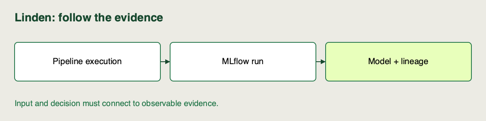

📝
# Revisiting MLflow in a pipeline context

You have logged parameters and metrics in MLflow before. Linden now needs that record to be created whenever the pipeline runs, including from a terminal. We will trace where the run starts, which calls record its results, and how its model and recovery files stay connected.

## Your route through this lesson

Inspect how one execution records settings, held-out metrics, a model and recovery files. Run the explained blocks in order, pausing to compare each result with its interpretation. Use the local Python 3.12 setup or the linked Colab route. Terminal commands and notebook Python are different interfaces; the setup guide shows their equivalents.

**Finish with:** Matched manifest/raw/UI records for the actual pipeline run.

Use the [setup and execution guide](https://github.com/richhiey/ml-llm-ops/blob/main/module-a/docs/learning-guide.md) and [Colab guided notebook](https://colab.research.google.com/github/richhiey/ml-llm-ops/blob/main/module-a/notebooks/02-tracking-and-evidence.ipynb#scrollTo=tracking-records). The [pipeline source](https://github.com/richhiey/ml-llm-ops/blob/main/module-a/src/campus_mlops/pipeline.py) and [tracking/registry source](https://github.com/richhiey/ml-llm-ops/blob/main/module-a/src/campus_mlops/lifecycle.py) are the code you will inspect.

## Before you start

Use the [helper setup](https://github.com/richhiey/ml-llm-ops/blob/main/module-a/README.md). MLflow is a run store and model artifact system. The local **backend** is a SQLite database for metadata; artifacts live in a separate local directory. Use the [tracking notebook](https://github.com/richhiey/ml-llm-ops/blob/main/module-a/notebooks/02-tracking-and-evidence.ipynb) or a Python session in the helper environment.

## Understand the three places information lives

An MLflow **experiment** groups related executions; a **run** identifies one execution; an **artifact store** holds its files. The local SQLite database stores searchable metadata, such as run IDs and metrics. It does not contain all model/source files inside the database. Linden's `Workspace` creates an experiment named `linden-demand` and an artifact directory under your chosen state path.

The Python helper uses MLflow's API to write these records. A browser server is only needed to inspect the UI; training does not require a separate web server in this local arrangement. You will first create and inspect a run through Python, then open the same backend in the UI. Keep its absolute state path in your notes so you can reopen the correct store.

## 1. Create an explicit workspace

```python
from campus_mlops import *
ws = Workspace('state-tracking')
print(ws.uri)
```

**Expected:** an absolute `sqlite:///.../mlflow.db` URI. Check the path belongs to your intended workspace. This prevents a successful run being logged into a different experiment store.

## 2. Execute and inspect a tracked pipeline

```python
record = ws.run(Config(alpha=1, range_guard=True), name='guarded-baseline')
print(record['run_id'], record['metrics'])
```

**Expected:** a unique run ID and validation RMSE about `1.443003925` kWh. `Workspace.run` opens the run, executes stages, logs parameters/metrics, logs the fitted model, and archives reproduction evidence. Check `record['config']` and `evaluation_partition` before interpreting the score.

## Connect the wrapper to the actual logging calls

Open `Workspace.run` in `lifecycle.py`. The `with mlflow.start_run(...)` block owns the execution's run context. Calls inside that block attach to that run, so the model, metrics and recovery files do not depend on manually carrying a notebook's latest printout into a sheet.

`mlflow.log_params` records settings and identities after the pipeline produces its result. Parameters are represented as strings in the raw MLflow record; the returned manifest keeps the Python configuration structure. `mlflow.log_metrics(metrics)` records numeric validation results. `mlflow.sklearn.log_model` serializes the fitted scaler and estimator, with an example and signature describing expected input/output structure. The source archive and environment files are then logged under `reproduction`.

A **signature** describes input/output structure for model loading or prediction checks. It does not replace Linden's semantic range rules: the value `24` can have the right numeric type and still be an invalid hour. Record both boundaries in your explanation.

## 3. Read raw records and artifacts

```python
raw = ws.client.get_run(record['run_id'])
print(raw.data.params)
print(raw.data.metrics)
print([a.path for a in ws.client.list_artifacts(record['run_id'], 'reproduction')])
```

**Expected:** parameters include alpha, guard, data hash, source revision and partition; artifacts include `manifest.json`, `config.json`, `environment.txt`, `source.tar.gz`. An artifact is a stored file, not a scalar metric. Check the model URI in tags matches the manifest's URI.

## Match values across the manifest and raw run

Run this after retrieving `raw`:

```python
assert raw.info.run_id == record['run_id']
assert float(raw.data.params['alpha']) == record['config']['alpha']
assert raw.data.metrics['rmse_kwh'] == record['metrics']['rmse_kwh']
assert raw.data.tags['model_uri'] == record['model_uri']
print(raw.info.status, raw.data.params['evaluation_partition'])
```

**Expected:** `FINISHED validation`. A **tag** is descriptive metadata, while the model URI locates the logged model. These assertions check that your convenient manifest and MLflow's stored evidence refer to the same execution. If a field is missing, investigate the logging path before writing a report that assumes it was captured.

Now run the same configuration again under a different display name and retain the returned ID. Both IDs should differ while their controlled validation results agree. This is how an automatic record preserves repeat executions without overwriting the earlier result. Do not add this repeat as a distinct alpha configuration in your selection matrix.

## 4. Verify the same evidence in MLflow

In a helper-root terminal run `uv run campus-mlops ui --state state-tracking`, then open `http://127.0.0.1:5050`. Open `linden-demand`, select your run by ID, and inspect its parameters, metrics and artifacts.

**Expected:** the same alpha, RMSE and reproduction files as the API record. Match by run ID, since display names can repeat. This UI check confirms you opened the intended backend. Stop the server with Ctrl+C when finished.

## Export one recovery file and inspect it

```python
from pathlib import Path
import json
manifest_path = Path(ws.client.download_artifacts(
    record['run_id'], 'reproduction/manifest.json'))
stored = json.loads(manifest_path.read_text())
assert stored['run_id'] == record['run_id']
print(stored['config'], stored['model_uri'])
```

**Expected:** the stored config matches the run you just inspected. `download_artifacts` retrieves a file; reading its bytes checks more than seeing a filename in a UI. The full `source.tar.gz` contains the recoverable training package. Preserve its connection to this manifest when preparing a handoff.

In Colab the Python inspection works in the hosted runtime. The UI activity uses the local clone: Colab's `127.0.0.1` is the hosted machine, not your computer. Recreate a local comparison state rather than claiming a printed hosted URL was inspected.

## Watch out for

A blank UI often means a different state path. Keep client and UI on MLflow `3.5.1`; old screenshots may use different tabs. Artifact storage is separate from SQLite, so copying only `mlflow.db` is not a complete handoff. The locked SQLAlchemy dependency is required by this MLflow setup.

## Quick reference

| Action | API / command |
|---|---|
| Integrated logging | `ws.run(Config(...))` |
| Raw run | `ws.client.get_run(run_id)` |
| Evidence files | `list_artifacts(run_id, 'reproduction')` |
| UI | `uv run campus-mlops ui --state state-tracking` |



## Read what automatic pipeline logging means

Open `Workspace.run` in `src/campus_mlops/lifecycle.py` and connect the calls to the observed record:

| Call | Why it lives inside the execution |
|---|---|
| `mlflow.start_run(...)` | Owns one run's lifetime |
| `run_pipeline(...)` | Produces this model and held-out result |
| `mlflow.log_params(...)` | Records the actual configuration and identities |
| `mlflow.log_metrics(metrics)` | Names the declared validation error explicitly |
| `mlflow.sklearn.log_model(...)` | Stores the fitted transform and estimator |
| `mlflow.log_artifacts(...)` | Stores recovery files with that same run |

“Automatic” here means the pipeline executes these logging calls every time; it is distinct from library **autologging**, a hook that observes `fit`. The helper enables that hook before training with `Config(autolog=True)` and disables its model logging to keep one explicit model artifact. The independent exercise will compare those additional fields with the explicit acceptance metric. Cleanup disables the hook even after a failed run.

## Learner checklist

- I can match the same run ID, parameters, primary metric and reproduction artifacts in raw records and the intended UI store.
- I can name one failure and the evidence needed to diagnose it.

## Learning outcome

Use the provided MLflow setup to log parameters, metrics, and artifacts automatically as part of the cumulative pipeline, building on basic experiment logging from T4 (AI track).

## Summary

The pipeline’s run now carries parameters, validation metrics, a model artifact and recovery files together. You checked the same record through both the API and the local UI.
