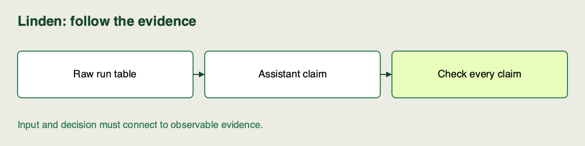

📝
# Validating an assistant-generated experiment summary

Linden Facilities has a useful result table, but an assistant can still misread metric direction or compare incompatible runs. We will ask for a recommendation and check every claim before it influences promotion.

**Continue here:** [Sprint 2 · continue in the same notebook](https://colab.research.google.com/github/richhiey/ml-llm-ops/blob/main/module-a/notebooks/02-tracking-and-evidence.ipynb#scrollTo=assistant-review). Keep your code and answers in the same sprint notebook. [Local setup](https://github.com/richhiey/ml-llm-ops/blob/main/module-a/docs/setup.md).

## Review a recommendation against the runs

Use **Validate an assistant recommendation** in the sprint notebook. The code demonstrates a deliberately wrong recommendation and a correct numeric selection. You will also inspect an actual assistant response; a passing numeric check cannot validate all its prose.

1. **Check the input table.** Export only your five returned IDs. Confirm unique IDs, distinct declared alphas, shared controls and finite validation RMSE before requesting advice. Leave the final holdout closed.
2. **Direct your approved assistant.** Supply the raw table and ask: “Recommend a run using lower validation `rmse_kwh`. Name the run ID, explain comparability and controls, and separate measured findings from claims requiring more evidence.” Keep its actual response in this notebook.
3. **Validate the numeric choice.** Run `verify_summary` against its nominated ID. For the supplied reference matrix, `alpha=0.01` has the lowest validation RMSE. The intentionally worst-run example must fail. A rejection can also mean incompatible controls; inspect the reason before ranking.
4. **Audit the other claims.** Break the response into claims and match each to a source field. “Lowest validation RMSE” is testable from the table. “Cheapest service” needs operational cost evidence; “always the best alpha” needs broader experiments. Correct or qualify unsupported claims.

## Watch out for

Do not relabel training error as validation error. A close winning margin supports this fixture's ranking, not a universal recommendation. Use your institution-approved assistant and permitted data; no provider credential is required by the course helper.

## Quick reference

| Claim | Check |
|---|---|
| Winner | Returned ID + lowest comparable validation RMSE |
| Fair comparison | Data/split/features/guard/evaluation controls |
| Operational recommendation | Evidence outside the metric table, or an explicit caveat |

## Check your review

Keep one compact table in this notebook: claim → supporting field → accepted/corrected/unsupported. Include one supported numeric claim and one overclaim you corrected. Reuse the table at the sprint checkpoint.

## Learning outcome

Direct an approved assistant to generate a summary comparison across logged experiment runs, validate every recommendation against the raw MLflow data and the declared primary metric, and flag any inaccuracy or invalid comparison.

## Summary

The assistant’s recommendation is now an inspectable set of claims. Your raw-data checks distinguish a valid metric choice from unsupported promotion advice.
