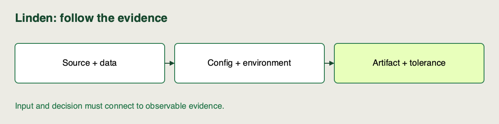

🏷️
# What full reproducibility requires

Linden Facilities has a model artifact and its RMSE, yet another engineer cannot reproduce the result. The missing piece might be the input data, source logic, config or even the library version used to load the artifact.

**Continue here:** [Sprint 3 · continue in the same notebook](https://colab.research.google.com/github/richhiey/ml-llm-ops/blob/main/module-a/notebooks/03-registry-and-reproduction.ipynb#scrollTo=reproduce-reference). Keep your code and answers in the same sprint notebook. [Local setup](https://github.com/richhiey/ml-llm-ops/blob/main/module-a/docs/setup.md).

## Record a connected set, not five isolated labels

**Lineage** is the connection from a result to the inputs and transformations that produced it. A reproducible training run needs both identifiers and recoverable content. A file hash helps detect differences; it cannot recreate a missing file.

| Element | Linden evidence | What it prevents |
|---|---|---|
| Code | Source-content revision + `source.tar.gz` | Reusing a changed training function |
| Data | Snapshot bytes + SHA256 | Quietly replacing evaluation rows |
| Config | `config.json`, alpha, guard, partition | Guessing the original factors |
| Environment | Python/package versions + `uv.lock` | Depending on today's resolver result |
| Model | Logged model URI + registry source run | Loading a similarly named artifact |
| Execution/result | Exact command, metrics and tolerance | Calling an unexplained score “close enough” |

A **hash** is a content fingerprint. GitHub identifies repository commits, while the helper records a defined source-content hash and recoverable archive for each training run. Both identities remain useful.

## A lockfile is necessary but not sufficient

`uv.lock` records resolved dependencies. It does not pin the dataset, choose alpha, or recover an edited source function. Conversely, copying a model pickle does not prove the training result can be rebuilt. Keep the fitted artifact and the recipe as distinct evidence.

A declared clean state removes inherited tracking stores, registry versions and notebook variables. A new source folder and environment test whether setup is sufficient; a new state directory alone tests a smaller property.

## Define agreement before rerunning

The [clean-state specification](https://github.com/richhiey/ml-llm-ops/blob/main/module-a/docs/clean-state.md) accepts absolute RMSE difference at most `1e-6` kWh with matching source, data, config and environment. Run IDs, timestamps and artifact paths can change. Timing is measured anew and must satisfy the inference deadline; it is not compared with a numerical equality tolerance.

If the score matches but the data hash differs, the reproduction fails. If lineage matches but RMSE exceeds tolerance, investigate numerical or execution differences before claiming success. Reproducibility is a contract to check, not a property conferred by logging fields.

## Check for Understanding

An engineer has the manifest, `uv.lock` and a model URI, but the original artifact directory has been removed. Inventory which claims remain inspectable and which recovery is blocked. State what must be recovered before the handoff can be called reproducible.

▶️ **Solution** *(toggle)*

> **Result you should get:** the manifest still describes recorded identities/settings, but the missing source/model bytes cannot be reconstructed from their names, hashes or URI. Recover the retained source and fitted artifact from exported files or the original storage.
>
> **How:** trace each manifest field to content that can actually be opened. A lock reconstructs declared packages, not missing data or source. A model URI is a recovery link, not a cryptographic integrity guarantee. Preserve original evidence and restore into a new folder before rerunning.

## Learning outcome

Identify the code version, data snapshot, parameters/configuration, environment, and model artifact that must be traceable together for a training run to be reproducible.

## Summary

You can name both the identifiers and recoverable content behind a result. The tolerance and clean starting state make “reproducible” a claim another engineer can test.
